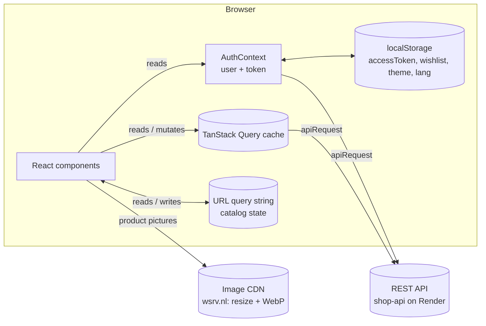
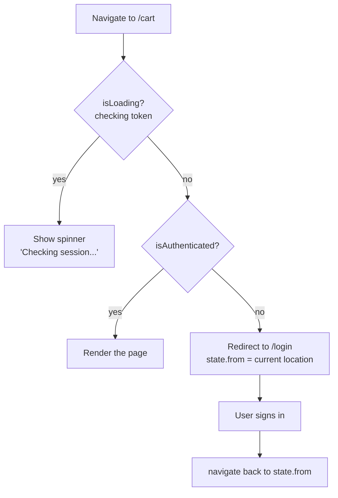
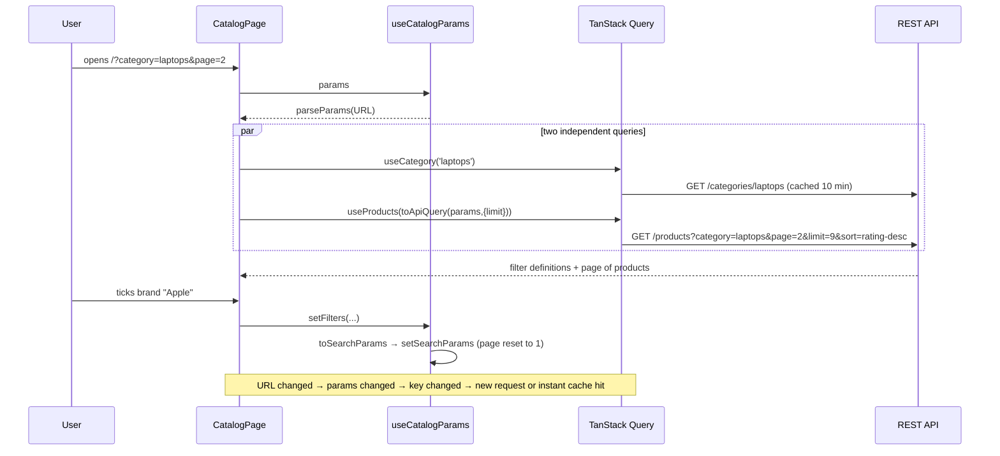
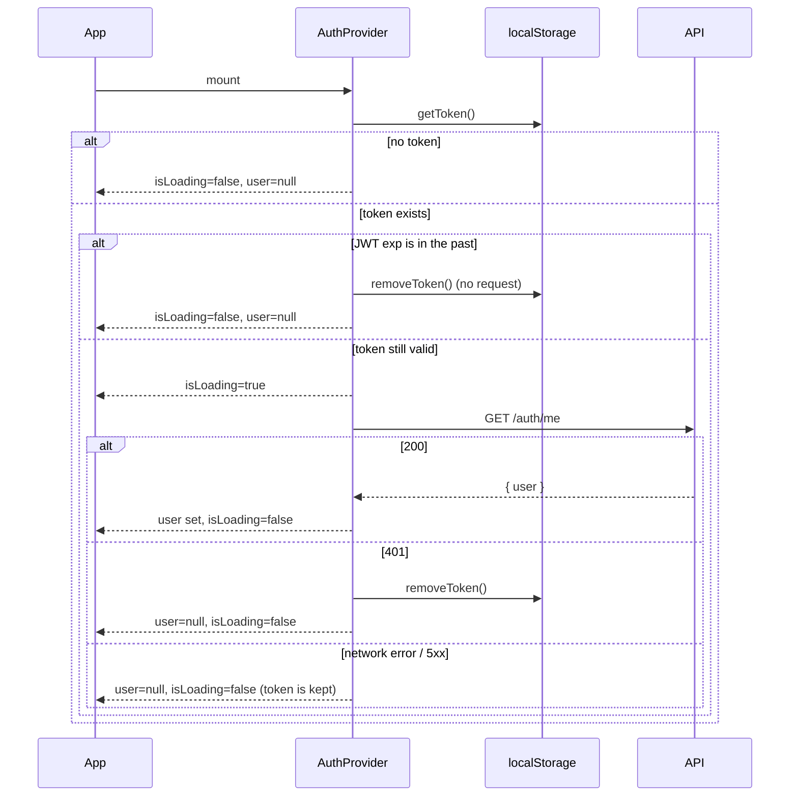
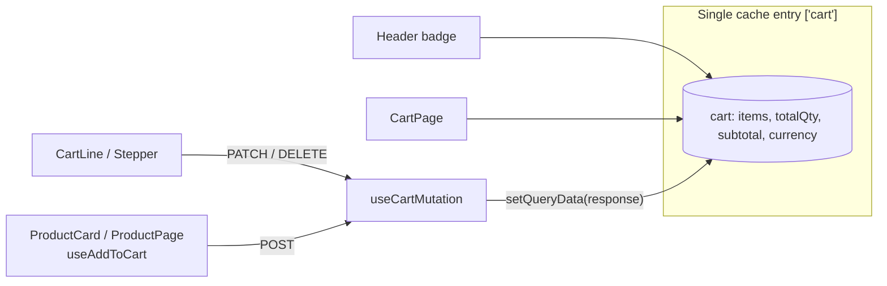
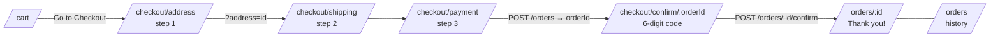
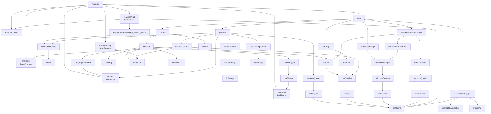

# Architecture — Cyber Shop

This document explains how the Cyber Shop front end is built: where every piece of code lives, how data moves through the app, what each module and function is responsible for, and the reasoning behind the main design decisions. It is written so that a new developer can open any file and immediately understand *what it does*, *who calls it* and *what it depends on*.

> The reasoning behind the key decisions is recorded separately in [`docs/adr/`](./docs/adr) (stack, token storage, cart quantity stepper, profile current password, checkout state in the URL, color theme, i18n strategy, the switch to react-i18next, and performance + SEO).

> Scope: this repository contains the **front end only** (a single-page application). The back end is a separate, ready-made REST API (`https://shop-api-kbe6.onrender.com/api`).

---

## Table of contents

1. [Big picture](#1-big-picture)
2. [Tech stack and tooling](#2-tech-stack-and-tooling)
3. [Folder structure](#3-folder-structure)
4. [Application bootstrap](#4-application-bootstrap)
5. [Routing](#5-routing)
6. [State management model](#6-state-management-model)
7. [Networking layer](#7-networking-layer)
8. [Catalog module](#8-catalog-module)
9. [Product page](#9-product-page)
10. [Authentication module](#10-authentication-module)
11. [Cart module](#11-cart-module)
12. [Addresses module](#12-addresses-module)
13. [Checkout and orders module](#13-checkout-and-orders-module)
14. [Wishlist module](#14-wishlist-module)
15. [Shared UI kit](#15-shared-ui-kit)
16. [Layout components](#16-layout-components)
17. [Styling system](#17-styling-system)
18. [Error handling strategy](#18-error-handling-strategy)
19. [Accessibility notes](#19-accessibility-notes)
20. [Performance and SEO notes](#20-performance-and-seo-notes)
21. [API reference (as used by the front end)](#21-api-reference-as-used-by-the-front-end)
22. [Dependency graph between modules](#22-dependency-graph-between-modules)
23. [How to extend the project](#23-how-to-extend-the-project)
24. [Known limitations and technical debt](#24-known-limitations-and-technical-debt)
25. [Glossary](#25-glossary)

---

## 1. Big picture

Cyber Shop is an online electronics store. A visitor can browse a category, filter, sort and search products, open a product page, register / sign in, add products to a **server-side cart**, and edit their profile. A signed-in user can keep several **delivery addresses**, pay through a 3-step checkout (address → shipping → card → e-mail code → order page) and see the **history of orders**. The wishlist page and the About / Contact / Blog pages are placeholders. The public pages are prepared for search engines and link previews (per-page title, description, canonical address, Open Graph, schema.org data) and for a fast first screen on a slow phone (route-level code splitting, early first-screen requests, resized WebP pictures) — see [section 20](#20-performance-and-seo-notes) and [ADR 0009](./docs/adr/0009-performance-and-seo.md).



The key architectural idea is a **strict split of state by origin**:

| Kind of state | Where it lives | Why |
| --- | --- | --- |
| Server data (products, categories, cart, addresses, checkout, orders) | TanStack Query cache | Caching, deduplication, loading / error states, background refetch come for free |
| Who is signed in | `AuthContext` (+ token in `localStorage`) | It is client state that many components need |
| Catalog filters, sort, page, search | The URL query string | Shareable links, working Back button, state survives refresh |
| Checkout progress (chosen address, pending order) | The URL (`?address=<id>`, `/checkout/confirm/:orderId`) | F5 and the Back button keep the step (ADR 0005) |
| Card number, holder, expiry, CVC | Only the state of the payment form | Never stored anywhere else (ADR 0005) |
| Wishlist | `ShopContext` (+ `localStorage`) | The API has no wishlist endpoints yet |
| Color theme (light / dark / system) | `data-theme` on `<html>` (+ `localStorage`, key `theme`) | CSS reads the attribute; `system` follows the OS preference live; the choice survives a refresh and is shared between tabs (ADR 0006) |
| Language (ka / en) | i18next instance (`lib/i18n/`) read through `useTranslation()` (+ `localStorage`, key `lang`; + `<html lang>`) | Every UI string uses `t('key')` from the JSON dictionaries; `Intl` for prices, dates and ratings; no provider and no page reload on change (ADR 0007, ADR 0008) |
| Page metadata (description, canonical, robots, Open Graph, JSON-LD) | The `<head>` of the document, written by `<Seo />` (`components/Seo`) | Search engines and link previews read `<head>`; the component changes the tags that `index.html` already has and restores them when the page is left (ADR 0009) |
| Purely visual state (open dropdown, selected photo) | Local `useState` inside the component | Nobody else needs it |

---

## 2. Tech stack and tooling

| Area | Technology | Notes |
| --- | --- | --- |
| UI | React 19 | Function components and hooks only. `ref` is passed as a normal prop (React 19), see `Input` / `PasswordInput`. |
| Build | Vite 8 | Dev server and production bundler. |
| Optimisation | React Compiler (`babel-plugin-react-compiler` via `@rolldown/plugin-babel`) | Automatic memoisation; that is why the code has very few `useMemo` / `useCallback` calls. Three components opt out with the `'use no memo'` directive because they combine React Hook Form with refs: `AccountPage`, `AddressForm`, `ConfirmPage` (checked on 28.10.2026). |
| Routing | React Router 7 (`react-router-dom`) | Declarative `<Routes>` with a nested layout route. |
| Server state | TanStack Query 5 (+ Devtools in dev) | Single shared `QueryClient`. |
| Forms | React Hook Form 7 + `@hookform/resolvers` | Uncontrolled inputs, `register()` spread. |
| Validation | Zod 3 | All schemas in one file: `src/shared/lib/validators.js`. |
| Linting | ESLint 10 (flat config) + `react-hooks` + `react-refresh` | `npm run lint`. On 28.10.2026: 1 error, 0 warnings — `react-refresh/only-export-components` at `src/main.jsx:17` (the development-only lazy `ReactQueryDevtools` constant); see [section 24](#24-known-limitations-and-technical-debt). |
| Language | JavaScript (ES modules, JSX) | Types come from `@types/react` for editor hints only. |
| Fonts | Inter (Google Fonts, loaded in `index.html` without blocking the first paint: `preload` → `stylesheet`) + **ADG2** (a local Georgian font, `src/assets/fonts/ADG2.woff2`, 29.9 kB, declared in `styles/fonts.css` with a Georgian `unicode-range`, so Latin letters and digits keep using Inter) | |
| SEO | `components/Seo` + `lib/seo.js`, static tags in `index.html`, `public/robots.txt` | One `<h1>` per page, canonical addresses, `noindex` for private and duplicate screens, Open Graph / Twitter tags, schema.org `Product` and `BreadcrumbList` data on the product page (see [section 20](#20-performance-and-seo-notes), ADR 0009). |
| Images | Free image CDN `wsrv.nl` (default) through `lib/image.js` | Product pictures are requested resized and as WebP with `srcset`; an automatic fallback to the original URL; switched off with an empty `VITE_IMAGE_PROXY`. |
| Theming | CSS variables + the `data-theme` attribute | Light and dark values of the same tokens live in `styles/theme.css`; 3 choices: light / dark / system (see [section 17](#17-styling-system), ADR 0006, and the inline FOUC-prevention script in `index.html`). |
| i18n | `i18next` 26 + `react-i18next` 17 + `Intl` | Georgian (default) and English; two JSON dictionaries with the same 393 keys; `useTranslation()` from `react-i18next`; plurals (`_one` / `_other`) and `{{param}}` interpolation; `Intl` for prices, dates, ratings (see ADR 0007 and ADR 0008). |

### Build configuration (`vite.config.js`)

* Plugins: `@vitejs/plugin-react` and `@rolldown/plugin-babel` with `reactCompilerPreset()`, plus two small plugins written in the config itself:
  * `siteUrlPlugin` replaces the placeholder `__SITE_URL__` in the Open Graph tags and in the structured data of `index.html` with `VITE_SITE_URL`; when the variable is empty the lines are removed (an Open Graph picture needs an absolute address, a wrong one is worse than none).
  * `inlineMainCssPlugin` puts the main stylesheet (36.5 kB in the current build) straight into `index.html` as a `<style>` element, so the browser does not wait for a render-blocking CSS request. Stylesheets of lazy pages stay separate files, and a stylesheet larger than 80 kB is left alone.
* Path aliases (also used by ESLint/IDE resolution through Vite):

| Alias | Resolves to |
| --- | --- |
| `@` | `src/` |
| `@api` | `src/api/` |
| `@shared` | `src/shared/` |
| `@features` | `src/features/` |

### Environment

| Variable | Default | Purpose |
| --- | --- | --- |
| `VITE_API_URL` | `https://shop-api-kbe6.onrender.com/api` | Base URL of the REST API. The same value is hard-coded as a fallback in `apiClient.js`, so the app works without a `.env` file. |
| `VITE_SITE_URL` | empty (`.env.example`); `http://localhost:4173` in the local `.env` | Public address of the deployed site, no trailing slash. Used for `canonical`, Open Graph and structured data. Empty → canonical addresses use `window.location.origin` and the Open Graph lines are removed from the built `index.html`. **Set the real address on the host before publishing.** |
| `VITE_IMAGE_PROXY` | `https://wsrv.nl` (line left out → default; empty value → no CDN) | Image CDN that resizes pictures and converts them to WebP (`src/lib/image.js`). |

### SPA hosting

All paths must be rewritten to `index.html`. `public/_redirects` (`/*  /index.html  200`) covers Netlify-style hosts; Render static sites need a rewrite `/*` → `/index.html`; Firebase needs `"rewrites": [{ "source": "**", "destination": "/index.html" }]`. `public/_headers` (Netlify / Cloudflare Pages format; other hosts ignore it) sets `Cache-Control: immutable` for the hashed files in `/assets/*`, one day for the icons and `og-image.png`, `must-revalidate` for `index.html`, and `X-Content-Type-Options` + `Referrer-Policy` for every path.

---

## 3. Folder structure

The tree below is the **real** state of the repository (176 files in `src/`: 115 JavaScript / JSX, 58 CSS, 2 JSON and 1 font; `node_modules/` and `dist/` are not shown; counted on 28.10.2026). A folder written as `Name/ (.jsx + .css)` contains `Name.jsx` and `Name.css`.

```
cyber-shop/
├─ index.html                 HTML shell: default title / description / Open Graph / JSON-LD (Georgian), preconnect to the API and the image CDN, non-blocking Inter font, theme-color meta; TWO inline <script>s in <head> (early first-screen requests; FOUC prevention for theme + lang); a static header (app shell) inside <div id="root">; loads /src/main.jsx
├─ vite.config.js             Vite 8 + React plugin + React Compiler (Babel preset) + path aliases @, @api, @shared, @features + two local plugins (__SITE_URL__ replacement, main CSS inlined into index.html)
├─ eslint.config.js           ESLint flat config: js recommended + react-hooks + react-refresh
├─ package.json               scripts (dev, build, lint, preview) and dependencies
├─ package-lock.json          exact dependency versions
├─ .env / .env.example        VITE_API_URL, VITE_SITE_URL, VITE_IMAGE_PROXY (.env is git-ignored, .env.example is the template)
├─ .gitignore, LICENSE        git ignore rules; MIT licence
├─ README.md                  how to install, run, build, deploy; routes; project status
├─ ARCHITECTURE.md            this document
│
├─ docs/
│  ├─ index.md                documentation index, ADR list, "where is each decision implemented"
│  └─ adr/                    ARCHITECTURE DECISION RECORDS (one decision = one file, never deleted)
│     ├─ 0001-frontend-stack.md
│     ├─ 0002-token-storage.md
│     ├─ 0003-cart-quantity-stepper.md
│     ├─ 0004-profile-current-password.md
│     ├─ 0005-checkout-state-in-url.md
│     ├─ 0006-color-theme.md
│     ├─ 0007-i18n-strategy.md
│     ├─ 0008-react-i18next.md
│     └─ 0009-performance-and-seo.md
│
├─ journal/                   weekly development journal
│  ├─ week-1.md               05.10 – 11.10.2026 (FE-001 … FE-005)
│  ├─ week-2.md               12.10 – 18.10.2026 (FE-006, FE-007: addresses, checkout, orders, dark theme)
│  └─ week-3.md               19.10 – 28.10.2026 (FE-008 i18n, FE-009 3-state theme, lecturer fixes, performance + SEO, final measurements)
│
├─ public/                    copied to the build as they are
│  ├─ favicon.svg, icons.svg  static assets
│  ├─ og-image.png            1200 × 630 picture for link previews (Open Graph / Twitter), 22.7 kB
│  ├─ robots.txt              allows the public pages, closes private screens and duplicate catalog URLs (search, sort, price)
│  ├─ _headers                HTTP caching and security headers (Netlify / Cloudflare Pages format)
│  └─ _redirects              SPA fallback for Netlify-style hosting (/*  /index.html  200)
│
└─ src/
   ├─ main.jsx                entry point: provider stack (Query → Toast → Auth → Shop → Router) + render; `import '@/lib/i18n'` initialises i18next; `initTheme()` before the first render; the Query Devtools are loaded lazily and only in `npm run dev`
   ├─ App.jsx                 the whole route table (public, protected, checkout, 404); 15 of the pages are `React.lazy` chunks, only `Layout` and `CatalogPage` are in the main bundle
   ├─ assets/fonts/ADG2.woff2  local Georgian font (see styles/fonts.css)
   │
   ├─ api/                    SERVER-STATE LAYER: plain request functions (xxxApi.js) + TanStack Query hooks (xxxQueries.js)
   │  ├─ queryClient.js         the one shared QueryClient + defaults (staleTime 60 s, no retry on 4xx)
   │  ├─ queryKeys.js           central registry of cache keys (categories, products, cart, addresses, checkout, orders)
   │  │                         + PRIVATE_QUERY_KEYS — the keys that are wiped on login / logout
   │  ├─ catalogApi.js          GET /categories, /categories/:slug, /products, /products/:slug (public, auth: false)
   │  ├─ catalogQueries.js      queryOptions + hooks: useCategories, useCategory, useProducts, useProduct
   │  ├─ cartApi.js             GET /cart, POST /cart/items, PATCH / DELETE /cart/items/:id
   │  ├─ cartQueries.js         cart query + useAddCartItem / useUpdateCartItem / useRemoveCartItem (serial scope "cart")
   │  ├─ addressApi.js          GET / POST /addresses, PATCH / DELETE /addresses/:id
   │  ├─ addressQueries.js      addressesQuery + useCreateAddress / useUpdateAddress / useDeleteAddress
   │  │                         (serial scope "addresses"; the whole list is reloaded after every change)
   │  ├─ checkoutApi.js         GET /checkout, POST /orders, POST /orders/:id/confirm, POST /orders/:id/resend-code,
   │  │                         GET /orders, GET /orders/:id
   │  └─ checkoutQueries.js     checkoutQuery, ordersQuery, orderQuery + useCreateOrder, useConfirmOrder, useResendOrderCode
   │
   ├─ shared/                 CROSS-CUTTING building blocks, no business logic
   │  ├─ api/
   │  │  └─ apiClient.js        apiRequest() (also takes the answers of the early requests started in index.html), ApiError, getToken / setToken / removeToken, isTokenExpired
   │  ├─ lib/
   │  │  └─ validators.js       all Zod schemas: login, register, forgotPassword, verifyCode, resetPassword, profile, address
   │  └─ ui/                   UI KIT (import from the barrel @shared/ui)
   │     ├─ index.js            barrel: components, useToast, icons
   │     ├─ Button/ (.jsx + .css)         primary / secondary button with a loading spinner
   │     ├─ Input/ (.jsx + .css)          text input (ref as a prop, aria-invalid)
   │     ├─ PasswordInput/ (.jsx + .css)  Input + show / hide toggle
   │     ├─ FormField/ (.jsx + .css)      label + control + error message
   │     ├─ Alert/ (.jsx + .css)          form-level banner (success / error / warning)
   │     ├─ Toast/                        ToastProvider.jsx, ToastContext.js, useToast.js, Toast.css
   │     └─ Icons/Icons.jsx               form / auth icons (IconMail, IconLock, IconLoader, …)
   │
   ├─ features/               SELF-CONTAINED FEATURE MODULES (each has an index.js barrel)
   │  ├─ auth/                  sign in / register / reset password / profile
   │  │  ├─ index.js
   │  │  ├─ context/            AuthContext.js, AuthProvider.jsx (startup session check, login, logout, wipes private cache)
   │  │  ├─ hooks/useAuth.js    useContext wrapper that throws outside the provider
   │  │  ├─ lib/profileForm.js  pure helpers of the profile form (buildPatch, hasChanges, applyServerErrors, …)
   │  │  ├─ components/
   │  │  │  ├─ AuthLayout/ (.jsx + .css)      narrow centred card with <Outlet />
   │  │  │  └─ ProtectedRoute/ (.jsx + .css)  route guard (spinner → page | redirect to /login)
   │  │  └─ pages/
   │  │     ├─ LoginPage/ (.jsx + .css)
   │  │     ├─ RegisterPage/ (.jsx + .css)
   │  │     ├─ ForgotPasswordPage/ (.jsx + .css)   3 steps in one component
   │  │     └─ AccountPage/ (.jsx + .css)          profile editor
   │  │
   │  ├─ cart/                  server cart
   │  │  ├─ index.js            exports CartPage, useCart, useAddToCart
   │  │  ├─ hooks/              useCart.js (the ['cart'] entry), useAddToCart.js (guest → /login, toast, stock guard)
   │  │  ├─ lib/                cartRules.js (MIN_QTY, MAX_QTY, getMaxQty, getStockIssue), cartErrors.js (code → text)
   │  │  ├─ components/
   │  │  │  ├─ CartLine/ (.jsx + .css)          one row of the cart
   │  │  │  ├─ QuantityStepper/ (.jsx + .css)   − qty +
   │  │  │  └─ CartSummary/ (.jsx + .css)       order summary + "Go to Checkout"
   │  │  └─ pages/CartPage/ (.jsx + .css)
   │  │
   │  ├─ addresses/             saved delivery addresses (max 10)
   │  │  ├─ index.js            exports AddressesPage, AddressManager, useAddresses, MAX_ADDRESSES
   │  │  ├─ hooks/useAddresses.js         the ['addresses'] entry
   │  │  ├─ lib/addressForm.js            pure helpers: toFormValues, buildCreateBody, buildPatch, hasChanges, applyServerErrors
   │  │  ├─ components/
   │  │  │  ├─ AddressManager/ (.jsx + .css)  the whole "my addresses" UI (list, add, edit, delete, default) — used twice
   │  │  │  ├─ AddressCard/ (.jsx + .css)     one address (optional radio button, edit, delete with confirmation)
   │  │  │  └─ AddressForm/ (.jsx + .css)     add / edit form (React Hook Form + addressSchema)
   │  │  └─ pages/AddressesPage.jsx + .css    /addresses
   │  │
   │  ├─ checkout/              3-step checkout → code → order page → orders history
   │  │  ├─ index.js            exports CheckoutLayout, AddressStep, ShippingStep, PaymentStep, ConfirmPage, OrderPage, OrdersPage
   │  │  ├─ hooks/
   │  │  │  ├─ useCheckout.js          GET /checkout (cart + totals)
   │  │  │  ├─ useSelectedAddress.js   ?address=<id> from the URL + data from ['addresses']
   │  │  │  ├─ useOrder.js             GET /orders/:id
   │  │  │  └─ useOrders.js            GET /orders
   │  │  ├─ lib/
   │  │  │  ├─ checkoutRoutes.js       CHECKOUT_STEPS, checkoutPath, confirmPath, orderPath
   │  │  │  ├─ checkoutErrors.js       getGenericMessage, getStockProblems, splitOrderErrors
   │  │  │  ├─ checkoutFormat.js       formatShippingFee, formatShipmentDate, formatDateTime, shortOrderNumber, amountToFreeShipping
   │  │  │  └─ card.js                 card number / expiry formatting, Luhn, expiry check, detectBrand, cardSchema (Zod)
   │  │  ├─ components/
   │  │  │  ├─ CheckoutStepper/ (.jsx + .css)  "Step 1 Address — Step 2 Shipping — Step 3 Payment" bar
   │  │  │  ├─ OrderSummary/ (.jsx + .css)     summary card of step 3 (server numbers only)
   │  │  │  └─ CardPreview/ (.jsx + .css)      live preview of the card with the brand logo
   │  │  └─ pages/
   │  │     ├─ CheckoutLayout/       CheckoutLayout.jsx + CheckoutPages.css — frame + guard (empty cart → /cart)
   │  │     ├─ AddressStep/          step 1 (.jsx)
   │  │     ├─ ShippingStep/         step 2 (.jsx + .css)
   │  │     ├─ PaymentStep/          step 3, card form → POST /orders (.jsx + .css)
   │  │     ├─ ConfirmPage/          6-digit code, resend timer (.jsx + .css)
   │  │     ├─ OrderPage/            "Thank you!" / order details (.jsx + .css)
   │  │     └─ OrdersPage/           orders history (.jsx + .css)
   │  │
   │  └─ shop/                  wishlist (localStorage, per user)
   │     ├─ index.js            exports ShopProvider, useShop
   │     ├─ context/            ShopContext.js, ShopProvider.jsx
   │     └─ hooks/useShop.js    wishlistCount, isInWishlist, toggleWishlist (guest → /login)
   │
   ├─ pages/                  CATALOG-SIDE PAGES
   │  ├─ CatalogPage/ (.jsx + .css)   product grid + filters + sort + pagination; SEO: sr-only <h1>, canonical, noindex for filtered / sorted / searched lists
   │  ├─ FiltersPage/ (.jsx + .css)   mobile filters screen with the "Apply" button
   │  ├─ ProductPage/ (.jsx + .css)   single product (gallery, quick specs, spec tables, related); SEO: description, canonical, og:image, JSON-LD Product + BreadcrumbList
   │  └─ StubPage/ (.jsx + .css)      placeholder pages and the 404 page (noindex)
   │
   ├─ components/             SHOP-SPECIFIC REUSABLE COMPONENTS (each: Name/Name.jsx + Name.css, unless noted)
   │  ├─ Layout/                Header + <Suspense> around <Outlet /> + Footer, scroll to top on route change, `noindex` for private routes (.jsx only)
   │  ├─ Seo/                   per-page SEO tags (description, canonical, robots, Open Graph, Twitter, JSON-LD) written into <head>; renders nothing (.jsx only)
   │  ├─ Header/                logo, search, nav, wishlist + cart badges, profile slot, mobile menu
   │  ├─ UserMenu/              avatar dropdown: Account, Orders, Address, Logout
   │  ├─ ThemeToggle/           ONE button that cycles light → dark → system (icons stacked, the label names the next mode); used in the Header and, with `withLabel`, in the mobile menu
   │  ├─ LanguageSwitcher/      KA / EN segmented pill with a sliding thumb (`role="group"`, buttons with `aria-pressed`); used in the Header and in the mobile menu
   │  ├─ Footer/                footer (placeholder links)
   │  ├─ Logo/                  SVG text logo (Logo.jsx only)
   │  ├─ ProductCard/, ProductCardSkeleton/, Stars/
   │  ├─ ProductImage/          picture with resized WebP `srcset`, a fallback chain (resized → original → placeholder) and a placeholder
   │  ├─ FilterPanel/, Checkbox/, PriceRange/, SortSelect/, Pagination/
   │  ├─ Breadcrumbs/, LoadingHint/, QueryError/
   │  ├─ ActionButton/          big black / outlined button of the mockups (Back / Next / Pay); a <Link> or a <button>
   │  └─ icons/                 icons.jsx (cart, heart, search, burger, chevron, star, …),
   │                            checkoutIcons.jsx (pin, shipment, payment, pencil, close, plus, check, card chip, contactless)
   │
   ├─ lib/                    PURE FUNCTIONS (no React, easy to test)
   │  ├─ catalog.js             URL ⇄ state ⇄ API query mapping
   │  ├─ i18n/                  i18n without React components: config.js (languages, default, `Intl` locales, `<html lang>`), i18n.js (i18next init, side effect), format.js (formatPriceI18n, formatDateI18n, formatRatingI18n, getCategoryName, getFilterOptionLabel), index.js (barrel)
   │  ├─ specs.js               product spec names → i18n keys (`SPEC_I18N_KEYS`), quick specs and grouping (accept `t`)
   │  ├─ filterLabels.js        filter titles (`getFilterTitle(group, t)`) and colour swatches
   │  ├─ seo.js                 SITE_NAME, SITE_URL, `absoluteUrl()`, `toSnippet()` (text → ≈155-character description on a word boundary)
   │  ├─ image.js               image CDN helpers: `canOptimize`, `optimizedUrl`, `buildImageProps` ({ src, srcSet })
   │  └─ theme.js               color theme: initTheme, setTheme, getTheme, getPreference + store for useSyncExternalStore; 3 states: light | dark | system (touches the DOM and localStorage, so not pure)
   │
   ├─ locales/                 TRANSLATION DICTIONARIES (JSON, 393 keys each, identical in both files)
   │  ├─ ka.json                Georgian (default language)
   │  └─ en.json                English
   │
   ├─ hooks/                  GENERIC HOOKS
   │  ├─ useCatalogParams.js    catalog state ⇄ URL (the only place that reads / writes it)
   │  ├─ useMediaQuery.js       reactive window.matchMedia
   │  └─ useTheme.js            current theme + setters (useSyncExternalStore over lib/theme.js)
   │
   └─ styles/                 GLOBAL CSS
      ├─ vars.css               shop colour variables (--c-*)
      ├─ fonts.css              @font-face of the local Georgian font ADG2 (Georgian unicode-range only, font-display: swap)
      ├─ auth-tokens.css        auth / form design tokens (--color-*, spacing, radius, shadow)
      ├─ cyber-form.css         .cyber-form / .cyber-check: inputs drawn like the checkout / address mockups
      ├─ reset.css              CSS reset
      ├─ theme.css              light / dark: the theme tokens (light values in :root, dark values under :root[data-theme='dark']) + a short list of dark-only additions (photo tile, focus ring, footer border)
      └─ global.css             imports vars, fonts, reset, auth-tokens and theme + base styles + utilities
```

### Project in numbers (measured on 28.10.2026)

Counted from the files of this repository and from `npm run lint` / `npm run build` run on the same day (Node 22, npm 10). The repository has no `.git` folder in the archive that was analysed, so commit counts are not part of this table.

| Metric | Value |
| --- | --- |
| Files in `src/` | 176 (115 JS / JSX, 58 CSS, 2 JSON, 1 font) |
| Lines of code in `src/` | 7,831 JS / JSX + 5,283 CSS + 902 JSON = 14,016 |
| Components | 21 shop components in `src/components/` (+ the `icons/` folder), 7 UI-kit components in `src/shared/ui/`, 17 page components (4 in `src/pages/`, 4 auth, 1 cart, 1 addresses, 7 checkout / orders) |
| Feature modules | 5 (`auth`, `cart`, `addresses`, `checkout`, `shop`), each with an `index.js` barrel |
| Routes | 21 route entries, 15 of them are lazy chunks |
| API paths used | 21 (`/auth/me` is used with `GET` and `PATCH`) |
| Translation keys | 393 in `ka.json` and 393 in `en.json` (identical key sets) |
| Dependencies | 10 runtime + 12 development packages |
| ADRs | 9 (`docs/adr/0001` … `0009`) |
| Journal | 3 weekly files, about 75 hours in total (25 + 30 + 20, the author's own figures) |
| Production build | 274 modules, 32 JavaScript chunks, 18 CSS files, built in ≈ 8.7 s |
| First-screen JavaScript | ≈ 494 kB (≈ 156 kB gzip): the `index` chunk 303.8 kB + the 5 chunks `index.html` preloads |
| All JavaScript (every chunk) | ≈ 704 kB |
| `index.html` after the build | 46.0 kB (11.4 kB gzip) with the main CSS (36.5 kB) already inside |
| Lint | 1 error, 0 warnings |
| Automated tests | 0 |

### Conventions

* **One component = one folder** containing `Component.jsx` and `Component.css` (BEM-style class names such as `product-card__btn--disabled`).
* **Barrel files** (`index.js`) expose the public API of a feature (`@features/auth`, `@features/cart`, `@features/addresses`, `@features/checkout`, `@features/shop`, `@shared/ui`). Inside a feature, files import each other by relative path. A few hooks are imported by their full path on purpose (`@features/auth/hooks/useAuth`, `@features/checkout/lib/checkoutErrors`) because they are not part of the barrel — see [section 24](#24-known-limitations-and-technical-debt).
* **Layering rule (top to bottom may import, never upwards):**

```
pages / features  →  components  →  shared (ui, api, lib)  →  lib / hooks (pure)
        ↓
       api (query hooks)  →  shared/api/apiClient
```

* **Pure logic is extracted** from components into `lib/` files (`catalog.js`, `seo.js`, `image.js`, `cartRules.js`, `cartErrors.js`, `profileForm.js`, `addressForm.js`, `card.js`, `checkoutRoutes.js`, `checkoutErrors.js`, `checkoutFormat.js`, `i18n/format.js`, `specs.js`) so it has no React dependency and can be unit-tested directly.
* **Plain fetch functions are separated from React hooks** (`catalogApi.js` vs `catalogQueries.js`, and the same for cart, addresses and checkout).
* **Every private cache key is registered** in `PRIVATE_QUERY_KEYS` (`api/queryKeys.js`), so login and logout wipe it automatically.

---

## 4. Application bootstrap

`src/main.jsx` mounts the app and defines the **provider order**. The order matters because providers depend on each other:

```jsx
<StrictMode>
  <QueryClientProvider client={queryClient}>   // 1. server-state cache
    <ToastProvider>                            // 2. toast notifications
      <AuthProvider>                           // 3. who is signed in (uses QueryClient)
        <ShopProvider>                         // 4. wishlist (needs the user id from AuthProvider)
          <BrowserRouter>                      // 5. routing
            <App />
          </BrowserRouter>
        </ShopProvider>
      </AuthProvider>
    </ToastProvider>
    <Suspense fallback={null}>
      <ReactQueryDevtools initialIsOpen={false} />   // dev only (the "flower" button), loaded lazily
    </Suspense>
  </QueryClientProvider>
</StrictMode>
```

Why this order?

1. `QueryClientProvider` is outermost: `AuthProvider` needs `useQueryClient()` to clear the cart cache on login/logout.
2. `ToastProvider` has no dependencies, but hooks such as `useAddToCart` need `useToast()`.
3. `AuthProvider` must wrap `ShopProvider` because the wishlist is stored *per user id*.
4. `BrowserRouter` is innermost of the providers; `useShop()` and `useAddToCart()` use router hooks (`useNavigate`, `useLocation`) so they must be called under the router.

In the production build the Devtools branch is removed together with the whole package: `main.jsx` creates `ReactQueryDevtools` with `lazy(() => import(...))` only when `import.meta.env.DEV` is true, otherwise it is an empty component. (This conditional constant is also the one error that `npm run lint` reports, see [section 24](#24-known-limitations-and-technical-debt).)

`App.jsx` then renders the route table (next section). The global stylesheet `styles/global.css` is imported once in `main.jsx`.

Right after the imports, before the first render, `main.jsx` calls `initTheme()` (`lib/theme.js`): it reads the saved color theme from `localStorage` (or the OS preference) and sets `data-theme` on `<html>`. The theme is not a provider — see [6.5](#65-color-theme-libthemejs).

**Before `main.jsx` runs** the browser has already executed two inline scripts of `index.html` and painted a static header (the *app shell*): the first one starts the first-screen API requests, the second one applies the theme and the language. React replaces the shell completely when `createRoot` starts, and the logo does not move. Details: [section 20](#20-performance-and-seo-notes).

Language has no provider either: `main.jsx` imports `@/lib/i18n` once (`import '@/lib/i18n'`), which initialises i18next as a side effect, and `react-i18next` (`initReactI18next`) lets any component call `useTranslation()`. See [6.6](#66-language--i18n-libi18n-react-i18next).

---

## 5. Routing

All routes are children of one layout route, so the **Header and Footer are always on screen**; only the `<Outlet />` changes.

| Path | Component | Access | Description |
| --- | --- | --- | --- |
| `/` | `CatalogPage` | public | Catalog. All state is in the query string. |
| `/filters` | `FiltersPage` | public | Mobile filters screen. On desktop it redirects to `/`. |
| `/product/:slug` | `ProductPage` | public | Product details. |
| `/login` | `LoginPage` (in `AuthLayout`) | public | Sign in. |
| `/register` | `RegisterPage` (in `AuthLayout`) | public | Create account. |
| `/forgot-password` | `ForgotPasswordPage` (in `AuthLayout`) | public | 3-step password reset. |
| `/account` | `AccountPage` | **protected** | Profile editor. |
| `/cart` | `CartPage` | **protected** | Server cart. |
| `/addresses` | `AddressesPage` | **protected** | Delivery addresses: add, edit, delete, default (max 10). |
| `/checkout` | redirect to `/checkout/address` | **protected** | |
| `/checkout/address` | `CheckoutLayout` + `AddressStep` | **protected** | Step 1: choose or add a delivery address (a new user must add one to continue). |
| `/checkout/shipping` | `CheckoutLayout` + `ShippingStep` | **protected** | Step 2: shipment method; the chosen address is `?address=<id>` (ADR 0005). |
| `/checkout/payment` | `CheckoutLayout` + `PaymentStep` | **protected** | Step 3: summary + card → `POST /orders`. |
| `/checkout/confirm/:orderId` | `ConfirmPage` | **protected** | 6-digit code, resend timer. Outside `CheckoutLayout` on purpose: after paying the cart is empty and the layout guard would send the user to `/cart`. |
| `/orders` | `OrdersPage` | **protected** | My orders (history), newest first, data from `GET /orders`. "Orders" in the profile menu and in the mobile menu. A row links to `/orders/:id`. |
| `/orders/:id` | `OrderPage` | **protected** | Order confirmation / details, data from `GET /orders/:id`. |
| `/about`, `/contact`, `/blog` | `StubPage` | public | Placeholders. |
| `/wishlist` | `StubPage` | public | Placeholder; the wishlist data exists, the page does not yet. |
| `*` | `StubPage` ("Page not found") | public | 404. |

### Route structure

```
<Route element={<Layout />}>                 Header + <Outlet/> + Footer
  index                  → CatalogPage
  filters                → FiltersPage
  product/:slug          → ProductPage
  <Route element={<AuthLayout />}>           narrow centred card
     login | register | forgot-password
  </Route>
  account  → <ProtectedRoute><AccountPage/></ProtectedRoute>   (wide card, so it sits outside AuthLayout)
  cart     → <ProtectedRoute><CartPage/></ProtectedRoute>
  addresses → <ProtectedRoute><AddressesPage/></ProtectedRoute>
  <Route path="checkout" element={<ProtectedRoute><Outlet/></ProtectedRoute>}>
     <Route element={<CheckoutLayout />}>    stepper + GET /checkout guard (empty cart → /cart)
        index → <Navigate to="address" replace />
        address | shipping | payment
     </Route>
     confirm/:orderId → ConfirmPage          outside the layout (the cart is empty after paying)
  </Route>
  orders       → <ProtectedRoute><OrdersPage/></ProtectedRoute>
  orders/:id   → <ProtectedRoute><OrderPage/></ProtectedRoute>
  about | contact | blog | wishlist → StubPage
  *        → StubPage (404)
</Route>
```

`Layout` also calls `window.scrollTo(0, 0)` whenever `pathname` changes, so every navigation starts at the top of the page. It deliberately skips the **first** render: the page is already at the top, and `scrollTo()` at start-up forces the browser to recalculate the layout ("Forced reflow" in Lighthouse). `CatalogPage` uses the same rule for its page-number scroll.

### Code splitting

Only `Layout` and `CatalogPage` (the first screen) are in the main bundle. The other **15 pages** are loaded on the first visit with `React.lazy`: `FiltersPage`, `ProductPage`, `LoginPage`, `RegisterPage`, `ForgotPasswordPage`, `AccountPage`, `CartPage`, `AddressesPage`, `CheckoutLayout`, `AddressStep`, `ShippingStep`, `PaymentStep`, `ConfirmPage`, `OrderPage`, `OrdersPage`. A `<Suspense>` boundary sits **inside `Layout`, around `<Outlet />`**, so the header and the footer stay on screen while a chunk loads (a centred spinner with `role="status"` is shown in the middle). Pages are imported from their own files and **not** from the feature barrels (`index.js`), because a barrel re-exports every page and would pull them all back into the main bundle.

### Indexing of routes

`Layout` renders `<Seo noindex />` for `/login`, `/register`, `/forgot-password`, `/account`, `/cart`, `/addresses`, `/checkout…`, `/orders…`, `/wishlist` and `/filters` (`NOINDEX_PREFIXES`); `StubPage` (placeholders and the 404 page) is `noindex` too. The same private paths are closed in `public/robots.txt`. See [section 20](#20-performance-and-seo-notes).

### ProtectedRoute behaviour



The `isLoading` state exists so that a signed-in user who refreshes `/cart` does **not** see a flash of the login page while the token is being verified.

---

## 6. State management model

### 6.1 URL state (catalog)

`useCatalogParams()` is the **only** place that reads and writes catalog state. There is no `useState` or context for filters, sort, page or search query.

```
URL  ──parseParams──▶  params {q, sort, page, category, filters}
                              │
                              ├──toApiQuery──▶ query object ──▶ useProducts(query)  (query object = cache key)
                              └──UI reads params to render selected filters, sort, page

user changes a filter ─▶ setFilters() ─▶ toSearchParams() ─▶ setSearchParams() ─▶ URL changes ─▶ everything above re-runs
```

Example URL:

```
/?category=laptops&brand=Apple,Samsung&storage=256gb&minPrice=500&maxPrice=3000&inStock=true&sort=price-asc&page=2&q=pro
```

Rules that keep URLs clean:

* Default category (`smartphones`), default sort (`rating-desc`) and page 1 are **omitted** from the URL.
* Multiple values of one filter are comma-separated (exactly the format the API expects).
* Changing filters or sort resets `page` to 1.

### 6.2 Server state (TanStack Query)

* One `QueryClient` for the whole app (`src/api/queryClient.js`).
* **Defaults:** `staleTime` 60 s; `refetchOnWindowFocus` disabled; `retry` — never for 4xx responses (they are answers, not failures), at most 2 retries otherwise.
* **Per-query overrides:** categories and category filter definitions use `staleTime` of 10 minutes because they almost never change.
* **Query keys** are centralised in `queryKeys.js`:

| Key | Data |
| --- | --- |
| `['categories']` | list of categories |
| `['categories', slug]` | one category with its `filters` array |
| `['products', 'list', query]` | one page of products; `query` is the whole API query object |
| `['products', 'detail', slug]` | one product |
| `['cart']` | the signed-in user's whole cart |
| `['addresses']` | saved delivery addresses (default first) |
| `['checkout']` | cart + totals + shipping fee for the checkout steps |
| `['orders', 'list']` | order history |
| `['orders', 'detail', id]` | one order |

* **`placeholderData: keepPreviousData`** on `useProducts` keeps the previous page on screen (dimmed, class `catalog__grid--stale`) while the next one loads — no spinner flash when paginating or filtering.

### 6.3 Auth state (`AuthContext`)

| Field | Type | Meaning |
| --- | --- | --- |
| `user` | object \| null | The current user from `GET /auth/me`, `/auth/login` or `/auth/register` |
| `isLoading` | boolean | `true` only during the startup session check |
| `isAuthenticated` | boolean | `!!user` |
| `login(token, user)` | function | Stores the token, sets the user, wipes the previous user's private cache (`PRIVATE_QUERY_KEYS`: cart, addresses, checkout, orders) |
| `logout()` | async function | Calls `POST /auth/logout`, always removes the token, clears the user and the private cache |
| `setUser(user)` | function | Used by the profile page to publish saved changes |

Three states are possible: **loading** (token present, being verified), **authenticated**, **unauthenticated**.

### 6.4 Wishlist state (`ShopContext`)

Stored in `localStorage` under `shop:<userId>` as `{ wishlist: [productId, …] }`. See [section 14](#14-wishlist-module).

### 6.5 Color theme (`lib/theme.js`)

The theme preference (`'light'` | `'dark'` | `'system'`) is stored in `localStorage` under `theme`. The resolved theme (`'light'` | `'dark'`) is set as the `data-theme` attribute on `<html>`; CSS reads only this attribute (`styles/theme.css`). When the preference is `'system'`, the resolved theme live-follows the OS via `matchMedia('prefers-color-scheme: dark')`.

**FOUC prevention:** An inline `<script>` in `index.html` `<head>` reads `localStorage.theme`, resolves `system` via `matchMedia`, and sets `data-theme`, `color-scheme`, and `<meta name="theme-color">` **before the first paint**. The same script also reads `localStorage.lang` and sets `<html lang>`. This is an intentional exception to ADR 0002 ("never read localStorage outside React"). The logic is duplicated in `lib/theme.js` on purpose (the script must run before any module loads), so the two must be kept in sync.

`ThemeToggle` is a single button that cycles `light → dark → system`; the three states are all reachable and `system` keeps following the OS live.

| Function | What it does |
| --- | --- |
| `initTheme()` | Applies the saved (or OS) theme; called once in `main.jsx` before the first render |
| `getPreference()` | Returns the stored preference: `'light'`, `'dark'`, or `'system'` |
| `getTheme()` | Returns the resolved theme: `'light'` or `'dark'` (resolves `system` via `matchMedia`) |
| `setTheme(pref)` | Saves `pref` to `localStorage`, applies the resolved theme (`data-theme`, `color-scheme`, `<meta name="theme-color">`) and notifies subscribers |
| `toggleTheme()` | Cycles light → dark → system |
| `subscribe(listener)` | For `useSyncExternalStore`; also listens to the `storage` event (another tab changed the theme) and to the OS theme change while preference is `system` |

React reads the state through `useTheme()` (`hooks/useTheme.js`), which returns `{ theme, preference, isDark, setTheme, toggleTheme }`. There is no Context: the attribute on `<html>` is the single source of truth. See [ADR 0006](./docs/adr/0006-color-theme.md).

### 6.6 Language / i18n (`lib/i18n/`, react-i18next)

The language (`'ka'` | `'en'`) is held by the i18next instance and saved in `localStorage` under `lang`; `<html lang>` and `<meta name="description">` follow it. There is **no provider**: `lib/i18n/i18n.js` initialises i18next once (imported in `main.jsx`), components call `useTranslation()` from `react-i18next` and re-render when the language changes — the page is never reloaded.

| Piece | What it does |
| --- | --- |
| `lib/i18n/config.js` | `LANG_KEY` (`lang`), `DEFAULT_LANG` (`ka`), `LANGUAGES`, `INTL_LOCALES` (`ka-GE`, `en-US`), `getInitialLang()`, `applyLang()` (sets `<html lang>`) |
| `lib/i18n/i18n.js` | `i18n.use(initReactI18next).init(...)`: bundled resources, `lng` from `localStorage` (or `ka`), cross-language fallback (`ka → en`, `en → ka`), `nsSeparator: false` (keys like `cart.title`), `useSuspense: false`. On `languageChanged` it saves the language and updates `<html lang>` and the meta description |
| `useTranslation()` | `{ t, i18n }`; `i18n.language` is the current language, `i18n.changeLanguage('en')` switches it |
| `t(key, params?)` | Dictionary lookup with `{{param}}` interpolation and plurals through `key_one` / `key_other` (e.g. `year_*`, `items_*`) |
| `formatPriceI18n(value, currency, lang)` | `Intl.NumberFormat`, `ka-GE` / `en-US`, narrow currency symbol: whole prices without decimals |
| `formatDateI18n(date, lang)`, `formatRatingI18n(value, lang)` | `Intl.DateTimeFormat` / `Intl.NumberFormat` (rating `4,5` in Georgian, `4.5` in English) |
| `getCategoryName(category, lang)` | `nameEn` for English, `name` for Georgian (the API sends both) |
| `getFilterOptionLabel(option, filterKey, lang)` | Georgian: the API `label`; English: the API `value` (an English slug) with a capital first letter; brands stay as they are |
| `getFilterTitle(group, t)` (`lib/filterLabels.js`) | `t('filter.<key>')`, falling back to the API label for unknown filters |
| `SPEC_I18N_KEYS`, `getSpecLabel(key, t)` (`lib/specs.js`) | Maps the Georgian spec **names** from the API to `specs.*` keys; the spec **values** are shown as the API sends them |

Dictionaries: `src/locales/ka.json` and `src/locales/en.json`, 393 keys each (identical key sets, checked on 28.10.2026), grouped by feature: `common`, `header`, `theme`, `lang`, `catalog`, `sort`, `filter`, `product`, `specs`, `cart*`, `auth`, `checkout`, `orders`, `addresses`, `validation`, `a11y`, `errors`, and so on.

**What is and is not translated** (the API has one language): everything written in the code is translated; category names use `nameEn`; filter titles and options are translated on the front end; product titles are English already; the spec values and product descriptions stay as the API sends them. The proper long-term fix is for the API to accept an `Accept-Language` header. Reasons and alternatives: [ADR 0007](./docs/adr/0007-i18n-strategy.md) (the original strategy) and [ADR 0008](./docs/adr/0008-react-i18next.md) (the switch to react-i18next).

---

## 7. Networking layer

### 7.1 `apiRequest(endpoint, options)` — `src/shared/api/apiClient.js`

Every HTTP call in the app goes through this one function.

| Step | Behaviour |
| --- | --- |
| Base URL | `import.meta.env.VITE_API_URL` or the Render URL fallback |
| Token | `Authorization: Bearer <token>` is added from `localStorage` **unless** the call is made with `{ auth: false }` |
| Headers | `Content-Type: application/json` is added **only when there is a body** (so plain `GET`s avoid a CORS preflight) |
| Response | JSON is parsed when the content type is JSON; an empty body (e.g. 204) gives `{}` |
| Errors | Non-2xx responses throw an **`ApiError`** |
| Session loss | On `401` with code `TOKEN_EXPIRED` or `INVALID_TOKEN`: remove token and throw an `ApiError` (the calling hook navigates to `/login` with `state.from` preserved, so the user returns to the same page after re-login) |
| Early requests | For a `GET` the function first looks into `window.__earlyRequests[url]`. The first-screen requests are started by an inline script in `index.html` while the JavaScript bundle is still downloading; the answer is used **once** (the entry is deleted), and if it failed the normal `fetch` below is made. |
| Exceptions to the redirect | `POST /auth/login`, `POST /auth/register` (a 401 there is a normal form error) and `GET /auth/me` (the startup check, handled by `AuthProvider`) |

```js
class ApiError extends Error {
  status   // HTTP status
  code     // machine-readable code, e.g. 'INSUFFICIENT_STOCK' (defaults to 'UNKNOWN_ERROR')
  errors   // field → message map for validation errors, or null
  data     // the full error body (e.g. { available: 3 } or { retryAfterSeconds: 30 })
}
```

> **Rule used throughout the code:** decide what to do from `error.code` / `error.status`, never from `error.message` (the text may change).

Token helpers: `getToken()`, `setToken(token)`, `removeToken()` — thin wrappers over `localStorage['accessToken']`.

### 7.2 Public vs. private calls

* **Catalog requests** (`catalogApi.js`) are sent with `auth: false`. An expired token can therefore never break browsing.
* **Cart requests** (`cartApi.js`) use the default (`auth: true`).

### 7.3 Request cancellation

Query functions receive `{ signal }` from TanStack Query and pass it to `fetch`, so outdated requests (the user changed a filter again) are aborted.

---

## 8. Catalog module

Files: `pages/CatalogPage`, `pages/FiltersPage`, `components/FilterPanel`, `PriceRange`, `Checkbox`, `SortSelect`, `Pagination`, `ProductCard`, `ProductCardSkeleton`, `Breadcrumbs`, `lib/catalog.js`, `lib/filterLabels.js`, `hooks/useCatalogParams.js`, `hooks/useMediaQuery.js`, `api/catalogApi.js`, `api/catalogQueries.js`.

### 8.1 Data flow of the catalog page



### 8.2 `CatalogPage` responsibilities

* Chooses the page size: **8 products on mobile, 9 on desktop** (`useMediaQuery(MOBILE_QUERY)`; mobile = `max-width: 1023px`).
* Renders the filter sidebar (desktop only), the result counter, the "Filters" button (mobile only), the sort dropdown, the product grid, the range text ("Showing 1–9 of 42") and pagination.
* Handles every state of both queries:

| Situation | What is shown |
| --- | --- |
| Category query 404 | `StubPage` "Category not found" |
| Products loading (first time) | `LoadingHint` + 8/9 `ProductCardSkeleton`s |
| Products loading (next page / new filter) | Previous grid, dimmed |
| Products error | `QueryError` with a "Try again" button (`refetch`) |
| Empty result | "No products match your filters." + "Reset filters" link |
| Page number beyond the last page | `<Navigate replace>` to the last page |
| Category filters loading / failed | Skeleton blocks / "Could not load the filters." |

* `useEffect` scrolls to top whenever `page` changes.
* The `AVAILABILITY_GROUP` ("In stock", "On sale") is **appended** to the category's own filter list on the client, because it maps to the API flags `inStock` and `onSale` and is not a category attribute.
* Sets the document title with the React 19 `<title>` element.

**SEO of the catalog page.** `CatalogPage` renders one `<h1>` (class `sr-only`, the visual design has no heading here) with the category name and a `<title>` (`Category — Cyber`, with the page number from page 2). A *plain view* is a list without search text, with the default sort and without filters: it is indexed and is its own canonical (`/?category=…&page=N`). Search results, filtered lists and re-sorted lists are duplicates of the category, so they get `noindex` and a canonical address that points to the category. A category that does not exist (`404` from `GET /categories/:slug`) renders `StubPage` (`noindex`). `ProductCard` receives `priority` (the first two cards: `loading="eager"` + `fetchPriority="high"`, the probable LCP picture) and `eager` (the first four: loaded at once); the rest are lazy.

### 8.3 `lib/catalog.js` — the URL ⇄ state ⇄ API translator

| Export | Signature | What it does |
| --- | --- | --- |
| `DEFAULT_CATEGORY` | `'smartphones'` | Used when the URL has no `category` |
| `DEFAULT_SORT` | `'rating-desc'` | Used when `sort` is missing or invalid |
| `SORT_OPTIONS` | array | `rating-desc`, `price-asc`, `price-desc`, `newest`, `oldest`, `popular`, `title-asc` with labels |
| `AVAILABILITY_GROUP` | object | Virtual checkbox group: In stock / On sale |
| `emptyFilters()` | `() → filters` | `{ availability: [], minPrice: null, maxPrice: null }` |
| `parseParams(sp)` | `URLSearchParams → { q, sort, page, category, filters }` | Parses and **validates**: unknown sort → default; invalid page → 1; negative / non-numeric prices → `null`; ignores reserved keys and unsafe keys (regex `^[a-z][\w-]*$`); every other key becomes an attribute filter with comma-separated values |
| `toSearchParams(state)` | `→ URLSearchParams` | Inverse of `parseParams`; omits defaults |
| `toApiQuery(state, { limit })` | `→ object` | Builds the `GET /products` query; the same object is the **TanStack Query key** |
| `countActiveFilters(filters)` | `→ number` | Sum of selected values + price bounds; shown on the mobile "Filters (N)" button |

Reserved URL keys (never treated as attribute filters): `q`, `sort`, `page`, `category`, `minPrice`, `maxPrice`, `inStock`, `onSale`, `minRating`.

### 8.4 Data-driven filters — `FilterPanel`

`FilterPanel` renders whatever the API sends in `category.filters`:

```js
{ key: 'brand', label: '…', type: 'checkbox' | 'radio' | 'color' | 'range', options: [{ value, label }], min, max }
```

Nothing is hard-coded per category, so adding a category on the server needs **no front-end change**.

| Prop | Meaning |
| --- | --- |
| `groups` | array of filter definitions |
| `value` | `{ [key]: string[], minPrice, maxPrice }` |
| `onChange(nextValue)` | called with the full new filter object |
| `defaultOpen` | section keys opened initially (`['price','brand']` on desktop) |
| `withPrice` | render the price section |
| `scrollable` | give long option lists their own scroll area (mobile screen) |
| `priceDelay` | debounce for the price slider (`0` on mobile) |

Behaviour details:

* **Accordion sections** with `aria-expanded` / `aria-controls`.
* A list with **more than 6 options gets its own search box**.
* **Radio** groups hold at most one value and show an explicit "Reset" button (a radio cannot be un-ticked by clicking it again).
* **Colour** groups show a swatch from `getColorHex(value)`; unknown colours fall back to neutral grey `#cfcfcf` (the text label is always shown too).
* When the user selects the full price range, `minPrice` / `maxPrice` are set to `null` so no price filter appears in the URL or request.
* `getFilterTitle(group)` uses an English title for known keys (brand, price, storage, ram, color, os, type, material, size, gender, season, availability) and falls back to the API label (which is Georgian).

### 8.5 `PriceRange`

A dual-handle slider plus two numeric text inputs.

* While dragging, only a **local draft** changes; `onChange` fires `delay` ms (400 by default) after the last movement, so the app does not send one request per pixel.
* Typing a number and pressing **Enter** or leaving the field commits immediately (value is clamped between the bounds and the other handle).
* `delay = 0` (mobile filters screen) calls `onChange` immediately because nothing is fetched until "Apply".
* It resynchronises its draft when the parent value changes from outside (reset, Back button) using the "adjust state during render" pattern rather than an effect.

### 8.6 Mobile filters screen — `FiltersPage`

* On desktop it immediately redirects to `/` (the sidebar is used instead).
* Keeps a **draft** copy of the filters in local state. Nothing is applied until the user presses **Apply**, which writes the draft to the URL (page reset to 1) and navigates back to `/`.
* "Clear all" resets the draft; the Back arrow returns to the catalog preserving the current query string.

### 8.7 Header search

`HeaderSearch` (inside `Header`):

* Keeps its own text state, debounced by **400 ms** (`SEARCH_DELAY`) before updating `q` in the URL.
* Preserves all other query parameters, removes `page`, and always navigates to `/`.
* On the catalog page typing uses `replace` (no history spam); pressing Enter forces a normal navigation.
* If the URL's `q` changes from outside (e.g. the "Clear" link), the input text is resynchronised.

### 8.8 `Pagination`

`getPages(page, total)` returns a compact list: all pages when `total ≤ 5`; otherwise `1 2 3 … N`, `1 … N-2 N-1 N`, or `1 … p-1 p p+1 … N`. Buttons carry `aria-label="Page N"` and `aria-current="page"`. The component renders nothing when there is only one page. With the optional `hrefFor(page)` prop (the catalog passes it) the numbers and the arrows are real **links** (`<Link to="/?page=2">`, the arrows have `rel="prev"` / `rel="next"`), so search engines can follow them to every page of the catalog and Ctrl / Cmd-click opens a page in a new tab; a normal click is handled by React Router without a reload. Without `hrefFor` the old behaviour is kept: buttons that call `onChange(page)`.

---

## 9. Product page

File: `pages/ProductPage/ProductPage.jsx`.

Structure: `ProductPage` (data loading) → `ProductView` (presentation).

* `ProductPage` calls `useProduct(slug)`. Loading → `ProductSkeleton`; 404 → `StubPage` "Product not found"; other errors → `QueryError` with retry.
* `ProductView` is rendered with `key={product.id}` so navigating between related products **resets local state** (selected photo, expanded specs) automatically.

Sections:

1. **Breadcrumbs** — Home › Catalog › Category › Brand › Title (category and brand links point back to the filtered catalog).
2. **Gallery** — thumbnails (if more than one image) + main photo via `ProductImage`.
3. **Info block** — title, price (with old price and `-N%` badge), colour swatch, storage chip, six **quick specs** with icons, wishlist toggle, **Add to Cart** button (disabled when out of stock or while adding), and three perk tiles (delivery, stock count, warranty).
4. **Details** — description and spec tables. `buildSpecGroups()` produces `{ main, more }`: the first two groups are always visible, the rest are behind a **View More / View Less** toggle.
5. **Reviews** — only the real rating and review count (the API has no reviews endpoint, so no fake reviews are shown).
6. **Related products** — up to 8 `ProductCard`s from `product.related`.

### `lib/specs.js`

The API returns `specs` as `{ "<Georgian name>": "value" }` for every category. The names are mapped to translation keys, the values are shown unchanged.

| Export | What it does |
| --- | --- |
| `SPEC_I18N_KEYS` | Georgian spec name → i18n key (`specs.screen`, `specs.cpu`, `specs.ram`, … `specs.warranty`) |
| `QUICK_KEYS` | The six keys shown as quick specs under the price |
| `getSpecLabel(key, t)` | The label in the current language, or the original name if it is unknown |
| `getQuickSpecs(specs)` | The known quick keys that exist; if fewer than 3 match, falls back to the first 6 entries |
| `buildSpecGroups(specs, t)` | Groups known keys into Screen / CPU / Camera / Battery / Protection (titles from `specs.group*`); remaining keys go to an "Other" (or "Specifications") group |

### `ProductImage`

Shows the image; if `src` is `null` or the image fails to load (`onError`), shows a neutral placeholder. It remembers **which URL failed and how many times** (`failure = { src, level }`), so a different URL (another product, a fixed image) is tried again automatically. Decorative images (`alt=""`) hide the placeholder from screen readers.

With the optional props `widths` and `sizes` the picture is requested through the image CDN (`lib/image.js`): `` with resized WebP versions (`https://wsrv.nl/?url=<original>&w=<width>&output=webp&q=75&we`; `we` = never enlarge a small original). There are three levels: **0** the resized version, **1** the original URL (when the CDN fails), **2** the placeholder. Used with `widths` 160 / 240 / 320 / 480 in `ProductCard` (shown at 104 px on mobile and 160 px on desktop), 80 / 160 / 240 for gallery thumbnails, 320 / 480 / 640 / 700 for the main product picture (`loading="eager"`, `fetchPriority="high"`) and 96 / 192 / 288 in `CartLine`. The reason: the API serves every picture in its original size (700 × 700, 50–77 kB) although a card shows it at 104–160 px.

### SEO of the product page

`ProductView` sets `<title>` (`Title — Cyber`), a description (the product description cut to ≈ 155 characters by `toSnippet()`, or the translated `seo.productDescription` text), the canonical address `/product/:slug`, `og:type=product`, `og:image` (the first picture) and two JSON-LD blocks: a schema.org **`Product`** (name, images, brand, `sku`, `aggregateRating` when there are reviews, an `Offer` with price, currency, `InStock` / `OutOfStock`) and a **`BreadcrumbList`** (Home › Category › Product). All of it goes through `<Seo />`.

### Formatting of prices, dates and ratings

Prices, dates and ratings are formatted in one place, `lib/i18n/format.js` (`formatPriceI18n`, `formatDateI18n`, `formatRatingI18n`), with `Intl`. The old `lib/format.js` (`formatPrice`, `formatWarranty`) no longer exists. The warranty text is built by `formatWarrantyI18n(months, t)`, a local helper in `ProductPage.jsx` that uses the `warranty.*` keys. The checkout date helpers in `features/checkout/lib/checkoutFormat.js` also take the locale from the current language.

---

## 10. Authentication module

Location: `src/features/auth/`.

```
features/auth/
├─ index.js                      barrel export
├─ context/
│  ├─ AuthContext.js              createContext(null)
│  └─ AuthProvider.jsx            state + login/logout + startup session check
├─ hooks/useAuth.js               useContext wrapper that throws outside the provider
├─ components/
│  ├─ AuthLayout/                 centred card with <Outlet/>
│  └─ ProtectedRoute/             route guard
├─ lib/profileForm.js             pure helpers for the profile form
└─ pages/
   ├─ LoginPage/
   ├─ RegisterPage/
   ├─ ForgotPasswordPage/         3 steps in one component
   └─ AccountPage/                profile editor
```

### 10.1 Session lifecycle



`isLoading` is initialised **synchronously** with `() => !!token && !isTokenExpired(token)` so the very first render already knows whether a check is pending.

Why the expiry is read locally: the access token lives 30 minutes, so after a longer break the stored token is dead. Calling `GET /auth/me` with it only produces a `401` line in the browser console (the browser prints it for every failed request; it cannot be hidden in code). `isTokenExpired()` in `apiClient.js` decodes the `exp` claim of the JWT and the request is simply not sent. A token that cannot be decoded is **not** treated as expired — the server decides. The check itself goes through `checkSession()`, which shares one in-flight request: React StrictMode (dev) runs effects twice and used to send `GET /auth/me` twice. Only a `401` removes the token; a network error or `5xx` (the free server waking up) keeps it, so the user is not signed out by a temporary failure.

### 10.2 Login / register

* Forms use React Hook Form with a Zod resolver (`mode: 'onSubmit'`, `reValidateMode: 'onChange'` — errors appear after the first submit, then update live).
* On success: `login(accessToken, user)` then `navigate(from, { replace: true })`, where `from` is `location.state.from` (pathname + search + hash) or `/`. A guest who came from `/?category=laptops&page=2` returns to exactly that URL.
* Error mapping:

| Server response | UI result |
| --- | --- |
| `INVALID_CREDENTIALS` / 401 on login | Banner "Incorrect email or password" |
| `EMAIL_TAKEN` / 409 on register | Error under the Email field |
| `VALIDATION_ERROR` with `errors` map | Each message under its own field |
| Anything else | Banner with the server message or a generic text |

### 10.3 Forgot password (3 steps on one URL)

| Step | Component | Request | Notes |
| --- | --- | --- | --- |
| 1 | `Step1Email` | `POST /auth/forgot-password` | The API always answers 200 (does not reveal whether the e-mail exists). In the API's dev mode the response also contains `devCode`, which the page shows in a banner on step 2 for testing. |
| 2 | `Step2Code` | `POST /auth/verify-reset-code` | 6-digit code validated by Zod. Returns `resetToken`, kept **in component state only** (never `localStorage`). `INVALID_RESET_CODE` → error; `TOO_MANY_ATTEMPTS` (429) → message and automatic return to step 1 after 3 s. |
| 3 | `Step3NewPassword` | `POST /auth/reset-password` | Sends `resetToken` + new password. `RESET_TOKEN_USED` is handled. On success the user is sent to `/login`. |

### 10.4 Account page (profile editor)

Flow: `user` (from context) → form defaults → submit → `PATCH /auth/me` with **only changed fields** + `currentPassword` → `setUser(data.user)` + `reset(...)`.

`lib/profileForm.js` (pure functions):

| Export | Purpose |
| --- | --- |
| `PROFILE_FIELDS` | `['name','email']` — fields sent as-is (phone and address moved to `/addresses`) |
| `FORM_FIELDS` | every real input name (used to route server errors) |
| `toFormValues(user)` | API user → form values (`null` → `''`) |
| `buildPatch({ dirtyFields, values, initial })` | Builds the PATCH body from fields that are both dirty **and** really different from the server value (typing and deleting a space sends nothing). Returns `null` when there is nothing to send. |
| `hasChanges(dirtyFields)` | Drives the disabled state of the Save button. Typing only the current password is **not** a change. |
| `applyServerErrors(errors, setError)` | Puts server field errors under inputs; returns messages without an input for the banner |

Error mapping on the profile page: `INVALID_CURRENT_PASSWORD` (400 — the session is fine, so the user stays) → under "Current password"; `EMAIL_TAKEN` → under Email; `VALIDATION_ERROR` → per field; `TOKEN_EXPIRED` → handled centrally by `apiClient`.

### 10.5 Validation schemas (`src/shared/lib/validators.js`)

| Schema | Rules |
| --- | --- |
| `loginSchema` | email required + valid; password required (no strength rules — it may come from an older policy) |
| `registerSchema` | name ≥ 2; valid e-mail; password ≥ 8 with a letter and a digit; confirmation must match |
| `forgotPasswordSchema` | valid e-mail |
| `verifyCodeSchema` | exactly 6 digits (also used for the payment code on `ConfirmPage`) |
| `resetPasswordSchema` | password ≥ 8 with a letter and a digit |
| `addressSchema` | label ≤ 30; full name ≥ 2; phone required, `^\+?[\d\s()-]{9,20}$`; city ≥ 2; address ≥ 5; `isDefault` boolean (see [section 12](#12-addresses-module)) |
| `profileSchema` | mirrors the server: name ≥ 2; valid e-mail; new password optional with the same strength rules; confirm must match; current password required. The confirmation field exists **only on the front end**. |

---

## 11. Cart module

Location: `src/features/cart/` plus `src/api/cartApi.js` and `src/api/cartQueries.js`.

### 11.1 Design in one paragraph

The cart lives **on the server** and belongs to the user. Every cart endpoint returns the **whole updated cart**, so the response is written straight into one cache entry, `['cart']`. The header badge and the cart page read that single entry through `useCart()`; checkout reads the cart with its totals through its own entry, `['checkout']`. No extra `GET /cart` is needed after a mutation.



### 11.2 Cart shape (from the API)

```js
{
  items: [{ id, productId, qty, lineTotal, product: { id, slug, title, brand, image, price, oldPrice, currency, stock, inStock } }],
  totalQty, subtotal, currency
}
```

> **Two different ids — the most common mistake.** `productId` (= `product.id`) is used **only** for `POST /cart/items`. `items[].id` (the cart *line* id) is used for `PATCH` and `DELETE /cart/items/:id`.

### 11.3 API functions (`cartApi.js`)

| Function | Request | Notes |
| --- | --- | --- |
| `fetchCart({ signal })` | `GET /cart` | |
| `addCartItem({ productId, qty = 1 })` | `POST /cart/items` | 201 for a new line, 200 if the line existed (qty is added) |
| `updateCartItem({ id, qty })` | `PATCH /cart/items/:id` | Sets the **exact** quantity (1–99). 0 is not allowed — use remove |
| `removeCartItem({ id })` | `DELETE /cart/items/:id` | |

### 11.4 Hooks

**`useCart(options)`** — wraps `useQuery(cartQuery())` with `enabled: isAuthenticated`. Guests have no cart, so the request is not even sent. `options` can override anything, e.g. `{ refetchOnMount: 'always' }`.

**`useCartMutation(name, mutationFn)`** (internal base of all three mutation hooks):

| Setting | Why |
| --- | --- |
| `mutationKey: ['cart', name]` | Identifies the mutation in devtools |
| `scope: { id: 'cart' }` | Mutations with the same scope id run **one at a time, in creation order**, so a stale response can never be the last one written |
| `onMutate: cancelQueries(['cart'])` | A `GET /cart` that is still in flight cannot overwrite the newer data |
| `onSuccess: setQueryData(['cart'], cart)` | Writes the server's full cart into the cache |
| `onError` | On `404` / `409` the local picture is outdated, so the cart is invalidated and reloaded |

Exposed hooks: `useAddCartItem()` → `mutate({ productId, qty })`; `useUpdateCartItem()` → `mutate({ id, qty })`; `useRemoveCartItem()` → `mutate({ id })`.

**`useAddToCart()`** — used by `ProductCard` and `ProductPage`:

```js
const { addToCart, isAdding } = useAddToCart();
addToCart(product, qty = 1)
```

* Guest → `navigate('/login', { state: { from: { pathname: '/product/<slug>' } } })`, so after signing in the user lands on that product page.
* Ignored while a request is pending or when `product.inStock === false`.
* Success → toast "Added to cart" (the badge updates by itself).
* Error → `401` goes to login; everything else shows a toast with `getCartErrorMessage(error)`.
* Requires `product.id` (**not** the slug) and `product.slug`.

### 11.5 Components

| Component | Responsibility |
| --- | --- |
| `CartPage` | Reads the cart with `refetchOnMount: 'always'` (opening the page always re-checks the server because stock may have changed, while the cached cart is still shown immediately). Shows skeleton / error / empty state / list + summary. Computes `hasStockIssues`. |
| `CartLine` | One cart row: image, brand, title, unit price (with old price struck through), quantity stepper, **server-provided** `lineTotal`, remove button, stock warning, request error. Owns one `useUpdateCartItem` and one `useRemoveCartItem` instance. |
| `QuantityStepper` | `− qty +`. "−" is disabled at 1 (use remove instead of 0); "+" is disabled at `max`. Accessible group with `aria-label`s and `aria-live` output. |
| `CartSummary` | "Order Summary": item count and subtotal from the server. The "Go to Checkout" link becomes a **disabled button with an explanation** while any line has a stock problem. |

**Why the stepper is locked during a request** (ADR 0003): `PATCH` sets an **absolute** quantity. Three quick clicks on "+" computed from the same old number would send the same value three times. So the stepper and trash button are disabled while the line's request is in flight, and the number on screen is always the server's answer. All money values come from the server — nothing is calculated in the browser.

### 11.6 Business rules (`lib/cartRules.js`)

| Export | Meaning |
| --- | --- |
| `MIN_QTY = 1`, `MAX_QTY = 99` | API limits |
| `getMaxQty(product)` | `min(max(stock, 0), 99)` — the stepper ceiling |
| `getStockIssue({ qty, product })` | Returns a message if the product is out of stock (`"Out of stock — remove this item to continue"`) or `stock < qty` (`"Only N in stock — reduce the quantity"`); otherwise `null`. Any non-null result blocks checkout. |

### 11.7 Error texts (`lib/cartErrors.js`)

`getCartErrorMessage(error)` maps **codes** to user-friendly text:

| Code / type | Message |
| --- | --- |
| `TypeError` (no network) | "Network error. Check your connection and try again." |
| `OUT_OF_STOCK` | "This product is out of stock" |
| `INSUFFICIENT_STOCK` | "Only N in stock" (uses `error.data.available`), or "out of stock" when `available === 0` |
| `PRODUCT_NOT_FOUND` | "This product no longer exists" |
| `CART_ITEM_NOT_FOUND` | "This item is no longer in your cart" |
| `VALIDATION_ERROR` | "Quantity must be between 1 and 99" |
| other | the server message or a generic text |

### 11.8 Privacy of the cached cart

The cart is private data, and so are the addresses, the checkout data and the orders. `PRIVATE_QUERY_KEYS` in `api/queryKeys.js` lists all four (`['cart']`, `['addresses']`, `['checkout']`, `['orders']`). `AuthProvider.login()` removes them **before** storing the new token, and `logout()` removes them in `finally` — so the next person using the same browser never sees someone else's data. The data itself stays on the server. **A new private cache key must be added to `PRIVATE_QUERY_KEYS`.**

---

## 12. Addresses module

Location: `src/features/addresses/` plus `src/api/addressApi.js` and `src/api/addressQueries.js`.

A user can save **up to 10 delivery addresses** (`MAX_ADDRESSES`). The same UI is used on the `/addresses` page and on checkout step 1, so the two always behave the same.

```
Address = { id, label | null, fullName, phone, city, address, isDefault, createdAt }
```

### 12.1 Data and cache

* One cache entry, `['addresses']`, read through `useAddresses()` (guests: the request is not sent). `data.items` has the **default address first**.
* Mutations (`useCreateAddress`, `useUpdateAddress`, `useDeleteAddress`) share the serial scope `addresses` and call `invalidateQueries(['addresses'])` in `onSettled`. The list is **reloaded from the server after every change** instead of being patched by hand, because one change touches several rows (a new default removes the flag from the old one, deleting the default promotes another address, the order changes).
* The cache entry is private: it is in `PRIVATE_QUERY_KEYS` and is wiped on login / logout.

### 12.2 Components

| Component | Responsibility |
| --- | --- |
| `AddressesPage` | `/addresses` (protected): title, short explanation, `<AddressManager />` |
| `AddressManager` | List + "add" form + edit + delete + "Set as default". Props: `selectable`, `selectedId`, `onSelect`, `onCreated` (checkout step 1 turns the cards into radio buttons). Reads with `refetchOnMount: 'always'`. With no addresses the "add" form is open and cannot be closed. When the limit of 10 is reached the "add" button is disabled and a hint asks to delete one first |
| `AddressCard` | One address: name, optional label tag, "Default" tag, address, phone. Optional radio button, edit (pencil), delete (×) with confirmation inside the card |
| `AddressForm` | Add / edit form (React Hook Form + `addressSchema`). The first address is always the default one, and the default cannot be switched off (make *another* address the default) — so there is no checkbox in those cases. A new address starts with the user's name |

### 12.3 `lib/addressForm.js` (pure functions)

| Export | Purpose |
| --- | --- |
| `MAX_ADDRESSES = 10` | API limit |
| `ADDRESS_FIELDS` | `label, fullName, phone, city, address` — fields sent as they are |
| `toFormValues(address, { user, isFirst })` | API address → form values (`label: null` → `''`; a new address gets the user's name; the first address is the default) |
| `buildCreateBody(values)` | POST body; an empty label is left out |
| `buildPatch({ dirtyFields, values, initial })` | PATCH body with **only changed fields**; `label: ''` is sent on purpose (it clears the label); `isDefault` is sent only as `true`. Returns `null` when there is nothing to send |
| `hasChanges(dirtyFields)` | Drives the disabled state of "Save" |
| `applyServerErrors(errors, setError)` | Server field errors go under the inputs, the rest is returned for the banner |

### 12.4 Validation (`addressSchema`) and error mapping

`addressSchema`: label ≤ 30 characters; full name ≥ 2; phone required and matching `^\+?[\d\s()-]{9,20}$` (example `+995 555 12 34 56`); city ≥ 2; address ≥ 5; `isDefault` boolean.

| Server response | UI result |
| --- | --- |
| `422 VALIDATION_ERROR` | message under the field |
| `409 ADDRESS_LIMIT_REACHED` | banner in the form |
| `404 ADDRESS_NOT_FOUND` | the address was removed elsewhere (another tab): the list reloads, the confirmation closes |
| `TOKEN_EXPIRED` | handled centrally by `apiClient` (no toast) |
| anything else | toast with `getGenericMessage(error)` |

---

## 13. Checkout and orders module

Location: `src/features/checkout/` plus `src/api/checkoutApi.js` and `src/api/checkoutQueries.js` (task FE-006). The payment is **simulated**: no money moves.

### 13.1 The flow



| Screen | Component | What happens |
| --- | --- | --- |
| Frame | `CheckoutLayout` | Reads `GET /checkout` with `refetchOnMount: 'always'`; shows the `CheckoutStepper`; an **empty cart redirects to `/cart`** |
| Step 1 | `AddressStep` | `<AddressManager selectable>`; preselection priority: the card the user just clicked → `?address=` from the URL → the default address. With no address "Next" is disabled |
| Step 2 | `ShippingStep` | The API has **one** delivery option, so "Regular shipment" is the only real choice (fee from the server, arrival date = today + 5 days, display only); "Express" and "Schedule" are drawn greyed out like in the mockup. A hint shows how much is missing for free delivery |
| Step 3 | `PaymentStep` | Order summary + card form (`cardSchema`) with a live `CardPreview`. Pay → `POST /orders { shipping, card }` |
| Code | `ConfirmPage` | 6-digit code "sent by e-mail" (valid 10 minutes), resend timer of 30 s. Confirm → `POST /orders/:id/confirm` |
| Result | `OrderPage` | "Thank you!" with the order data from `GET /orders/:id`; an unpaid order offers to go back and enter the code |
| History | `OrdersPage` | `GET /orders`, newest first: number, date, status, up to 4 thumbnails, item count, total; a row links to `/orders/:id` |

### 13.2 Where the state lives (ADR 0005)

| Data | Where |
| --- | --- |
| Chosen address | URL `?address=<id>`; the data itself comes from `['addresses']` (`useSelectedAddress`). An unknown id gives `address: null` and the step returns to step 1 |
| `orderId` | URL `/checkout/confirm/:orderId`; the order is read with `GET /orders/:id` → F5 keeps the screen |
| Card | **Only** the state of the payment form; `reset()` right after `POST /orders` succeeds. Never in storage, URL, a global store or `console` |
| Cart + totals + shipping fee | `['checkout']` (`GET /checkout`); every number is the server's, nothing is calculated in the browser |

### 13.3 Cache behaviour

| Key | Data | Notes |
| --- | --- | --- |
| `['checkout']` | cart with totals | Removed after a successful payment |
| `['orders', 'list']` | order history | Invalidated after a successful confirm, so the new order is visible at once |
| `['orders', 'detail', id]` | one order | After confirm it is written with `setQueryData` so `/orders/:id` opens instantly |
| `['cart']` | cart | After confirm it is set to an empty cart (badge → 0) — the server has already emptied it |

`useConfirmOrder` does all four things in its `onSuccess`.

### 13.4 Safety guards

* **Double payment:** `inFlight` (a `useRef`) blocks a second submit in the same tick, before React disables the button; then `isSubmitting` / `isLoading` keeps it disabled. The same guard exists on the code screen.
* **Card data:** emptied right after the order is created; the number is never logged.
* **`devCode`:** the learning API also returns the code in the `POST /orders` response. The UI deliberately does **not** fill it in — read it in DevTools → Network and type it by hand.
* `'use no memo'` is set on `PaymentStep` and `ConfirmPage` (see [section 2](#2-tech-stack-and-tooling)).

### 13.5 Error handling

`POST /orders` (`PaymentStep`):

| Server response | UI result |
| --- | --- |
| `201` | `reset(EMPTY_CARD)` → `/checkout/confirm/:orderId?address=<id>` |
| `422 VALIDATION_ERROR` with `card.*` | under the matching card field (`errors["card.number"]` → field `number`) |
| `422` with `shipping.*` | banner "The delivery address is not valid" + link to edit it on step 1 (card data stays typed) |
| `402 CARD_DECLINED` | banner in the card section; the address is not lost |
| `409 CART_EMPTY` | `/cart` |
| `409 INSUFFICIENT_STOCK` | list of products (`items[]`, read defensively) + link to the cart |
| `401 UNAUTHORIZED` | `/login` with `from` = current location |
| other | banner with `getGenericMessage(error)` |

`POST /orders/:id/confirm` and `/resend-code` (`ConfirmPage`):

| Server response | UI result |
| --- | --- |
| `200` | toast "Payment successful" → `/orders/:id` (`replace`) |
| `400 INVALID_PAYMENT_CODE` | under the code field |
| `429 TOO_MANY_ATTEMPTS` | banner; the code is blocked until a new one is requested |
| `409 ORDER_ALREADY_PAID` | `/orders/:id` |
| `409 INSUFFICIENT_STOCK` | list of products + link to the cart |
| `404 ORDER_NOT_FOUND` | the order is re-read; on first load the page shows "Order not found" |
| `429 RESEND_TOO_SOON` | the timer continues from `retryAfterSeconds` |

### 13.6 Pure helpers

| File | Exports |
| --- | --- |
| `lib/checkoutRoutes.js` | `CHECKOUT_STEPS`, `checkoutPath(step, addressId)`, `confirmPath(orderId, addressId)`, `orderPath(orderId)` |
| `lib/checkoutErrors.js` | `NETWORK_ERROR_MESSAGE`, `isNetworkError`, `getGenericMessage`, `getStockProblems`, `splitOrderErrors` |
| `lib/checkoutFormat.js` | `formatShippingFee` (`0` → "Free"), `REGULAR_SHIPMENT_DAYS`, `formatShipmentDate`, `formatDateTime`, `shortOrderNumber` (last 8 characters, upper case), `amountToFreeShipping` |
| `lib/card.js` | `formatCardNumber` (4-4-4-4, up to 19 digits), `formatExpiry` (MM/YY), `passesLuhn`, `isExpiryValid`, `detectBrand` (Mastercard, Visa, Mada, PayPak, Jaywan, UnionPay, Amex, Diners, JCB, Discover, Maestro, UATP), `cardSchema` (Zod) |

---

## 14. Wishlist module

Location: `src/features/shop/`.

The API has no wishlist endpoints, so the wishlist is **client-side only**.

* Storage key: `shop:<userId>` → `{ "wishlist": ["<productId>", …] }` in `localStorage` (ids are stored as strings).
* `ShopProvider` loads the right user's list whenever the user id changes (sign in, sign out, session restored). On sign-out the state is empty; on the next sign-in it is restored. This uses the "derive state during render" pattern (`if (state.ownerId !== userId) setState(...)`) instead of an effect.
* `load` / `save` are wrapped in `try/catch`: corrupted JSON or a full / blocked storage never crashes the app (the state keeps working until reload).
* `useShop()` returns `{ wishlistCount, isInWishlist(id), toggleWishlist(id) }`. For guests, `toggleWishlist` redirects to `/login` and returns the user to the page they were on.

---

## 15. Shared UI kit

Location: `src/shared/ui/` (import from the barrel `@shared/ui`).

| Component | Props | Notes |
| --- | --- | --- |
| `Button` | `variant` (`primary` \| `secondary`), `isLoading`, `disabled`, `type` (default `submit`), `onClick`, `className` | Shows a spinner and disables itself while loading |
| `Input` | `id`, `type`, `placeholder`, `error`, `disabled`, `icon`, `className`, `ref`, …rest | `aria-invalid` is set from `error`; spread-compatible with `register()` |
| `PasswordInput` | like `Input` | Built on `Input`, adds a show / hide toggle button |
| `FormField` | `label`, `error`, `htmlFor`, `required` | Wraps label + control + error message (`role="alert"`) |
| `Alert` | `type` (`success` \| `error` \| `warning`), `message`, `className` | Form-level banner; renders nothing without a message |
| `ToastProvider` / `useToast` | `toast.success(msg, duration?)`, `toast.error(msg, duration?)` | Max 3 visible, 3.5 s default, manual close button; success uses `role="status"`, error uses `role="alert"` |
| `Icons` | `IconMail`, `IconLock`, `IconUser`, `IconEye`, `IconEyeOff`, `IconAlertCircle`, `IconCheckCircle`, `IconLoader`, `IconArrowLeft`, `IconKeyRound`, `IconShield`, `IconLogOut`, `IconTerminal` | Used in forms and auth screens |

Shop-specific icons (cart, heart, search, burger, chevron, star, etc.) live separately in `src/components/icons/icons.jsx`.

---

## 16. Layout components

| Component | Responsibility |
| --- | --- |
| `Layout` | Header + `<main style="flex-grow:1">` with `<Suspense>` around `<Outlet />` + Footer; scrolls to top on every path change except the first render; renders `<Seo noindex />` on private routes |
| `Seo` | Renders nothing; per-page SEO in `<head>`. Props (all optional, only what is passed is changed): `description`, `canonical`, `noindex`, `image`, `ogTitle`, `type`, `jsonLd`. It **updates the tags that `index.html` already contains** (description, `og:*`, `twitter:*`, robots) instead of rendering more `<meta>` elements, which would duplicate them, adds a `<link rel="canonical">` and a `<script type="application/ld+json">` (text is set with `textContent`), and **restores the defaults** when the page is left (the default description follows the current language: `meta.description`) |
| `ProductImage` | `` with resized WebP `srcset` through the image CDN, fallback chain resized → original → placeholder (see [section 9](#productimage)) |
| `Pagination` | Page numbers and arrows as real links when `hrefFor` is passed (see [8.8](#88-pagination)) |
| `Header` | Logo, `HeaderSearch`, nav (`Home`, `About`, `Contact Us`, `Blog`), wishlist icon with badge, cart icon with badge (`cart.totalQty`, 0 for guests/while loading), profile slot (spinner while auth loads, `UserMenu` when signed in, sign-in icon otherwise), the language switch (`LanguageSwitcher`) and the theme switch (`ThemeToggle`) at the right end, and a burger button that opens a mobile menu (nav + cart + auth actions: Account, Orders, Address, Logout, theme switch, language switch) |
| `UserMenu` | Avatar circle with the first letter of the name; dropdown with name, e-mail, "Account", "Orders" (`/orders`), "Address" and "Logout", each with a small icon from the header icon set (`UserIcon`, `OrdersIcon`, `MapPinIcon`, `LogoutIcon`). Closes on outside click and `Escape`. Logout navigates to `/` |
| `ThemeToggle` | One `button` that cycles light → dark → system. Three stacked icons (sun, moon, monitor), the active one is shown; the `aria-label` / `title` name the **next** mode. With `withLabel` (mobile menu) it is a full-width row with the name of the current mode. Reads and changes the theme through `useTheme()`; the choice is saved to `localStorage` (see [6.5](#65-color-theme-libthemejs)) |
| `LanguageSwitcher` | KA / EN segmented pill (`role="group"`, buttons with `aria-pressed`, a sliding thumb driven by `--i` / `--n`). Calls `i18n.changeLanguage()`; adding a language needs an entry in `LANGUAGES` and in its `LABELS` |
| `Footer` | Logo, about text, social icons, two link lists (placeholders — links point to `#`) |
| `Breadcrumbs` | `<nav><ol>` with chevrons; last item is `aria-current="page"`; desktop only |
| `LoadingHint` | After `delay` (4 s) explains that the free-hosted server is waking up. Mount it only while loading |
| `QueryError` | Standard error block with optional "Try again" |
| `Stars` | Five stars, rounded rating, `role="img"` with `aria-label="x out of 5"` |
| `Checkbox` | Custom checkbox / radio (real input visually hidden), optional colour swatch and count |
| `SortSelect` | Labelled native `<select>` using `SORT_OPTIONS` |
| `Logo` | SVG text logo |
| `ActionButton` | The big black / outlined button of the mockups (Back / Next / Pay, "Go to Checkout"). With `to` it renders a `<Link>`, otherwise a `<button>`; while `isLoading` it is disabled and a spinner replaces the label without changing the width |

`isActive(to)` in `Header` highlights the current nav item; `Home` is active whenever the path is not one of the other nav paths.

---

## 17. Styling system

* Plain **CSS files next to components**, BEM-like naming (`block__element--modifier`). No CSS-in-JS and no utility framework.
* `styles/global.css` imports `vars.css`, `reset.css`, `auth-tokens.css`, `theme.css` and defines base typography (Inter, 16 px), the `.container` (max-width 1140 px), focus ring (`:focus-visible`), `.sr-only`, and the skeleton shimmer (disabled under `prefers-reduced-motion`).
* **Two token sets:** `vars.css` (`--c-black`, `--c-gray`, `--c-gray-text`, `--c-border`, `--c-border-light`, `--c-surface`, `--c-input`, `--c-star`) for the shop; `auth-tokens.css` (`--color-primary`, `--color-error`, `--color-success`, `--color-warning`, `--color-bg`, `--color-surface`, `--color-text*`, spacing / radius / shadow tokens) for forms and auth screens.
* **`cyber-form.css`** is not imported globally: the address and checkout forms import it themselves. A form wrapped in `.cyber-form` gets the shared `<Input>` / `<FormField>` restyled like the checkout mockups (white field, 56 px high, thin grey border, black on focus); `.cyber-check` is the matching checkbox.
* **Color theme (light / dark).** The theme is the `data-theme` attribute on `<html>`; `main.jsx` calls `initTheme()` (`lib/theme.js`) before the first render, which applies the saved choice (`localStorage`, key `theme`) or the OS preference. `styles/theme.css` holds the theme tokens (`--t-*`, plus shadows and gradients): the light values in `:root`, the dark values under `:root[data-theme='dark']`, together with the dark values of the shop and auth token sets. Components use only tokens for theme-dependent colors, so they are not duplicated. A short "dark-only additions" list at the end of the dark block covers things the light theme has no rule for (white tile under product photos, footer border, card preview ring); it uses CSS nesting. About 20 hard-coded colors are left in 6 stylesheets on purpose: the always-dark footer and payment card, star and heart accents, the white thumbnail tile. `useTheme()` exposes the state to React and `ThemeToggle` is the switch. Details and trade-offs: [ADR 0006](./docs/adr/0006-color-theme.md). New components must use the tokens (`var(--c-*)`, `var(--color-*)`, `var(--t-*)`).
* **One breakpoint:** mobile `max-width: 1023px`, desktop `min-width: 1024px` (CSS variables cannot be used in media queries, so the value is written out). The same breakpoint exists in JavaScript as `MOBILE_QUERY`.
* Helper classes `.only-desktop` and `.only-mobile` hide content per breakpoint.

---

## 18. Error handling strategy

| Layer | Strategy |
| --- | --- |
| Network wrapper | Throws a typed `ApiError`; handles expired sessions centrally |
| Queries (catalog, cart read) | Components read `isPending` / `isError` / `data`; errors render `QueryError` with `refetch`; 404 renders a friendly `StubPage` |
| Mutations (cart) | Errors are shown **next to the cause** (under the cart line) or as a toast (add to cart) |
| Mutations (addresses) | Field errors under the inputs, limit error in a banner, other errors as a toast; the list is always reloaded afterwards |
| Checkout (create order, confirm, resend) | By `code`: field errors under the card / code input, banners for a declined card or an invalid address, a list of products for `INSUFFICIENT_STOCK`, redirects for `CART_EMPTY` and `ORDER_ALREADY_PAID` (details in [section 13.5](#135-error-handling)) |
| Forms | Server errors are mapped to fields (`setError`), form-level problems go to an `Alert` banner |
| Retries | Never for 4xx; max 2 for network / 5xx |
| Storage | `localStorage` access in the wishlist is guarded by `try/catch` |
| Cold start of the free API | `LoadingHint` tells the user the server is waking up |

---

## 19. Accessibility notes

* Semantic landmarks (`header`, `nav` with `aria-label`, `main`, `aside`, `footer`, `section` with headings).
* Every icon-only button has an `aria-label` (cart, wishlist, remove, stepper buttons, pagination).
* Live regions: toasts (`status` / `alert`), cart subtotal and quantity (`aria-live="polite"`), loading hint (`role="status"`).
* Form fields have labels (`FormField` + `htmlFor`), `aria-invalid`, and error messages with `role="alert"`.
* Accordions use `aria-expanded` / `aria-controls`; toggles use `aria-pressed` / `aria-checked`; the current page uses `aria-current`.
* Visible `:focus-visible` outline, a `.sr-only` utility, and reduced-motion support for skeletons.
* Skeletons are `aria-hidden`; the loading container has `aria-busy`.
* The theme switch is one `button` whose `aria-label` names the next mode ("Switch to dark theme", …), with a visible focus ring and no animation under `prefers-reduced-motion`.
* The language switch is a `role="group"` with a translated `aria-label`; each button has `lang` and `aria-pressed`. `<html lang>` follows the chosen language, which matters for screen readers.

---

## 20. Performance and SEO notes

### 20.1 Runtime behaviour

* **Caching:** 1 min default freshness; 10 min for categories; unused entries are garbage-collected after the default 5 min.
* **Request cancellation** through `AbortSignal`.
* **Debouncing:** search (400 ms) and price slider (400 ms).
* **No spinner flash** between catalog pages (`keepPreviousData`).
* **React Compiler** removes most manual memoisation work (only 11 `useMemo` / `useCallback` calls are left in the whole `src/`).
* **No forced reflow at start-up:** `Layout` and `CatalogPage` do not call `scrollTo()` on the first render.

### 20.2 Loading speed (first screen on a slow phone)

| Technique | Where | What it does |
| --- | --- | --- |
| **Route-level code splitting** | `App.jsx`, `Layout.jsx` | 15 pages are `React.lazy` chunks; a `<Suspense>` in `Layout` keeps the header and footer visible (section 5). |
| **Early first-screen requests** | inline `<script>` in `index.html` + `apiClient.js` | On `/` without a query string the script starts `GET /categories/smartphones` and `GET /products?category=smartphones&sort=rating-desc&page=1&limit=8|9` (8 on mobile, 9 on desktop, the same as `CatalogPage`) at once, while the bundle is still downloading. `apiRequest()` takes the answers from `window.__earlyRequests` (each one is used once); a failed or non-matching request is simply made again by the app. |
| **Preload of the LCP picture** | the same script | When the product list arrives, the picture of the first product is preloaded with `fetchpriority=high` and the same `imagesrcset` / `imagesizes` as `ProductCard`, so the browser does not wait for React to render the ``. The widths in the script must be kept in sync with `lib/image.js` and `ProductCard`. |
| **App shell** | `index.html` | A static header (only the logo) is inside `<div id="root">`, so the page is painted before the bundle is ready; React replaces it when the app starts. |
| **Resized WebP pictures** | `lib/image.js`, `ProductImage` | A 700 × 700 original of 50–77 kB becomes a 160–480 px WebP; `ProductCard` gives explicit `width` / `height` (160 × 160) so the layout does not jump. Only the first two cards are `fetchPriority=high`; the first four are eager, the rest lazy. |
| **Main CSS inlined** | `vite.config.js` | `inlineMainCssPlugin` moves the main stylesheet (36.5 kB) into `index.html`: one request less before the first paint. |
| **Non-blocking fonts** | `index.html`, `styles/fonts.css` | Inter: `preload` → `stylesheet` on `onload` (and a `<noscript>` fallback); the Georgian font ADG2 has `font-display: swap` and a Georgian `unicode-range`. |
| **Early connections** | `index.html` | `preconnect` to the API (Render), the image CDN (`wsrv.nl`), `fonts.googleapis.com` and `fonts.gstatic.com`. |
| **HTTP caching** | `public/_headers` | Hashed files in `/assets/*` are cached for a year (`immutable`); `index.html` is always re-checked. |
| **Dev-only code removed** | `main.jsx` | The Query Devtools package is not in the production bundle. |

### 20.3 Measured build (28.10.2026, `npm run build`)

| Measurement | Value |
| --- | --- |
| Modules transformed | 274 |
| Build time | ≈ 8.7 s |
| JavaScript chunks | 32 (the largest: `index` 303.8 kB / 95.6 kB gzip, `useTranslation` 100.1 kB / 33.9 kB, `validators` 93.4 kB / 25.4 kB (Zod), `i18n` 43.9 kB / 11.3 kB) |
| **First-screen JavaScript** | `index` + 5 preloaded chunks (`useTranslation`, `QueryError`, `LoadingHint`, `i18n`, `icons`) = **≈ 494 kB (≈ 156 kB gzip)** |
| All JavaScript, every chunk | ≈ 704 kB (the split adds some shared-chunk overhead) |
| CSS | 18 files, ≈ 72 kB in total; the main one (36.5 kB) is inside `index.html` |
| `index.html` | 46.0 kB (11.4 kB gzip) |
| Vite size warning | none (the single-chunk warning of the earlier versions is gone) |

Earlier measurements (one single JS chunk): ≈ 511 kB (before checkout, addresses and orders), ≈ 567 kB on 17.10.2026, ≈ 682 kB (≈ 207 kB gzip, 282 modules) on 23.10.2026. Compared with the last single chunk, the JavaScript needed for the first screen is now about **27 % smaller (≈ 494 kB instead of ≈ 682 kB; ≈ 156 kB instead of ≈ 207 kB gzip)**. Both dictionaries are still bundled statically (they are inside the `i18n` chunk), and `i18next` + `react-i18next` are part of the first screen. Lighthouse scores were **not** measured for this document, so no score is quoted.

### 20.4 SEO

A single-page app sends the same `index.html` for every URL, so the SEO is built from three layers:

1. **Static defaults in `index.html`** (what crawlers and link previews see before any JavaScript runs): Georgian `<title>` and description, `robots`, Open Graph and Twitter tags, a JSON-LD `Organization` + `WebSite` (with a `SearchAction` that points to `/?q=`), the `lang` attribute. The lines with `__SITE_URL__` are filled in (or removed) by the build.
2. **Per-page tags from `<Seo />`** (section 16): description, canonical, `noindex`, `og:*`, `twitter:*` and JSON-LD for the catalog and the product pages; the page `<title>` is written with a plain `<title>` element in the page (React 19 moves it to `<head>`).
3. **Files for crawlers:** `public/robots.txt` allows the public pages, closes the private screens (`/cart`, `/checkout`, `/account`, `/addresses`, `/orders`, `/login`, `/register`, `/forgot-password`, `/wishlist`, `/filters`) and the duplicates of the catalog (`?q=`, `?sort=`, `?minPrice=`, `?maxPrice=`); `public/og-image.png` is the 1200 × 630 preview picture.

The rules of the catalog page (what is indexed, what is `noindex` and where the canonical points) are in [8.2](#82-catalogpage-responsibilities) and the product data in [section 9](#seo-of-the-product-page). The decision and its trade-offs: [ADR 0009](./docs/adr/0009-performance-and-seo.md).

---

## 21. API reference (as used by the front end)

Base URL: `VITE_API_URL` (default `https://shop-api-kbe6.onrender.com/api`). The API is on free hosting: the first request after inactivity may take up to a minute.

| Method & path | Auth | Used by | Purpose |
| --- | --- | --- | --- |
| `GET /categories` | no | `useCategories` | List of categories |
| `GET /categories/{slug}` | no | `useCategory` | Category + `filters` definitions |
| `GET /products?category&brand&…&minPrice&maxPrice&inStock&onSale&sort&page&limit&q` | no | `useProducts` | Paged product list → `{ items, total, page, limit, totalPages, sort }` |
| `GET /products/{slug}` | no | `useProduct` | Full product + `related` (8 similar) |
| `POST /auth/register` | no | `RegisterPage` | Create account → `{ accessToken, user }` |
| `POST /auth/login` | no | `LoginPage` | Sign in → `{ accessToken, user }` |
| `GET /auth/me` | yes | `AuthProvider` | Startup session check |
| `PATCH /auth/me` | yes | `AccountPage` | Edit profile (requires `currentPassword`) |
| `POST /auth/logout` | yes | `AuthProvider.logout` | Sign out (body contains `logoutAt` ISO timestamp) |
| `POST /auth/forgot-password` | no | `ForgotPasswordPage` | Step 1 |
| `POST /auth/verify-reset-code` | no | `ForgotPasswordPage` | Step 2 → `resetToken` |
| `POST /auth/reset-password` | no | `ForgotPasswordPage` | Step 3 |
| `GET /cart` | yes | `useCart` | Whole cart |
| `POST /cart/items` | yes | `useAddCartItem` | Add (`{ productId, qty }`) |
| `PATCH /cart/items/:id` | yes | `useUpdateCartItem` | Set exact quantity (1–99) |
| `DELETE /cart/items/:id` | yes | `useRemoveCartItem` | Remove a line |
| `GET /addresses` | yes | `useAddresses` | Saved addresses → `{ items: Address[] }`, default first |
| `POST /addresses` | yes | `useCreateAddress` | Add an address → `201 { address }`; the first one becomes the default |
| `PATCH /addresses/:id` | yes | `useUpdateAddress` | Edit (only changed fields); `isDefault: true` makes it the default; `label: ''` clears the label |
| `DELETE /addresses/:id` | yes | `useDeleteAddress` | Remove (`204`); if it was the default, the oldest remaining address becomes the default |
| `GET /checkout` | yes | `useCheckout` | Cart + totals → `{ items, totalQty, subtotal, shippingFee, total, currency, freeShippingFrom, shipping, addresses }`; an empty cart is `items: []` |
| `POST /orders` | yes | `useCreateOrder` → `PaymentStep` | Create an order from the server cart: body `{ shipping, card }` → `201 { orderId, status: 'pending_payment', total, currency, expiresInMinutes, devCode? }` |
| `POST /orders/:id/confirm` | yes | `useConfirmOrder` → `ConfirmPage` | Body `{ code }` → `{ order }`; the order becomes `paid` and the server empties the cart |
| `POST /orders/:id/resend-code` | yes | `useResendOrderCode` → `ConfirmPage` | New code; once per 30 s (`429 RESEND_TOO_SOON` with `retryAfterSeconds`) |
| `GET /orders` | yes | `useOrders` → `OrdersPage` | Order history → `{ items: Order[] }`, newest first. Query key `['orders', 'list']`; invalidated after a successful `POST /orders/:id/confirm` |
| `GET /orders/:id` | yes | `useOrder` → `OrderPage` | One order → `{ order }`; somebody else's id is `404 ORDER_NOT_FOUND` |

### Error codes the front end understands

`TOKEN_EXPIRED`, `INVALID_TOKEN`, `INVALID_CREDENTIALS`, `EMAIL_TAKEN`, `INVALID_CURRENT_PASSWORD`, `VALIDATION_ERROR`, `INVALID_RESET_CODE`, `TOO_MANY_ATTEMPTS`, `RESET_TOKEN_USED`, `RESEND_TOO_SOON`, `OUT_OF_STOCK`, `INSUFFICIENT_STOCK`, `PRODUCT_NOT_FOUND`, `CART_ITEM_NOT_FOUND`, `ADDRESS_NOT_FOUND`, `ADDRESS_LIMIT_REACHED`, `CARD_DECLINED`, `CART_EMPTY`, `INVALID_PAYMENT_CODE`, `ORDER_ALREADY_PAID`, `ORDER_NOT_FOUND`, `UNAUTHORIZED`.

---

## 22. Dependency graph between modules



Direction of dependencies is always *downwards*; `shared/` and `lib/` depend on nothing in the app.

---

## 23. How to extend the project

### Add a new page

1. Create `src/pages/MyPage/MyPage.jsx` and `MyPage.css`.
2. Add `<Route path="my-page" element={<MyPage />} />` inside the `<Layout />` route in `App.jsx`. Wrap it in `<ProtectedRoute>` if it requires sign-in.
3. Add a link in `Header`'s `NAV` array if it should appear in the menu.

### Add a new API-backed list (live examples: addresses, orders)

1. `src/api/xxxApi.js` — plain functions using `apiRequest` (see `addressApi.js`, `checkoutApi.js`).
2. Add keys to `queryKeys.js` (`orders: { all: ['orders'], list: ['orders', 'list'], detail: (id) => ['orders', 'detail', id] }`).
3. `src/api/xxxQueries.js` — `queryOptions(...)` factories and hooks (`useOrders`), and a feature hook such as `useOrders()` that adds `enabled: isAuthenticated`.
4. Use the hook in a page and render `isPending` / `isError` / `data`.
5. For writes, copy the pattern of `useCartMutation` (or use plain `useMutation` plus `invalidateQueries` if the response is not the whole resource).
6. If the data is private, add its key to `PRIVATE_QUERY_KEYS` in `queryKeys.js` — `AuthProvider` wipes that list on login and logout, so there is nothing else to change.

### Add a step to the checkout

Checkout (FE-006) is implemented (see [section 13](#13-checkout-and-orders-module) and ADR 0005). To add a step:

1. Add `{ key, label }` to `CHECKOUT_STEPS` in `features/checkout/lib/checkoutRoutes.js` and an icon to the `ICONS` map of `CheckoutStepper`.
2. Create `pages/MyStep/MyStep.jsx` and add `<Route path="my-step" element={<MyStep />} />` inside the `CheckoutLayout` route in `App.jsx` and export it from `features/checkout/index.js`.
3. Keep the state that must survive F5 in the URL (`checkoutPath` already carries `?address=`), and never keep card data outside the payment form.

### Add a new filter type

Filters are data-driven. Add the new `type` to the server response, extend `LIST_TYPES` / rendering in `FilterPanel`, and (if it needs special URL handling) `lib/catalog.js`. Add the key to `FILTER_TITLES` for a nicer English title.

### Add another product category's spec labels

Add the Georgian spec name to `SPEC_I18N_KEYS` in `lib/specs.js`, add the matching `specs.*` key to **both** `ka.json` and `en.json`, and (optionally) add it to `SPEC_GROUPS` and `QUICK_KEYS`.

### Add a form with server errors

Copy the pattern of `AddressForm` (React Hook Form + Zod resolver): a pure `lib/xxxForm.js` with `toFormValues`, `buildPatch`, `hasChanges` and `applyServerErrors`, field errors under the inputs, other errors in an `<Alert>`. Wrap the form in `.cyber-form` and import `@/styles/cyber-form.css` if it should look like the checkout forms.

### Add a toast / form-validation message

* Toast: `const toast = useToast(); toast.success('…')`.
* Validation: add the rule to the Zod schema in `validators.js`; the form picks it up through `zodResolver`.

---

## 24. Known limitations and technical debt

Checked on 28.10.2026: `npm run build` passes (274 modules, no size warning). `npm run lint` reports **1 error and 0 warnings**: `react-refresh/only-export-components` at `src/main.jsx:17` — the constant `ReactQueryDevtools` (a lazy component in development, an empty component in production) is declared in the entry file. It does not affect the build or the behaviour; moving the constant to its own file would remove it.

**Product gaps (by design for now)**

* Checkout step 2 is informational: the API has one delivery option; the "Express" and "Schedule" rows are disabled. There is no tax, billing address or PayPal in the API, so the PayPal tabs of the payment step are disabled and the "Estimated tax" row is not drawn.
* The payment is simulated by the learning API (no money moves; the confirmation code is also returned in `devCode`).
* About, Contact, Blog and Wishlist pages are placeholders; footer links point to `#`.
* The wishlist is stored only in the browser (no API support).
* Product reviews: only the rating and count are shown (no reviews endpoint).
* The footer text ("residential interior design firm located in Portland") is leftover template copy and does not describe an electronics store.

**Code-level observations**

* **Double-submit guard in `PaymentStep`:** the `inFlight` ref blocks a second submit in the same tick, before React disables the button. `ConfirmPage`, `AccountPage` and `AddressForm` opt out of the React Compiler with `'use no memo'` (`PaymentStep` does not). Earlier versions of this document listed two `react-hooks/refs` lint errors here; they no longer appear.
* **Search from non-catalog pages:** `HeaderSearch` always navigates to `/` and builds the query from the *current* URL; searching from a product or cart page therefore drops the category and falls back to the default (`smartphones`).
* **Spec labels** (`lib/specs.js`) are written for smartphones; other categories show unknown keys in the generic "Other" group.
* **Three icon files and two "shared component" locations:** `shared/ui/Icons/Icons.jsx` (forms, auth), `components/icons/icons.jsx` (shop) and `components/icons/checkoutIcons.jsx` (checkout, addresses), and `components/` vs `shared/ui/`. Consolidating them would simplify the structure.
* **Mixed import styles:** relative paths, `@/…`, `@api/…`, `@shared/…`, `@features/…` are all used.
* **Features import each other:** `features/addresses` imports `getGenericMessage` from `@features/checkout/lib/checkoutErrors`, while `features/checkout` imports the `@features/addresses` barrel — a circular dependency between two features (it works because only functions are imported, but it is fragile). `getGenericMessage` / `isNetworkError` belong in `shared/lib`.
* **Deep imports bypass the barrels:** `useAuth` is not exported by the `@features/auth` barrel, so 15 files import `@features/auth/hooks/useAuth` directly. Exporting it from `features/auth/index.js` would remove the deep path.
* **Leftover comments / dead code:** a commented `createContext` line in `AuthProvider` (line 16). `AuthProvider.logout` still has a `console.error('err logout', …)` (line 96), the only `console` call in `src/`; there are no `TODO` / `FIXME` markers.
* **Languages in the code:** comments and identifiers are in English (checked on 28.10.2026: no Cyrillic text anywhere in `src/`, `public/` or `index.html`). Georgian appears only where it must: `src/locales/ka.json`, the default title, description and Open Graph texts in `index.html` (they are what a crawler sees before JavaScript), the Georgian spec names the API uses as keys (`SPEC_I18N_KEYS` in `lib/specs.js`, the icon map in `ProductPage.jsx`) and the "ქარ" label of the language switch.
* **Dark theme:** components use theme tokens, and the dark values live in `styles/theme.css`. 18 lines with hard-coded colors remain in 6 stylesheets (`ProductCard`, `Stars`, `FilterPanel`, `Footer`, `CardPreview`, `CartLine`: footer, payment card, star / heart accents, thumbnail tile); a new hard-coded color will not follow the theme. Product photos are shown on a white tile because they are shot on white. `theme.css` uses CSS nesting for the dark-only additions. The inline script in `index.html` duplicates the resolve logic of `lib/theme.js` and has to be kept in sync. (**Fixed in FE-009:** the FOUC — flash of wrong theme on reload — is eliminated by that inline script, which applies the theme before the first paint.)
* **Partial translation (FE-008):** the API is single-language, so product specs values, descriptions and brand names are shown as the API sends them, and English filter option labels are derived from the English `value` slug (first letter capitalised). Spec **names** are translated through `SPEC_I18N_KEYS`; an unknown spec name is shown as it comes. The proper fix is an `Accept-Language` header on the API side (ADR 0008). The language is kept in `localStorage`, not in the URL, so a shared link does not carry the language.
* **Token in `localStorage`:** simple and common, but readable by any script running on the page (XSS risk). HttpOnly cookies would be the more secure alternative if the API supported them.
* **Bundle size:** the route-level code splitting is done (≈ 494 kB of JavaScript for the first screen instead of ≈ 682 kB). What is left: the `validators` chunk (93 kB, Zod) and the `useTranslation` chunk (100 kB) are loaded on the first screen, and both dictionaries are bundled statically (loading only the current language would shrink the `i18n` chunk).
* **SEO limits of a single-page app:** the per-page tags are written by JavaScript, so a crawler that does not run JavaScript sees only the static Georgian defaults of `index.html`; the real fix is pre-rendering or server-side rendering. The link previews of messengers (they do not run JavaScript) therefore show the same texts for every page. `public/robots.txt` says that `npm run build` appends the `Sitemap:` line through `scripts/generate-sitemap.mjs`, **but that script and its `package.json` hook do not exist in the repository**, so there is no `sitemap.xml` yet.
* **`VITE_SITE_URL`:** the local `.env` contains `http://localhost:4173`. It must be replaced by the real public address on the host, otherwise the canonical and Open Graph addresses point to localhost.
* **Image CDN is a third party:** product pictures go through `wsrv.nl`. If it is blocked or slow, `ProductImage` falls back to the original URL (level 1); `VITE_IMAGE_PROXY=` (empty) switches the CDN off. The widths in the inline script of `index.html` must be kept in sync with `lib/image.js` and `ProductCard`.
* **Lighthouse:** no Lighthouse run is recorded in this repository, so the performance work above is described by what it changes and by the measured build sizes, not by a score.
* **No automated tests.** The pure modules (`lib/catalog.js`, `cartRules.js`, `cartErrors.js`, `profileForm.js`, `addressForm.js`, `card.js`, `checkoutErrors.js`, `checkoutFormat.js`, `checkoutRoutes.js`, `specs.js`, `i18n/format.js`, `isTokenExpired`) are ideal first targets; `passesLuhn`, `isExpiryValid` and `detectBrand` have clear input / output tables.
* **Free-tier API:** cold starts of up to a minute are expected; the UI explains it but cannot avoid it.

---

## 25. Glossary

| Term | Meaning |
| --- | --- |
| **Query** | A read request managed by TanStack Query (`useQuery`) |
| **Mutation** | A write request managed by TanStack Query (`useMutation`) |
| **Query key** | The "address" of data in the cache; same key → same entry |
| **Stale / fresh** | Fresh data is served from cache without a request; stale data is shown and refetched in the background |
| **`staleTime`** | How long data counts as fresh |
| **`gcTime`** | How long an *unused* cache entry is kept in memory |
| **Placeholder data** | Data shown while the real data for a new key is loading (`keepPreviousData`) |
| **Cart line** | One row of the cart (`items[]`); has its own `id` distinct from `productId` |
| **Slug** | Human-readable identifier used in URLs (`/product/iphone-15-pro`) |
| **Protected route** | A route that redirects guests to `/login` |
| **Barrel file** | An `index.js` that re-exports a module's public API |
| **ADR** | Architecture Decision Record (e.g. ADR 0003: cart quantity stepper) |
| **Theme** | The light / dark / system color scheme: the `data-theme` attribute on `<html>`, saved in `localStorage` under `theme` (ADR 0006) |
| **FOUC** | Flash of the wrong theme before the first paint; prevented by an inline script in `index.html` |
| **i18n** | Internationalisation: Georgian (`ka`) and English (`en`) through `react-i18next`; keys are meaning-based (`cart.empty`), the language is saved under `lang` (ADR 0007, ADR 0008) |
| **Private query keys** | The cache keys (`PRIVATE_QUERY_KEYS`) that belong to one account and are wiped on login / logout: cart, addresses, checkout, orders |
| **Default address** | The address that is preselected at checkout; the API always returns it first and the first address a user adds is the default |
| **`pending_payment` / `paid`** | The two order statuses the front end knows: the order exists but the code is not confirmed yet / the code is confirmed |
| **`devCode`** | A learning-mode field of the API that contains the confirmation code; the UI never fills it in automatically |
| **`'use no memo'`** | A directive that tells the React Compiler not to optimise one component |
| **Code splitting** | Splitting the bundle into several files that are loaded on demand (`React.lazy` + `<Suspense>`) |
| **App shell** | The static header inside `index.html` that is painted before the JavaScript bundle is ready |
| **LCP** | Largest Contentful Paint: the time until the biggest element of the first screen (here the first product picture) is shown |
| **Canonical** | `<link rel="canonical">`: the main address of a page; duplicates (filtered, sorted, searched lists) point to it |
| **`noindex`** | A robots instruction that asks search engines not to put a page into their index |
| **Open Graph** | `og:*` meta tags that messengers and social networks read to build a link preview |
| **JSON-LD** | Structured data (schema.org) in a `<script type="application/ld+json">`: `Product`, `BreadcrumbList`, `Organization`, `WebSite` |
| **Image CDN** | An external service (`wsrv.nl`) that resizes a picture and converts it to WebP on request (ADR 0009) |
| **FE-00x** | Task identifiers from the course/project backlog referenced in code comments (FE-001/002 auth, FE-004 profile, FE-005 cart, FE-006 checkout, FE-008 i18n, FE-009 theme) |
