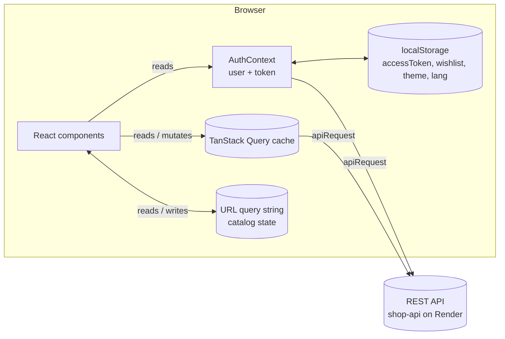
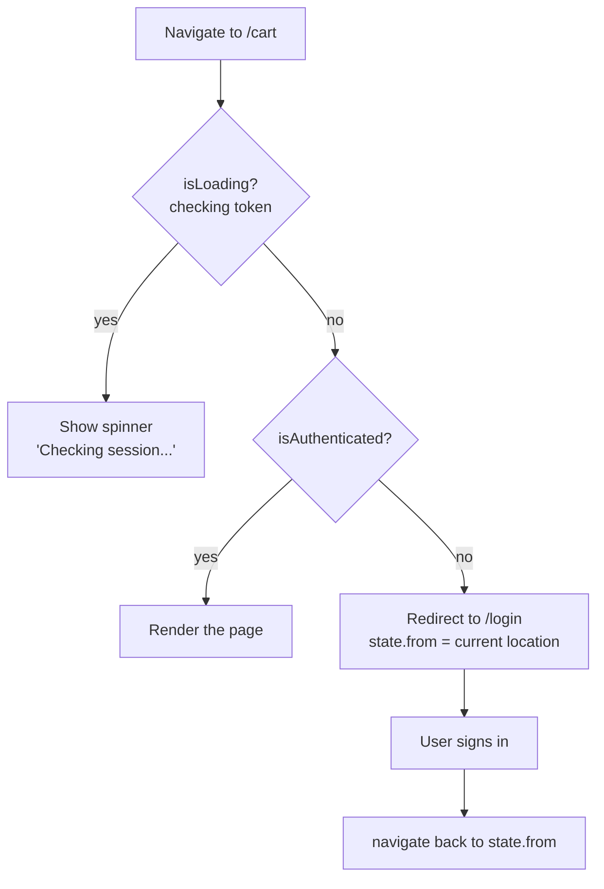
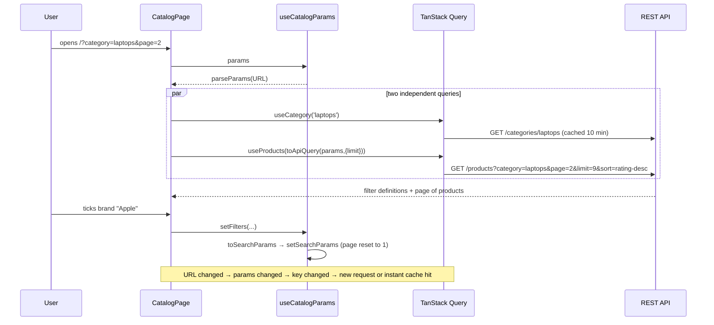
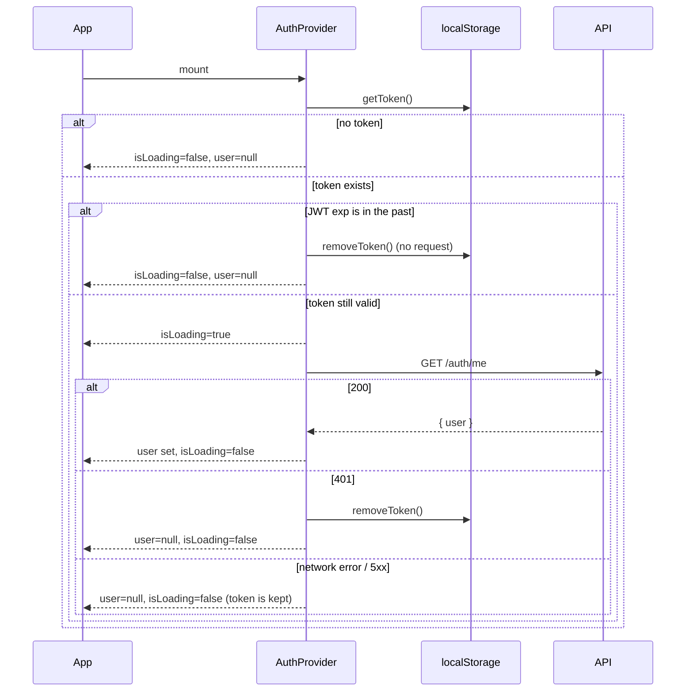
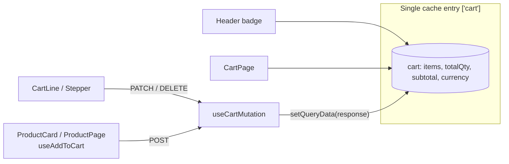
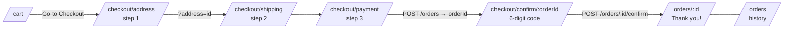
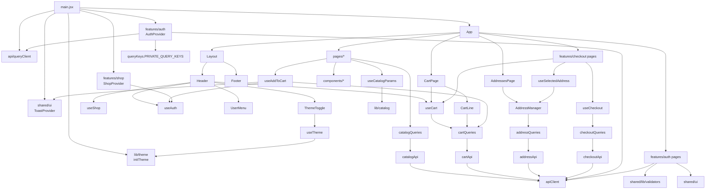

# Architecture — Cyber Shop

This document explains how the Cyber Shop front end is built: where every piece of code lives, how data moves through the app, what each module and function is responsible for, and the reasoning behind the main design decisions. It is written so that a new developer can open any file and immediately understand *what it does*, *who calls it* and *what it depends on*.

> The reasoning behind the key decisions is recorded separately in [`docs/adr/`](./docs/adr) (stack, token storage, cart quantity stepper, profile current password, checkout state in the URL, color theme, i18n strategy).

> Scope: this repository contains the **front end only** (a single-page application). The back end is a separate, ready-made REST API (`https://shop-api-kbe6.onrender.com/api`).

---

## Table of contents

1. [Big picture](#1-big-picture)
2. [Tech stack and tooling](#2-tech-stack-and-tooling)
3. [Folder structure](#3-folder-structure)
4. [Application bootstrap](#4-application-bootstrap)
5. [Routing](#5-routing)
6. [State management model](#6-state-management-model)
7. [Networking layer](#7-networking-layer)
8. [Catalog module](#8-catalog-module)
9. [Product page](#9-product-page)
10. [Authentication module](#10-authentication-module)
11. [Cart module](#11-cart-module)
12. [Addresses module](#12-addresses-module)
13. [Checkout and orders module](#13-checkout-and-orders-module)
14. [Wishlist module](#14-wishlist-module)
15. [Shared UI kit](#15-shared-ui-kit)
16. [Layout components](#16-layout-components)
17. [Styling system](#17-styling-system)
18. [Error handling strategy](#18-error-handling-strategy)
19. [Accessibility notes](#19-accessibility-notes)
20. [Performance notes](#20-performance-notes)
21. [API reference (as used by the front end)](#21-api-reference-as-used-by-the-front-end)
22. [Dependency graph between modules](#22-dependency-graph-between-modules)
23. [How to extend the project](#23-how-to-extend-the-project)
24. [Known limitations and technical debt](#24-known-limitations-and-technical-debt)
25. [Glossary](#25-glossary)

---

## 1. Big picture

Cyber Shop is an online electronics store. A visitor can browse a category, filter, sort and search products, open a product page, register / sign in, add products to a **server-side cart**, and edit their profile. A signed-in user can keep several **delivery addresses**, pay through a 3-step checkout (address → shipping → card → e-mail code → order page) and see the **history of orders**. The wishlist page and the About / Contact / Blog pages are placeholders.



The key architectural idea is a **strict split of state by origin**:

| Kind of state | Where it lives | Why |
| --- | --- | --- |
| Server data (products, categories, cart, addresses, checkout, orders) | TanStack Query cache | Caching, deduplication, loading / error states, background refetch come for free |
| Who is signed in | `AuthContext` (+ token in `localStorage`) | It is client state that many components need |
| Catalog filters, sort, page, search | The URL query string | Shareable links, working Back button, state survives refresh |
| Checkout progress (chosen address, pending order) | The URL (`?address=<id>`, `/checkout/confirm/:orderId`) | F5 and the Back button keep the step (ADR 0005) |
| Card number, holder, expiry, CVC | Only the state of the payment form | Never stored anywhere else (ADR 0005) |
| Wishlist | `ShopContext` (+ `localStorage`) | The API has no wishlist endpoints yet |
| Color theme (light / dark / system) | `data-theme` on `<html>` (+ `localStorage`, key `theme`) | CSS reads the attribute; `system` follows the OS preference live; the choice survives a refresh and is shared between tabs (ADR 0006) |
| Language (ka / en) | `I18nContext` (+ `localStorage`, key `lang`; + `<html lang>`) | Every UI string uses `t('key')` from JSON dictionaries; `Intl.NumberFormat` for prices (ADR 0007) |
| Purely visual state (open dropdown, selected photo) | Local `useState` inside the component | Nobody else needs it |

---

## 2. Tech stack and tooling

| Area | Technology | Notes |
| --- | --- | --- |
| UI | React 19 | Function components and hooks only. `ref` is passed as a normal prop (React 19), see `Input` / `PasswordInput`. |
| Build | Vite 8 | Dev server and production bundler. |
| Optimisation | React Compiler (`babel-plugin-react-compiler` via `@rolldown/plugin-babel`) | Automatic memoisation; that is why the code has very few `useMemo` / `useCallback` calls. Four components opt out with the `'use no memo'` directive because they combine React Hook Form with refs: `AccountPage`, `AddressForm`, `PaymentStep`, `ConfirmPage`. |
| Routing | React Router 7 (`react-router-dom`) | Declarative `<Routes>` with a nested layout route. |
| Server state | TanStack Query 5 (+ Devtools in dev) | Single shared `QueryClient`. |
| Forms | React Hook Form 7 + `@hookform/resolvers` | Uncontrolled inputs, `register()` spread. |
| Validation | Zod 3 | All schemas in one file: `src/shared/lib/validators.js`. |
| Linting | ESLint 10 (flat config) + `react-hooks` + `react-refresh` | `npm run lint`. Currently reports 2 `react-hooks/refs` errors, see [section 24](#24-known-limitations-and-technical-debt). |
| Language | JavaScript (ES modules, JSX) | Types come from `@types/react` for editor hints only. |
| Fonts | Inter (Google Fonts, loaded in `index.html`) | |
| Theming | CSS variables + the `data-theme` attribute | Light by default; the dark palette is one file, `styles/theme.css`; 3 choices: light / dark / system (see [section 17](#17-styling-system), ADR 0006, and the inline FOUC-prevention script in `index.html`). |
| i18n | JSON dictionaries + React Context + `Intl` | Georgian (default) and English; `I18nProvider` with `useTranslation()` hook; `Intl.NumberFormat` for locale-aware prices (see ADR 0007). |

### Build configuration (`vite.config.js`)

* Plugins: `@vitejs/plugin-react` and `@rolldown/plugin-babel` with `reactCompilerPreset()`.
* Path aliases (also used by ESLint/IDE resolution through Vite):

| Alias | Resolves to |
| --- | --- |
| `@` | `src/` |
| `@api` | `src/api/` |
| `@shared` | `src/shared/` |
| `@features` | `src/features/` |

### Environment

| Variable | Default | Purpose |
| --- | --- | --- |
| `VITE_API_URL` | `https://shop-api-kbe6.onrender.com/api` | Base URL of the REST API. The same value is hard-coded as a fallback in `apiClient.js`, so the app works without a `.env` file. |

### SPA hosting

All paths must be rewritten to `index.html`. `public/_redirects` (`/*  /index.html  200`) covers Netlify-style hosts; Render static sites need a rewrite `/*` → `/index.html`; Firebase needs `"rewrites": [{ "source": "**", "destination": "/index.html" }]`.

---

## 3. Folder structure

The tree below is the **real** state of the repository (107 JavaScript / JSX files and 56 CSS files in `src/`; `node_modules/` and `dist/` are not shown). A folder written as `Name/ (.jsx + .css)` contains `Name.jsx` and `Name.css`.

```
cyber-shop/
├─ index.html                 HTML shell: Inter font (Google Fonts), <div id="root">, theme-color meta, loads /src/main.jsx; inline <script> in <head> for FOUC prevention (theme + lang before first paint)
├─ vite.config.js             Vite 8 + React plugin + React Compiler (Babel preset) + path aliases @, @api, @shared, @features
├─ eslint.config.js           ESLint flat config: js recommended + react-hooks + react-refresh
├─ package.json               scripts (dev, build, lint, preview) and dependencies
├─ package-lock.json          exact dependency versions
├─ .env / .env.example        VITE_API_URL (.env is git-ignored, .env.example is the template)
├─ .gitignore, LICENSE        git ignore rules; MIT licence
├─ README.md                  how to install, run, build, deploy; routes; project status
├─ ARCHITECTURE.md            this document
│
├─ docs/
│  ├─ index.md                documentation index, ADR list, "where is each decision implemented"
│  └─ adr/                    ARCHITECTURE DECISION RECORDS (one decision = one file, never deleted)
│     ├─ 0001-frontend-stack.md
│     ├─ 0002-token-storage.md
│     ├─ 0003-cart-quantity-stepper.md
│     ├─ 0004-profile-current-password.md
│     ├─ 0005-checkout-state-in-url.md
│     ├─ 0006-color-theme.md
│     └─ 0007-i18n-strategy.md
│
├─ journal/                   weekly development journal
│  ├─ week-1.md               05.10 – 11.10.2026 (FE-001 … FE-005)
│  ├─ week-2.md               12.10 – 18.10.2026 (FE-006, FE-007: addresses, checkout, orders, dark theme)
│  └─ week-3.md               19.10 – 25.10.2026 (FE-008 i18n, FE-009 3-state theme, lecturer fixes)
│
├─ public/                    copied to the build as they are
│  ├─ favicon.svg, icons.svg  static assets
│  └─ _redirects              SPA fallback for Netlify-style hosting (/*  /index.html  200)
│
└─ src/
   ├─ main.jsx                entry point: provider stack (Query → Toast → I18n → Auth → Shop → Router) + render; `initTheme()` before the first render
   ├─ App.jsx                 the whole route table (public, protected, checkout, 404)
   │
   ├─ api/                    SERVER-STATE LAYER: plain request functions (xxxApi.js) + TanStack Query hooks (xxxQueries.js)
   │  ├─ queryClient.js         the one shared QueryClient + defaults (staleTime 60 s, no retry on 4xx)
   │  ├─ queryKeys.js           central registry of cache keys (categories, products, cart, addresses, checkout, orders)
   │  │                         + PRIVATE_QUERY_KEYS — the keys that are wiped on login / logout
   │  ├─ catalogApi.js          GET /categories, /categories/:slug, /products, /products/:slug (public, auth: false)
   │  ├─ catalogQueries.js      queryOptions + hooks: useCategories, useCategory, useProducts, useProduct
   │  ├─ cartApi.js             GET /cart, POST /cart/items, PATCH / DELETE /cart/items/:id
   │  ├─ cartQueries.js         cart query + useAddCartItem / useUpdateCartItem / useRemoveCartItem (serial scope "cart")
   │  ├─ addressApi.js          GET / POST /addresses, PATCH / DELETE /addresses/:id
   │  ├─ addressQueries.js      addressesQuery + useCreateAddress / useUpdateAddress / useDeleteAddress
   │  │                         (serial scope "addresses"; the whole list is reloaded after every change)
   │  ├─ checkoutApi.js         GET /checkout, POST /orders, POST /orders/:id/confirm, POST /orders/:id/resend-code,
   │  │                         GET /orders, GET /orders/:id
   │  └─ checkoutQueries.js     checkoutQuery, ordersQuery, orderQuery + useCreateOrder, useConfirmOrder, useResendOrderCode
   │
   ├─ shared/                 CROSS-CUTTING building blocks, no business logic
   │  ├─ api/
   │  │  └─ apiClient.js        apiRequest(), ApiError, getToken / setToken / removeToken, isTokenExpired
   │  ├─ lib/
   │  │  └─ validators.js       all Zod schemas: login, register, forgotPassword, verifyCode, resetPassword, profile, address
   │  └─ ui/                   UI KIT (import from the barrel @shared/ui)
   │     ├─ index.js            barrel: components, useToast, icons
   │     ├─ Button/ (.jsx + .css)         primary / secondary button with a loading spinner
   │     ├─ Input/ (.jsx + .css)          text input (ref as a prop, aria-invalid)
   │     ├─ PasswordInput/ (.jsx + .css)  Input + show / hide toggle
   │     ├─ FormField/ (.jsx + .css)      label + control + error message
   │     ├─ Alert/ (.jsx + .css)          form-level banner (success / error / warning)
   │     ├─ Toast/                        ToastProvider.jsx, ToastContext.js, useToast.js, Toast.css
   │     └─ Icons/Icons.jsx               form / auth icons (IconMail, IconLock, IconLoader, …)
   │
   ├─ features/               SELF-CONTAINED FEATURE MODULES (each has an index.js barrel)
   │  ├─ auth/                  sign in / register / reset password / profile
   │  │  ├─ index.js
   │  │  ├─ context/            AuthContext.js, AuthProvider.jsx (startup session check, login, logout, wipes private cache)
   │  │  ├─ hooks/useAuth.js    useContext wrapper that throws outside the provider
   │  │  ├─ lib/profileForm.js  pure helpers of the profile form (buildPatch, hasChanges, applyServerErrors, …)
   │  │  ├─ components/
   │  │  │  ├─ AuthLayout/ (.jsx + .css)      narrow centred card with <Outlet />
   │  │  │  └─ ProtectedRoute/ (.jsx + .css)  route guard (spinner → page | redirect to /login)
   │  │  └─ pages/
   │  │     ├─ LoginPage/ (.jsx + .css)
   │  │     ├─ RegisterPage/ (.jsx + .css)
   │  │     ├─ ForgotPasswordPage/ (.jsx + .css)   3 steps in one component
   │  │     └─ AccountPage/ (.jsx + .css)          profile editor
   │  │
   │  ├─ cart/                  server cart
   │  │  ├─ index.js            exports CartPage, useCart, useAddToCart
   │  │  ├─ hooks/              useCart.js (the ['cart'] entry), useAddToCart.js (guest → /login, toast, stock guard)
   │  │  ├─ lib/                cartRules.js (MIN_QTY, MAX_QTY, getMaxQty, getStockIssue), cartErrors.js (code → text)
   │  │  ├─ components/
   │  │  │  ├─ CartLine/ (.jsx + .css)          one row of the cart
   │  │  │  ├─ QuantityStepper/ (.jsx + .css)   − qty +
   │  │  │  └─ CartSummary/ (.jsx + .css)       order summary + "Go to Checkout"
   │  │  └─ pages/CartPage/ (.jsx + .css)
   │  │
   │  ├─ addresses/             saved delivery addresses (max 10)
   │  │  ├─ index.js            exports AddressesPage, AddressManager, useAddresses, MAX_ADDRESSES
   │  │  ├─ hooks/useAddresses.js         the ['addresses'] entry
   │  │  ├─ lib/addressForm.js            pure helpers: toFormValues, buildCreateBody, buildPatch, hasChanges, applyServerErrors
   │  │  ├─ components/
   │  │  │  ├─ AddressManager/ (.jsx + .css)  the whole "my addresses" UI (list, add, edit, delete, default) — used twice
   │  │  │  ├─ AddressCard/ (.jsx + .css)     one address (optional radio button, edit, delete with confirmation)
   │  │  │  └─ AddressForm/ (.jsx + .css)     add / edit form (React Hook Form + addressSchema)
   │  │  └─ pages/AddressesPage.jsx + .css    /addresses
   │  │
   │  ├─ checkout/              3-step checkout → code → order page → orders history
   │  │  ├─ index.js            exports CheckoutLayout, AddressStep, ShippingStep, PaymentStep, ConfirmPage, OrderPage, OrdersPage
   │  │  ├─ hooks/
   │  │  │  ├─ useCheckout.js          GET /checkout (cart + totals)
   │  │  │  ├─ useSelectedAddress.js   ?address=<id> from the URL + data from ['addresses']
   │  │  │  ├─ useOrder.js             GET /orders/:id
   │  │  │  └─ useOrders.js            GET /orders
   │  │  ├─ lib/
   │  │  │  ├─ checkoutRoutes.js       CHECKOUT_STEPS, checkoutPath, confirmPath, orderPath
   │  │  │  ├─ checkoutErrors.js       getGenericMessage, getStockProblems, splitOrderErrors
   │  │  │  ├─ checkoutFormat.js       formatShippingFee, formatShipmentDate, formatDateTime, shortOrderNumber, amountToFreeShipping
   │  │  │  └─ card.js                 card number / expiry formatting, Luhn, expiry check, detectBrand, cardSchema (Zod)
   │  │  ├─ components/
   │  │  │  ├─ CheckoutStepper/ (.jsx + .css)  "Step 1 Address — Step 2 Shipping — Step 3 Payment" bar
   │  │  │  ├─ OrderSummary/ (.jsx + .css)     summary card of step 3 (server numbers only)
   │  │  │  └─ CardPreview/ (.jsx + .css)      live preview of the card with the brand logo
   │  │  └─ pages/
   │  │     ├─ CheckoutLayout/       CheckoutLayout.jsx + CheckoutPages.css — frame + guard (empty cart → /cart)
   │  │     ├─ AddressStep/          step 1 (.jsx)
   │  │     ├─ ShippingStep/         step 2 (.jsx + .css)
   │  │     ├─ PaymentStep/          step 3, card form → POST /orders (.jsx + .css)
   │  │     ├─ ConfirmPage/          6-digit code, resend timer (.jsx + .css)
   │  │     ├─ OrderPage/            "Thank you!" / order details (.jsx + .css)
   │  │     └─ OrdersPage/           orders history (.jsx + .css)
   │  │
   │  └─ shop/                  wishlist (localStorage, per user)
   │     ├─ index.js            exports ShopProvider, useShop
   │     ├─ context/            ShopContext.js, ShopProvider.jsx
   │     └─ hooks/useShop.js    wishlistCount, isInWishlist, toggleWishlist (guest → /login)
   │
   ├─ pages/                  CATALOG-SIDE PAGES
   │  ├─ CatalogPage/ (.jsx + .css)   product grid + filters + sort + pagination
   │  ├─ FiltersPage/ (.jsx + .css)   mobile filters screen with the "Apply" button
   │  ├─ ProductPage/ (.jsx + .css)   single product (gallery, quick specs, spec tables, related)
   │  └─ StubPage/ (.jsx + .css)      placeholder pages and the 404 page
   │
   ├─ components/             SHOP-SPECIFIC REUSABLE COMPONENTS (each: Name/Name.jsx + Name.css, unless noted)
   │  ├─ Layout/                Header + <Outlet /> + Footer, scroll to top (.jsx only)
   │  ├─ Header/                logo, search, nav, wishlist + cart badges, profile slot, mobile menu
   │  ├─ UserMenu/              avatar dropdown: Account, Orders, Address, Logout
   │  ├─ ThemeToggle/           light / dark / system toggle (role="radiogroup", 3 buttons); used in the Header and in the mobile menu
   │  ├─ LanguageSwitcher/      KA / EN language toggle (role="radiogroup"); used in the Header
   │  ├─ Footer/                footer (placeholder links)
   │  ├─ Logo/                  SVG text logo (Logo.jsx only)
   │  ├─ ProductCard/, ProductCardSkeleton/, ProductImage/, Stars/
   │  ├─ FilterPanel/, Checkbox/, PriceRange/, SortSelect/, Pagination/
   │  ├─ Breadcrumbs/, LoadingHint/, QueryError/
   │  ├─ ActionButton/          big black / outlined button of the mockups (Back / Next / Pay); a <Link> or a <button>
   │  └─ icons/                 icons.jsx (cart, heart, search, burger, chevron, star, …),
   │                            checkoutIcons.jsx (pin, shipment, payment, pencil, close, plus, check, card chip, contactless)
   │
   ├─ lib/                    PURE FUNCTIONS (no React, easy to test)
   │  ├─ catalog.js             URL ⇄ state ⇄ API query mapping
   │  ├─ format.js              formatPrice, formatWarranty (legacy, kept for reference; components use formatPriceI18n from i18n.jsx)
   │  ├─ i18n.jsx               I18nProvider, useTranslation, formatPriceI18n, formatDateI18n, getCategoryName, getFilterTitle
   │  ├─ specs.js               product spec labels and grouping
   │  ├─ filterLabels.js        filter titles and colour swatches (accepts t() for i18n)
   │  └─ theme.js               color theme: initTheme, setTheme, getTheme, getPreference + store for useSyncExternalStore; 3 states: light | dark | system (touches the DOM and localStorage, so not pure)
   │
   ├─ locales/                 TRANSLATION DICTIONARIES (JSON, ~250 keys each)
   │  ├─ ka.json                Georgian (default language)
   │  └─ en.json                English
   │
   ├─ hooks/                  GENERIC HOOKS
   │  ├─ useCatalogParams.js    catalog state ⇄ URL (the only place that reads / writes it)
   │  ├─ useMediaQuery.js       reactive window.matchMedia
   │  └─ useTheme.js            current theme + setters (useSyncExternalStore over lib/theme.js)
   │
   └─ styles/                 GLOBAL CSS
      ├─ vars.css               shop colour variables (--c-*)
      ├─ auth-tokens.css        auth / form design tokens (--color-*, spacing, radius, shadow)
      ├─ cyber-form.css         .cyber-form / .cyber-check: inputs drawn like the checkout / address mockups
      ├─ reset.css              CSS reset
      ├─ theme.css              light / dark: dark tokens under :root[data-theme='dark'] + overrides of hard-coded colors
      └─ global.css             imports vars, reset, auth-tokens and theme + base styles + utilities
```

### Conventions

* **One component = one folder** containing `Component.jsx` and `Component.css` (BEM-style class names such as `product-card__btn--disabled`).
* **Barrel files** (`index.js`) expose the public API of a feature (`@features/auth`, `@features/cart`, `@features/addresses`, `@features/checkout`, `@features/shop`, `@shared/ui`). Inside a feature, files import each other by relative path. A few hooks are imported by their full path on purpose (`@features/auth/hooks/useAuth`, `@features/checkout/lib/checkoutErrors`) because they are not part of the barrel — see [section 24](#24-known-limitations-and-technical-debt).
* **Layering rule (top to bottom may import, never upwards):**

```
pages / features  →  components  →  shared (ui, api, lib)  →  lib / hooks (pure)
        ↓
       api (query hooks)  →  shared/api/apiClient
```

* **Pure logic is extracted** from components into `lib/` files (`catalog.js`, `cartRules.js`, `cartErrors.js`, `profileForm.js`, `addressForm.js`, `card.js`, `checkoutRoutes.js`, `checkoutErrors.js`, `checkoutFormat.js`, `format.js`, `specs.js`) so it has no React dependency and can be unit-tested directly.
* **Plain fetch functions are separated from React hooks** (`catalogApi.js` vs `catalogQueries.js`, and the same for cart, addresses and checkout).
* **Every private cache key is registered** in `PRIVATE_QUERY_KEYS` (`api/queryKeys.js`), so login and logout wipe it automatically.

---

## 4. Application bootstrap

`src/main.jsx` mounts the app and defines the **provider order**. The order matters because providers depend on each other:

```jsx
<StrictMode>
  <QueryClientProvider client={queryClient}>   // 1. server-state cache
    <ToastProvider>                            // 2. toast notifications
      <I18nProvider>                           // 3. language context (ka/en)
        <AuthProvider>                         // 4. who is signed in (uses QueryClient)
          <ShopProvider>                       // 5. wishlist (needs the user id from AuthProvider)
            <BrowserRouter>                    // 6. routing
              <App />
            </BrowserRouter>
          </ShopProvider>
        </AuthProvider>
      </I18nProvider>
    </ToastProvider>
    <ReactQueryDevtools initialIsOpen={false} />   // dev only (the "flower" button)
  </QueryClientProvider>
</StrictMode>
```

Why this order?

1. `QueryClientProvider` is outermost: `AuthProvider` needs `useQueryClient()` to clear the cart cache on login/logout.
2. `ToastProvider` has no dependencies, but hooks such as `useAddToCart` need `useToast()`.
3. `I18nProvider` makes `useTranslation()` available to all components; it has no React dependency upward.
4. `AuthProvider` must wrap `ShopProvider` because the wishlist is stored *per user id*.
5. `BrowserRouter` is innermost of the providers; `useShop()` and `useAddToCart()` use router hooks (`useNavigate`, `useLocation`) so they must be called under the router.

`App.jsx` then renders the route table (next section). The global stylesheet `styles/global.css` is imported once in `main.jsx`.

Right after the imports, before the first render, `main.jsx` calls `initTheme()` (`lib/theme.js`): it reads the saved color theme from `localStorage` (or the OS preference) and sets `data-theme` on `<html>`. The theme is not a provider — see [6.5](#65-color-theme-libthemejs).

---

## 5. Routing

All routes are children of one layout route, so the **Header and Footer are always on screen**; only the `<Outlet />` changes.

| Path | Component | Access | Description |
| --- | --- | --- | --- |
| `/` | `CatalogPage` | public | Catalog. All state is in the query string. |
| `/filters` | `FiltersPage` | public | Mobile filters screen. On desktop it redirects to `/`. |
| `/product/:slug` | `ProductPage` | public | Product details. |
| `/login` | `LoginPage` (in `AuthLayout`) | public | Sign in. |
| `/register` | `RegisterPage` (in `AuthLayout`) | public | Create account. |
| `/forgot-password` | `ForgotPasswordPage` (in `AuthLayout`) | public | 3-step password reset. |
| `/account` | `AccountPage` | **protected** | Profile editor. |
| `/cart` | `CartPage` | **protected** | Server cart. |
| `/addresses` | `AddressesPage` | **protected** | Delivery addresses: add, edit, delete, default (max 10). |
| `/checkout` | redirect to `/checkout/address` | **protected** | |
| `/checkout/address` | `CheckoutLayout` + `AddressStep` | **protected** | Step 1: choose or add a delivery address (a new user must add one to continue). |
| `/checkout/shipping` | `CheckoutLayout` + `ShippingStep` | **protected** | Step 2: shipment method; the chosen address is `?address=<id>` (ADR 0005). |
| `/checkout/payment` | `CheckoutLayout` + `PaymentStep` | **protected** | Step 3: summary + card → `POST /orders`. |
| `/checkout/confirm/:orderId` | `ConfirmPage` | **protected** | 6-digit code, resend timer. Outside `CheckoutLayout` on purpose: after paying the cart is empty and the layout guard would send the user to `/cart`. |
| `/orders` | `OrdersPage` | **protected** | My orders (history), newest first, data from `GET /orders`. "Orders" in the profile menu and in the mobile menu. A row links to `/orders/:id`. |
| `/orders/:id` | `OrderPage` | **protected** | Order confirmation / details, data from `GET /orders/:id`. |
| `/about`, `/contact`, `/blog` | `StubPage` | public | Placeholders. |
| `/wishlist` | `StubPage` | public | Placeholder; the wishlist data exists, the page does not yet. |
| `*` | `StubPage` ("Page not found") | public | 404. |

### Route structure

```
<Route element={<Layout />}>                 Header + <Outlet/> + Footer
  index                  → CatalogPage
  filters                → FiltersPage
  product/:slug          → ProductPage
  <Route element={<AuthLayout />}>           narrow centred card
     login | register | forgot-password
  </Route>
  account  → <ProtectedRoute><AccountPage/></ProtectedRoute>   (wide card, so it sits outside AuthLayout)
  cart     → <ProtectedRoute><CartPage/></ProtectedRoute>
  addresses → <ProtectedRoute><AddressesPage/></ProtectedRoute>
  <Route path="checkout" element={<ProtectedRoute><Outlet/></ProtectedRoute>}>
     <Route element={<CheckoutLayout />}>    stepper + GET /checkout guard (empty cart → /cart)
        index → <Navigate to="address" replace />
        address | shipping | payment
     </Route>
     confirm/:orderId → ConfirmPage          outside the layout (the cart is empty after paying)
  </Route>
  orders       → <ProtectedRoute><OrdersPage/></ProtectedRoute>
  orders/:id   → <ProtectedRoute><OrderPage/></ProtectedRoute>
  about | contact | blog | wishlist → StubPage
  *        → StubPage (404)
</Route>
```

`Layout` also calls `window.scrollTo(0, 0)` whenever `pathname` changes, so every navigation starts at the top of the page.

### ProtectedRoute behaviour



The `isLoading` state exists so that a signed-in user who refreshes `/cart` does **not** see a flash of the login page while the token is being verified.

---

## 6. State management model

### 6.1 URL state (catalog)

`useCatalogParams()` is the **only** place that reads and writes catalog state. There is no `useState` or context for filters, sort, page or search query.

```
URL  ──parseParams──▶  params {q, sort, page, category, filters}
                              │
                              ├──toApiQuery──▶ query object ──▶ useProducts(query)  (query object = cache key)
                              └──UI reads params to render selected filters, sort, page

user changes a filter ─▶ setFilters() ─▶ toSearchParams() ─▶ setSearchParams() ─▶ URL changes ─▶ everything above re-runs
```

Example URL:

```
/?category=laptops&brand=Apple,Samsung&storage=256gb&minPrice=500&maxPrice=3000&inStock=true&sort=price-asc&page=2&q=pro
```

Rules that keep URLs clean:

* Default category (`smartphones`), default sort (`rating-desc`) and page 1 are **omitted** from the URL.
* Multiple values of one filter are comma-separated (exactly the format the API expects).
* Changing filters or sort resets `page` to 1.

### 6.2 Server state (TanStack Query)

* One `QueryClient` for the whole app (`src/api/queryClient.js`).
* **Defaults:** `staleTime` 60 s; `refetchOnWindowFocus` disabled; `retry` — never for 4xx responses (they are answers, not failures), at most 2 retries otherwise.
* **Per-query overrides:** categories and category filter definitions use `staleTime` of 10 minutes because they almost never change.
* **Query keys** are centralised in `queryKeys.js`:

| Key | Data |
| --- | --- |
| `['categories']` | list of categories |
| `['categories', slug]` | one category with its `filters` array |
| `['products', 'list', query]` | one page of products; `query` is the whole API query object |
| `['products', 'detail', slug]` | one product |
| `['cart']` | the signed-in user's whole cart |
| `['addresses']` | saved delivery addresses (default first) |
| `['checkout']` | cart + totals + shipping fee for the checkout steps |
| `['orders', 'list']` | order history |
| `['orders', 'detail', id]` | one order |

* **`placeholderData: keepPreviousData`** on `useProducts` keeps the previous page on screen (dimmed, class `catalog__grid--stale`) while the next one loads — no spinner flash when paginating or filtering.

### 6.3 Auth state (`AuthContext`)

| Field | Type | Meaning |
| --- | --- | --- |
| `user` | object \| null | The current user from `GET /auth/me`, `/auth/login` or `/auth/register` |
| `isLoading` | boolean | `true` only during the startup session check |
| `isAuthenticated` | boolean | `!!user` |
| `login(token, user)` | function | Stores the token, sets the user, wipes the previous user's private cache (`PRIVATE_QUERY_KEYS`: cart, addresses, checkout, orders) |
| `logout()` | async function | Calls `POST /auth/logout`, always removes the token, clears the user and the private cache |
| `setUser(user)` | function | Used by the profile page to publish saved changes |

Three states are possible: **loading** (token present, being verified), **authenticated**, **unauthenticated**.

### 6.4 Wishlist state (`ShopContext`)

Stored in `localStorage` under `shop:<userId>` as `{ wishlist: [productId, …] }`. See [section 14](#14-wishlist-module).

### 6.5 Color theme (`lib/theme.js`)

The theme preference (`'light'` | `'dark'` | `'system'`) is stored in `localStorage` under `theme`. The resolved theme (`'light'` | `'dark'`) is set as the `data-theme` attribute on `<html>`; CSS reads only this attribute (`styles/theme.css`). When the preference is `'system'`, the resolved theme live-follows the OS via `matchMedia('prefers-color-scheme: dark')`.

**FOUC prevention:** An inline `<script>` in `index.html` `<head>` reads `localStorage.theme`, resolves `system` via `matchMedia`, and sets `data-theme`, `color-scheme`, and `<meta name="theme-color">` **before the first paint**. This is an intentional exception to ADR 0002 ("never read localStorage outside React").

| Function | What it does |
| --- | --- |
| `initTheme()` | Applies the saved (or OS) theme; called once in `main.jsx` before the first render |
| `getPreference()` | Returns the stored preference: `'light'`, `'dark'`, or `'system'` |
| `getTheme()` | Returns the resolved theme: `'light'` or `'dark'` (resolves `system` via `matchMedia`) |
| `setTheme(pref)` | Saves `pref` to `localStorage`, applies the resolved theme, notifies subscribers, turns on a short color transition |
| `subscribe(listener)` | For `useSyncExternalStore`; also listens to the `storage` event (another tab changed the theme) and to the OS theme change while preference is `system` |

React reads the state through `useTheme()` (`hooks/useTheme.js`), which returns `{ theme, preference, isDark, setTheme }`. There is no Context: the attribute on `<html>` is the single source of truth. See [ADR 0006](./docs/adr/0006-color-theme.md).

### 6.6 Language / i18n (`lib/i18n.jsx`)

The language (`'ka'` | `'en'`) is stored in `localStorage` under `lang` and in `<html lang>`. The `I18nProvider` wraps the app and provides `useTranslation()` which returns `{ lang, setLang, t }`.

| Export | What it does |
| --- | --- |
| `I18nProvider` | React Context provider; reads `localStorage.lang` on mount, defaults to `'ka'`; updates `<html lang>` on change |
| `useTranslation()` | Returns `{ lang, setLang, t }` — the current language, a setter, and the translation function |
| `t(key, params?)` | Looks up `key` in the current language's JSON dictionary (e.g. `t('cart.addToCart')`); supports `{{param}}` interpolation |
| `formatPriceI18n(value, currency, lang)` | `Intl.NumberFormat` with `ka-GE` or `en-US` locale; produces `₾1 510` / `₾1,510` |
| `formatDateI18n(iso, lang)` | `Intl.DateTimeFormat` with locale-aware date formatting |
| `getCategoryName(cat, lang)` | Returns `cat.nameEn` for English, `cat.name` for Georgian |

Translation dictionaries: `src/locales/ka.json` and `src/locales/en.json` (~250 keys each, organised by feature: `header`, `footer`, `catalog`, `product`, `cart`, `auth`, `checkout`, `stub`, etc.). See [ADR 0007](./docs/adr/0007-i18n-strategy.md).

---

## 7. Networking layer

### 7.1 `apiRequest(endpoint, options)` — `src/shared/api/apiClient.js`

Every HTTP call in the app goes through this one function.

| Step | Behaviour |
| --- | --- |
| Base URL | `import.meta.env.VITE_API_URL` or the Render URL fallback |
| Token | `Authorization: Bearer <token>` is added from `localStorage` **unless** the call is made with `{ auth: false }` |
| Headers | `Content-Type: application/json` is added **only when there is a body** (so plain `GET`s avoid a CORS preflight) |
| Response | JSON is parsed when the content type is JSON; an empty body (e.g. 204) gives `{}` |
| Errors | Non-2xx responses throw an **`ApiError`** |
| Session loss | On `401` with code `TOKEN_EXPIRED` or `INVALID_TOKEN`: remove token and throw an `ApiError` (the calling hook navigates to `/login` with `state.from` preserved, so the user returns to the same page after re-login) |
| Exceptions to the redirect | `POST /auth/login`, `POST /auth/register` (a 401 there is a normal form error) and `GET /auth/me` (the startup check, handled by `AuthProvider`) |

```js
class ApiError extends Error {
  status   // HTTP status
  code     // machine-readable code, e.g. 'INSUFFICIENT_STOCK' (defaults to 'UNKNOWN_ERROR')
  errors   // field → message map for validation errors, or null
  data     // the full error body (e.g. { available: 3 } or { retryAfterSeconds: 30 })
}
```

> **Rule used throughout the code:** decide what to do from `error.code` / `error.status`, never from `error.message` (the text may change).

Token helpers: `getToken()`, `setToken(token)`, `removeToken()` — thin wrappers over `localStorage['accessToken']`.

### 7.2 Public vs. private calls

* **Catalog requests** (`catalogApi.js`) are sent with `auth: false`. An expired token can therefore never break browsing.
* **Cart requests** (`cartApi.js`) use the default (`auth: true`).

### 7.3 Request cancellation

Query functions receive `{ signal }` from TanStack Query and pass it to `fetch`, so outdated requests (the user changed a filter again) are aborted.

---

## 8. Catalog module

Files: `pages/CatalogPage`, `pages/FiltersPage`, `components/FilterPanel`, `PriceRange`, `Checkbox`, `SortSelect`, `Pagination`, `ProductCard`, `ProductCardSkeleton`, `Breadcrumbs`, `lib/catalog.js`, `lib/filterLabels.js`, `hooks/useCatalogParams.js`, `hooks/useMediaQuery.js`, `api/catalogApi.js`, `api/catalogQueries.js`.

### 8.1 Data flow of the catalog page



### 8.2 `CatalogPage` responsibilities

* Chooses the page size: **8 products on mobile, 9 on desktop** (`useMediaQuery(MOBILE_QUERY)`; mobile = `max-width: 1023px`).
* Renders the filter sidebar (desktop only), the result counter, the "Filters" button (mobile only), the sort dropdown, the product grid, the range text ("Showing 1–9 of 42") and pagination.
* Handles every state of both queries:

| Situation | What is shown |
| --- | --- |
| Category query 404 | `StubPage` "Category not found" |
| Products loading (first time) | `LoadingHint` + 8/9 `ProductCardSkeleton`s |
| Products loading (next page / new filter) | Previous grid, dimmed |
| Products error | `QueryError` with a "Try again" button (`refetch`) |
| Empty result | "No products match your filters." + "Reset filters" link |
| Page number beyond the last page | `<Navigate replace>` to the last page |
| Category filters loading / failed | Skeleton blocks / "Could not load the filters." |

* `useEffect` scrolls to top whenever `page` changes.
* The `AVAILABILITY_GROUP` ("In stock", "On sale") is **appended** to the category's own filter list on the client, because it maps to the API flags `inStock` and `onSale` and is not a category attribute.
* Sets the document title with the React 19 `<title>` element.

### 8.3 `lib/catalog.js` — the URL ⇄ state ⇄ API translator

| Export | Signature | What it does |
| --- | --- | --- |
| `DEFAULT_CATEGORY` | `'smartphones'` | Used when the URL has no `category` |
| `DEFAULT_SORT` | `'rating-desc'` | Used when `sort` is missing or invalid |
| `SORT_OPTIONS` | array | `rating-desc`, `price-asc`, `price-desc`, `newest`, `oldest`, `popular`, `title-asc` with labels |
| `AVAILABILITY_GROUP` | object | Virtual checkbox group: In stock / On sale |
| `emptyFilters()` | `() → filters` | `{ availability: [], minPrice: null, maxPrice: null }` |
| `parseParams(sp)` | `URLSearchParams → { q, sort, page, category, filters }` | Parses and **validates**: unknown sort → default; invalid page → 1; negative / non-numeric prices → `null`; ignores reserved keys and unsafe keys (regex `^[a-z][\w-]*$`); every other key becomes an attribute filter with comma-separated values |
| `toSearchParams(state)` | `→ URLSearchParams` | Inverse of `parseParams`; omits defaults |
| `toApiQuery(state, { limit })` | `→ object` | Builds the `GET /products` query; the same object is the **TanStack Query key** |
| `countActiveFilters(filters)` | `→ number` | Sum of selected values + price bounds; shown on the mobile "Filters (N)" button |

Reserved URL keys (never treated as attribute filters): `q`, `sort`, `page`, `category`, `minPrice`, `maxPrice`, `inStock`, `onSale`, `minRating`.

### 8.4 Data-driven filters — `FilterPanel`

`FilterPanel` renders whatever the API sends in `category.filters`:

```js
{ key: 'brand', label: '…', type: 'checkbox' | 'radio' | 'color' | 'range', options: [{ value, label }], min, max }
```

Nothing is hard-coded per category, so adding a category on the server needs **no front-end change**.

| Prop | Meaning |
| --- | --- |
| `groups` | array of filter definitions |
| `value` | `{ [key]: string[], minPrice, maxPrice }` |
| `onChange(nextValue)` | called with the full new filter object |
| `defaultOpen` | section keys opened initially (`['price','brand']` on desktop) |
| `withPrice` | render the price section |
| `scrollable` | give long option lists their own scroll area (mobile screen) |
| `priceDelay` | debounce for the price slider (`0` on mobile) |

Behaviour details:

* **Accordion sections** with `aria-expanded` / `aria-controls`.
* A list with **more than 6 options gets its own search box**.
* **Radio** groups hold at most one value and show an explicit "Reset" button (a radio cannot be un-ticked by clicking it again).
* **Colour** groups show a swatch from `getColorHex(value)`; unknown colours fall back to neutral grey `#cfcfcf` (the text label is always shown too).
* When the user selects the full price range, `minPrice` / `maxPrice` are set to `null` so no price filter appears in the URL or request.
* `getFilterTitle(group)` uses an English title for known keys (brand, price, storage, ram, color, os, type, material, size, gender, season, availability) and falls back to the API label (which is Georgian).

### 8.5 `PriceRange`

A dual-handle slider plus two numeric text inputs.

* While dragging, only a **local draft** changes; `onChange` fires `delay` ms (400 by default) after the last movement, so the app does not send one request per pixel.
* Typing a number and pressing **Enter** or leaving the field commits immediately (value is clamped between the bounds and the other handle).
* `delay = 0` (mobile filters screen) calls `onChange` immediately because nothing is fetched until "Apply".
* It resynchronises its draft when the parent value changes from outside (reset, Back button) using the "adjust state during render" pattern rather than an effect.

### 8.6 Mobile filters screen — `FiltersPage`

* On desktop it immediately redirects to `/` (the sidebar is used instead).
* Keeps a **draft** copy of the filters in local state. Nothing is applied until the user presses **Apply**, which writes the draft to the URL (page reset to 1) and navigates back to `/`.
* "Clear all" resets the draft; the Back arrow returns to the catalog preserving the current query string.

### 8.7 Header search

`HeaderSearch` (inside `Header`):

* Keeps its own text state, debounced by **400 ms** (`SEARCH_DELAY`) before updating `q` in the URL.
* Preserves all other query parameters, removes `page`, and always navigates to `/`.
* On the catalog page typing uses `replace` (no history spam); pressing Enter forces a normal navigation.
* If the URL's `q` changes from outside (e.g. the "Clear" link), the input text is resynchronised.

### 8.8 `Pagination`

`getPages(page, total)` returns a compact list: all pages when `total ≤ 5`; otherwise `1 2 3 … N`, `1 … N-2 N-1 N`, or `1 … p-1 p p+1 … N`. Buttons carry `aria-label="Page N"` and `aria-current="page"`. The component renders nothing when there is only one page.

---

## 9. Product page

File: `pages/ProductPage/ProductPage.jsx`.

Structure: `ProductPage` (data loading) → `ProductView` (presentation).

* `ProductPage` calls `useProduct(slug)`. Loading → `ProductSkeleton`; 404 → `StubPage` "Product not found"; other errors → `QueryError` with retry.
* `ProductView` is rendered with `key={product.id}` so navigating between related products **resets local state** (selected photo, expanded specs) automatically.

Sections:

1. **Breadcrumbs** — Home › Catalog › Category › Brand › Title (category and brand links point back to the filtered catalog).
2. **Gallery** — thumbnails (if more than one image) + main photo via `ProductImage`.
3. **Info block** — title, price (with old price and `-N%` badge), colour swatch, storage chip, six **quick specs** with icons, wishlist toggle, **Add to Cart** button (disabled when out of stock or while adding), and three perk tiles (delivery, stock count, warranty).
4. **Details** — description and spec tables. `buildSpecGroups()` produces `{ main, more }`: the first two groups are always visible, the rest are behind a **View More / View Less** toggle.
5. **Reviews** — only the real rating and review count (the API has no reviews endpoint, so no fake reviews are shown).
6. **Related products** — up to 8 `ProductCard`s from `product.related`.

### `lib/specs.js`

The API returns `specs` as `{ "<Georgian name>": "value" }` for every category.

| Export | What it does |
| --- | --- |
| `SPEC_LABELS` | Georgian key → English label (Screen, Refresh rate, CPU, RAM, Storage, Main camera, Front camera, Battery capacity, Charging, Operating system, Protection class, Color, Warranty) |
| `QUICK_KEYS` | The six keys shown as quick specs under the price |
| `getSpecLabel(key)` | English label, or the original key if unknown |
| `getQuickSpecs(specs)` | The known quick keys that exist; if fewer than 3 match, falls back to the first 6 entries |
| `buildSpecGroups(specs)` | Groups known keys into Screen / CPU / Camera / Battery / Protection; remaining keys go to an "Other" (or "Specifications") group |

### `ProductImage`

Shows the image; if `src` is `null` or the image fails to load (`onError`), shows a neutral placeholder. It remembers **which URL failed** (`failedSrc`), so a different URL (another product, a fixed image) is tried again automatically. Decorative images (`alt=""`) hide the placeholder from screen readers.

### `lib/format.js` (legacy)

* `formatPrice(value, currency = 'GEL')` → `₾1,510`, `$1,200`, `€99` (unknown currencies use `"CODE "` as prefix). **Superseded** by `formatPriceI18n` from `lib/i18n.jsx`, which uses `Intl.NumberFormat` for locale-aware formatting. Kept for reference; no component imports it any more.
* `formatWarranty(months)` → `1 year`, `2 years`, `6 months`, or `—` when empty. **Superseded** by `formatWarrantyI18n` in `lib/i18n.jsx`.

---

## 10. Authentication module

Location: `src/features/auth/`.

```
features/auth/
├─ index.js                      barrel export
├─ context/
│  ├─ AuthContext.js              createContext(null)
│  └─ AuthProvider.jsx            state + login/logout + startup session check
├─ hooks/useAuth.js               useContext wrapper that throws outside the provider
├─ components/
│  ├─ AuthLayout/                 centred card with <Outlet/>
│  └─ ProtectedRoute/             route guard
├─ lib/profileForm.js             pure helpers for the profile form
└─ pages/
   ├─ LoginPage/
   ├─ RegisterPage/
   ├─ ForgotPasswordPage/         3 steps in one component
   └─ AccountPage/                profile editor
```

### 10.1 Session lifecycle



`isLoading` is initialised **synchronously** with `() => !!token && !isTokenExpired(token)` so the very first render already knows whether a check is pending.

Why the expiry is read locally: the access token lives 30 minutes, so after a longer break the stored token is dead. Calling `GET /auth/me` with it only produces a `401` line in the browser console (the browser prints it for every failed request; it cannot be hidden in code). `isTokenExpired()` in `apiClient.js` decodes the `exp` claim of the JWT and the request is simply not sent. A token that cannot be decoded is **not** treated as expired — the server decides. The check itself goes through `checkSession()`, which shares one in-flight request: React StrictMode (dev) runs effects twice and used to send `GET /auth/me` twice. Only a `401` removes the token; a network error or `5xx` (the free server waking up) keeps it, so the user is not signed out by a temporary failure.

### 10.2 Login / register

* Forms use React Hook Form with a Zod resolver (`mode: 'onSubmit'`, `reValidateMode: 'onChange'` — errors appear after the first submit, then update live).
* On success: `login(accessToken, user)` then `navigate(from, { replace: true })`, where `from` is `location.state.from` (pathname + search + hash) or `/`. A guest who came from `/?category=laptops&page=2` returns to exactly that URL.
* Error mapping:

| Server response | UI result |
| --- | --- |
| `INVALID_CREDENTIALS` / 401 on login | Banner "Incorrect email or password" |
| `EMAIL_TAKEN` / 409 on register | Error under the Email field |
| `VALIDATION_ERROR` with `errors` map | Each message under its own field |
| Anything else | Banner with the server message or a generic text |

### 10.3 Forgot password (3 steps on one URL)

| Step | Component | Request | Notes |
| --- | --- | --- | --- |
| 1 | `Step1Email` | `POST /auth/forgot-password` | The API always answers 200 (does not reveal whether the e-mail exists). In the API's dev mode the response also contains `devCode`, which the page shows in a banner on step 2 for testing. |
| 2 | `Step2Code` | `POST /auth/verify-reset-code` | 6-digit code validated by Zod. Returns `resetToken`, kept **in component state only** (never `localStorage`). `INVALID_RESET_CODE` → error; `TOO_MANY_ATTEMPTS` (429) → message and automatic return to step 1 after 3 s. |
| 3 | `Step3NewPassword` | `POST /auth/reset-password` | Sends `resetToken` + new password. `RESET_TOKEN_USED` is handled. On success the user is sent to `/login`. |

### 10.4 Account page (profile editor)

Flow: `user` (from context) → form defaults → submit → `PATCH /auth/me` with **only changed fields** + `currentPassword` → `setUser(data.user)` + `reset(...)`.

`lib/profileForm.js` (pure functions):

| Export | Purpose |
| --- | --- |
| `PROFILE_FIELDS` | `['name','email']` — fields sent as-is (phone and address moved to `/addresses`) |
| `FORM_FIELDS` | every real input name (used to route server errors) |
| `toFormValues(user)` | API user → form values (`null` → `''`) |
| `buildPatch({ dirtyFields, values, initial })` | Builds the PATCH body from fields that are both dirty **and** really different from the server value (typing and deleting a space sends nothing). Returns `null` when there is nothing to send. |
| `hasChanges(dirtyFields)` | Drives the disabled state of the Save button. Typing only the current password is **not** a change. |
| `applyServerErrors(errors, setError)` | Puts server field errors under inputs; returns messages without an input for the banner |

Error mapping on the profile page: `INVALID_CURRENT_PASSWORD` (400 — the session is fine, so the user stays) → under "Current password"; `EMAIL_TAKEN` → under Email; `VALIDATION_ERROR` → per field; `TOKEN_EXPIRED` → handled centrally by `apiClient`.

### 10.5 Validation schemas (`src/shared/lib/validators.js`)

| Schema | Rules |
| --- | --- |
| `loginSchema` | email required + valid; password required (no strength rules — it may come from an older policy) |
| `registerSchema` | name ≥ 2; valid e-mail; password ≥ 8 with a letter and a digit; confirmation must match |
| `forgotPasswordSchema` | valid e-mail |
| `verifyCodeSchema` | exactly 6 digits (also used for the payment code on `ConfirmPage`) |
| `resetPasswordSchema` | password ≥ 8 with a letter and a digit |
| `addressSchema` | label ≤ 30; full name ≥ 2; phone required, `^\+?[\d\s()-]{9,20}$`; city ≥ 2; address ≥ 5; `isDefault` boolean (see [section 12](#12-addresses-module)) |
| `profileSchema` | mirrors the server: name ≥ 2; valid e-mail; new password optional with the same strength rules; confirm must match; current password required. The confirmation field exists **only on the front end**. |

---

## 11. Cart module

Location: `src/features/cart/` plus `src/api/cartApi.js` and `src/api/cartQueries.js`.

### 11.1 Design in one paragraph

The cart lives **on the server** and belongs to the user. Every cart endpoint returns the **whole updated cart**, so the response is written straight into one cache entry, `['cart']`. The header badge and the cart page read that single entry through `useCart()`; checkout reads the cart with its totals through its own entry, `['checkout']`. No extra `GET /cart` is needed after a mutation.



### 11.2 Cart shape (from the API)

```js
{
  items: [{ id, productId, qty, lineTotal, product: { id, slug, title, brand, image, price, oldPrice, currency, stock, inStock } }],
  totalQty, subtotal, currency
}
```

> **Two different ids — the most common mistake.** `productId` (= `product.id`) is used **only** for `POST /cart/items`. `items[].id` (the cart *line* id) is used for `PATCH` and `DELETE /cart/items/:id`.

### 11.3 API functions (`cartApi.js`)

| Function | Request | Notes |
| --- | --- | --- |
| `fetchCart({ signal })` | `GET /cart` | |
| `addCartItem({ productId, qty = 1 })` | `POST /cart/items` | 201 for a new line, 200 if the line existed (qty is added) |
| `updateCartItem({ id, qty })` | `PATCH /cart/items/:id` | Sets the **exact** quantity (1–99). 0 is not allowed — use remove |
| `removeCartItem({ id })` | `DELETE /cart/items/:id` | |

### 11.4 Hooks

**`useCart(options)`** — wraps `useQuery(cartQuery())` with `enabled: isAuthenticated`. Guests have no cart, so the request is not even sent. `options` can override anything, e.g. `{ refetchOnMount: 'always' }`.

**`useCartMutation(name, mutationFn)`** (internal base of all three mutation hooks):

| Setting | Why |
| --- | --- |
| `mutationKey: ['cart', name]` | Identifies the mutation in devtools |
| `scope: { id: 'cart' }` | Mutations with the same scope id run **one at a time, in creation order**, so a stale response can never be the last one written |
| `onMutate: cancelQueries(['cart'])` | A `GET /cart` that is still in flight cannot overwrite the newer data |
| `onSuccess: setQueryData(['cart'], cart)` | Writes the server's full cart into the cache |
| `onError` | On `404` / `409` the local picture is outdated, so the cart is invalidated and reloaded |

Exposed hooks: `useAddCartItem()` → `mutate({ productId, qty })`; `useUpdateCartItem()` → `mutate({ id, qty })`; `useRemoveCartItem()` → `mutate({ id })`.

**`useAddToCart()`** — used by `ProductCard` and `ProductPage`:

```js
const { addToCart, isAdding } = useAddToCart();
addToCart(product, qty = 1)
```

* Guest → `navigate('/login', { state: { from: { pathname: '/product/<slug>' } } })`, so after signing in the user lands on that product page.
* Ignored while a request is pending or when `product.inStock === false`.
* Success → toast "Added to cart" (the badge updates by itself).
* Error → `401` goes to login; everything else shows a toast with `getCartErrorMessage(error)`.
* Requires `product.id` (**not** the slug) and `product.slug`.

### 11.5 Components

| Component | Responsibility |
| --- | --- |
| `CartPage` | Reads the cart with `refetchOnMount: 'always'` (opening the page always re-checks the server because stock may have changed, while the cached cart is still shown immediately). Shows skeleton / error / empty state / list + summary. Computes `hasStockIssues`. |
| `CartLine` | One cart row: image, brand, title, unit price (with old price struck through), quantity stepper, **server-provided** `lineTotal`, remove button, stock warning, request error. Owns one `useUpdateCartItem` and one `useRemoveCartItem` instance. |
| `QuantityStepper` | `− qty +`. "−" is disabled at 1 (use remove instead of 0); "+" is disabled at `max`. Accessible group with `aria-label`s and `aria-live` output. |
| `CartSummary` | "Order Summary": item count and subtotal from the server. The "Go to Checkout" link becomes a **disabled button with an explanation** while any line has a stock problem. |

**Why the stepper is locked during a request** (ADR 0003): `PATCH` sets an **absolute** quantity. Three quick clicks on "+" computed from the same old number would send the same value three times. So the stepper and trash button are disabled while the line's request is in flight, and the number on screen is always the server's answer. All money values come from the server — nothing is calculated in the browser.

### 11.6 Business rules (`lib/cartRules.js`)

| Export | Meaning |
| --- | --- |
| `MIN_QTY = 1`, `MAX_QTY = 99` | API limits |
| `getMaxQty(product)` | `min(max(stock, 0), 99)` — the stepper ceiling |
| `getStockIssue({ qty, product })` | Returns a message if the product is out of stock (`"Out of stock — remove this item to continue"`) or `stock < qty` (`"Only N in stock — reduce the quantity"`); otherwise `null`. Any non-null result blocks checkout. |

### 11.7 Error texts (`lib/cartErrors.js`)

`getCartErrorMessage(error)` maps **codes** to user-friendly text:

| Code / type | Message |
| --- | --- |
| `TypeError` (no network) | "Network error. Check your connection and try again." |
| `OUT_OF_STOCK` | "This product is out of stock" |
| `INSUFFICIENT_STOCK` | "Only N in stock" (uses `error.data.available`), or "out of stock" when `available === 0` |
| `PRODUCT_NOT_FOUND` | "This product no longer exists" |
| `CART_ITEM_NOT_FOUND` | "This item is no longer in your cart" |
| `VALIDATION_ERROR` | "Quantity must be between 1 and 99" |
| other | the server message or a generic text |

### 11.8 Privacy of the cached cart

The cart is private data, and so are the addresses, the checkout data and the orders. `PRIVATE_QUERY_KEYS` in `api/queryKeys.js` lists all four (`['cart']`, `['addresses']`, `['checkout']`, `['orders']`). `AuthProvider.login()` removes them **before** storing the new token, and `logout()` removes them in `finally` — so the next person using the same browser never sees someone else's data. The data itself stays on the server. **A new private cache key must be added to `PRIVATE_QUERY_KEYS`.**

---

## 12. Addresses module

Location: `src/features/addresses/` plus `src/api/addressApi.js` and `src/api/addressQueries.js`.

A user can save **up to 10 delivery addresses** (`MAX_ADDRESSES`). The same UI is used on the `/addresses` page and on checkout step 1, so the two always behave the same.

```
Address = { id, label | null, fullName, phone, city, address, isDefault, createdAt }
```

### 12.1 Data and cache

* One cache entry, `['addresses']`, read through `useAddresses()` (guests: the request is not sent). `data.items` has the **default address first**.
* Mutations (`useCreateAddress`, `useUpdateAddress`, `useDeleteAddress`) share the serial scope `addresses` and call `invalidateQueries(['addresses'])` in `onSettled`. The list is **reloaded from the server after every change** instead of being patched by hand, because one change touches several rows (a new default removes the flag from the old one, deleting the default promotes another address, the order changes).
* The cache entry is private: it is in `PRIVATE_QUERY_KEYS` and is wiped on login / logout.

### 12.2 Components

| Component | Responsibility |
| --- | --- |
| `AddressesPage` | `/addresses` (protected): title, short explanation, `<AddressManager />` |
| `AddressManager` | List + "add" form + edit + delete + "Set as default". Props: `selectable`, `selectedId`, `onSelect`, `onCreated` (checkout step 1 turns the cards into radio buttons). Reads with `refetchOnMount: 'always'`. With no addresses the "add" form is open and cannot be closed. When the limit of 10 is reached the "add" button is disabled and a hint asks to delete one first |
| `AddressCard` | One address: name, optional label tag, "Default" tag, address, phone. Optional radio button, edit (pencil), delete (×) with confirmation inside the card |
| `AddressForm` | Add / edit form (React Hook Form + `addressSchema`). The first address is always the default one, and the default cannot be switched off (make *another* address the default) — so there is no checkbox in those cases. A new address starts with the user's name |

### 12.3 `lib/addressForm.js` (pure functions)

| Export | Purpose |
| --- | --- |
| `MAX_ADDRESSES = 10` | API limit |
| `ADDRESS_FIELDS` | `label, fullName, phone, city, address` — fields sent as they are |
| `toFormValues(address, { user, isFirst })` | API address → form values (`label: null` → `''`; a new address gets the user's name; the first address is the default) |
| `buildCreateBody(values)` | POST body; an empty label is left out |
| `buildPatch({ dirtyFields, values, initial })` | PATCH body with **only changed fields**; `label: ''` is sent on purpose (it clears the label); `isDefault` is sent only as `true`. Returns `null` when there is nothing to send |
| `hasChanges(dirtyFields)` | Drives the disabled state of "Save" |
| `applyServerErrors(errors, setError)` | Server field errors go under the inputs, the rest is returned for the banner |

### 12.4 Validation (`addressSchema`) and error mapping

`addressSchema`: label ≤ 30 characters; full name ≥ 2; phone required and matching `^\+?[\d\s()-]{9,20}$` (example `+995 555 12 34 56`); city ≥ 2; address ≥ 5; `isDefault` boolean.

| Server response | UI result |
| --- | --- |
| `422 VALIDATION_ERROR` | message under the field |
| `409 ADDRESS_LIMIT_REACHED` | banner in the form |
| `404 ADDRESS_NOT_FOUND` | the address was removed elsewhere (another tab): the list reloads, the confirmation closes |
| `TOKEN_EXPIRED` | handled centrally by `apiClient` (no toast) |
| anything else | toast with `getGenericMessage(error)` |

---

## 13. Checkout and orders module

Location: `src/features/checkout/` plus `src/api/checkoutApi.js` and `src/api/checkoutQueries.js` (task FE-006). The payment is **simulated**: no money moves.

### 13.1 The flow



| Screen | Component | What happens |
| --- | --- | --- |
| Frame | `CheckoutLayout` | Reads `GET /checkout` with `refetchOnMount: 'always'`; shows the `CheckoutStepper`; an **empty cart redirects to `/cart`** |
| Step 1 | `AddressStep` | `<AddressManager selectable>`; preselection priority: the card the user just clicked → `?address=` from the URL → the default address. With no address "Next" is disabled |
| Step 2 | `ShippingStep` | The API has **one** delivery option, so "Regular shipment" is the only real choice (fee from the server, arrival date = today + 5 days, display only); "Express" and "Schedule" are drawn greyed out like in the mockup. A hint shows how much is missing for free delivery |
| Step 3 | `PaymentStep` | Order summary + card form (`cardSchema`) with a live `CardPreview`. Pay → `POST /orders { shipping, card }` |
| Code | `ConfirmPage` | 6-digit code "sent by e-mail" (valid 10 minutes), resend timer of 30 s. Confirm → `POST /orders/:id/confirm` |
| Result | `OrderPage` | "Thank you!" with the order data from `GET /orders/:id`; an unpaid order offers to go back and enter the code |
| History | `OrdersPage` | `GET /orders`, newest first: number, date, status, up to 4 thumbnails, item count, total; a row links to `/orders/:id` |

### 13.2 Where the state lives (ADR 0005)

| Data | Where |
| --- | --- |
| Chosen address | URL `?address=<id>`; the data itself comes from `['addresses']` (`useSelectedAddress`). An unknown id gives `address: null` and the step returns to step 1 |
| `orderId` | URL `/checkout/confirm/:orderId`; the order is read with `GET /orders/:id` → F5 keeps the screen |
| Card | **Only** the state of the payment form; `reset()` right after `POST /orders` succeeds. Never in storage, URL, a global store or `console` |
| Cart + totals + shipping fee | `['checkout']` (`GET /checkout`); every number is the server's, nothing is calculated in the browser |

### 13.3 Cache behaviour

| Key | Data | Notes |
| --- | --- | --- |
| `['checkout']` | cart with totals | Removed after a successful payment |
| `['orders', 'list']` | order history | Invalidated after a successful confirm, so the new order is visible at once |
| `['orders', 'detail', id]` | one order | After confirm it is written with `setQueryData` so `/orders/:id` opens instantly |
| `['cart']` | cart | After confirm it is set to an empty cart (badge → 0) — the server has already emptied it |

`useConfirmOrder` does all four things in its `onSuccess`.

### 13.4 Safety guards

* **Double payment:** `inFlight` (a `useRef`) blocks a second submit in the same tick, before React disables the button; then `isSubmitting` / `isLoading` keeps it disabled. The same guard exists on the code screen.
* **Card data:** emptied right after the order is created; the number is never logged.
* **`devCode`:** the learning API also returns the code in the `POST /orders` response. The UI deliberately does **not** fill it in — read it in DevTools → Network and type it by hand.
* `'use no memo'` is set on `PaymentStep` and `ConfirmPage` (see [section 2](#2-tech-stack-and-tooling)).

### 13.5 Error handling

`POST /orders` (`PaymentStep`):

| Server response | UI result |
| --- | --- |
| `201` | `reset(EMPTY_CARD)` → `/checkout/confirm/:orderId?address=<id>` |
| `422 VALIDATION_ERROR` with `card.*` | under the matching card field (`errors["card.number"]` → field `number`) |
| `422` with `shipping.*` | banner "The delivery address is not valid" + link to edit it on step 1 (card data stays typed) |
| `402 CARD_DECLINED` | banner in the card section; the address is not lost |
| `409 CART_EMPTY` | `/cart` |
| `409 INSUFFICIENT_STOCK` | list of products (`items[]`, read defensively) + link to the cart |
| `401 UNAUTHORIZED` | `/login` with `from` = current location |
| other | banner with `getGenericMessage(error)` |

`POST /orders/:id/confirm` and `/resend-code` (`ConfirmPage`):

| Server response | UI result |
| --- | --- |
| `200` | toast "Payment successful" → `/orders/:id` (`replace`) |
| `400 INVALID_PAYMENT_CODE` | under the code field |
| `429 TOO_MANY_ATTEMPTS` | banner; the code is blocked until a new one is requested |
| `409 ORDER_ALREADY_PAID` | `/orders/:id` |
| `409 INSUFFICIENT_STOCK` | list of products + link to the cart |
| `404 ORDER_NOT_FOUND` | the order is re-read; on first load the page shows "Order not found" |
| `429 RESEND_TOO_SOON` | the timer continues from `retryAfterSeconds` |

### 13.6 Pure helpers

| File | Exports |
| --- | --- |
| `lib/checkoutRoutes.js` | `CHECKOUT_STEPS`, `checkoutPath(step, addressId)`, `confirmPath(orderId, addressId)`, `orderPath(orderId)` |
| `lib/checkoutErrors.js` | `NETWORK_ERROR_MESSAGE`, `isNetworkError`, `getGenericMessage`, `getStockProblems`, `splitOrderErrors` |
| `lib/checkoutFormat.js` | `formatShippingFee` (`0` → "Free"), `REGULAR_SHIPMENT_DAYS`, `formatShipmentDate`, `formatDateTime`, `shortOrderNumber` (last 8 characters, upper case), `amountToFreeShipping` |
| `lib/card.js` | `formatCardNumber` (4-4-4-4, up to 19 digits), `formatExpiry` (MM/YY), `passesLuhn`, `isExpiryValid`, `detectBrand` (Mastercard, Visa, Mada, PayPak, Jaywan, UnionPay, Amex, Diners, JCB, Discover, Maestro, UATP), `cardSchema` (Zod) |

---

## 14. Wishlist module

Location: `src/features/shop/`.

The API has no wishlist endpoints, so the wishlist is **client-side only**.

* Storage key: `shop:<userId>` → `{ "wishlist": ["<productId>", …] }` in `localStorage` (ids are stored as strings).
* `ShopProvider` loads the right user's list whenever the user id changes (sign in, sign out, session restored). On sign-out the state is empty; on the next sign-in it is restored. This uses the "derive state during render" pattern (`if (state.ownerId !== userId) setState(...)`) instead of an effect.
* `load` / `save` are wrapped in `try/catch`: corrupted JSON or a full / blocked storage never crashes the app (the state keeps working until reload).
* `useShop()` returns `{ wishlistCount, isInWishlist(id), toggleWishlist(id) }`. For guests, `toggleWishlist` redirects to `/login` and returns the user to the page they were on.

---

## 15. Shared UI kit

Location: `src/shared/ui/` (import from the barrel `@shared/ui`).

| Component | Props | Notes |
| --- | --- | --- |
| `Button` | `variant` (`primary` \| `secondary`), `isLoading`, `disabled`, `type` (default `submit`), `onClick`, `className` | Shows a spinner and disables itself while loading |
| `Input` | `id`, `type`, `placeholder`, `error`, `disabled`, `icon`, `className`, `ref`, …rest | `aria-invalid` is set from `error`; spread-compatible with `register()` |
| `PasswordInput` | like `Input` | Built on `Input`, adds a show / hide toggle button |
| `FormField` | `label`, `error`, `htmlFor`, `required` | Wraps label + control + error message (`role="alert"`) |
| `Alert` | `type` (`success` \| `error` \| `warning`), `message`, `className` | Form-level banner; renders nothing without a message |
| `ToastProvider` / `useToast` | `toast.success(msg, duration?)`, `toast.error(msg, duration?)` | Max 3 visible, 3.5 s default, manual close button; success uses `role="status"`, error uses `role="alert"` |
| `Icons` | `IconMail`, `IconLock`, `IconUser`, `IconEye`, `IconEyeOff`, `IconAlertCircle`, `IconCheckCircle`, `IconLoader`, `IconArrowLeft`, `IconKeyRound`, `IconShield`, `IconLogOut`, `IconTerminal` | Used in forms and auth screens |

Shop-specific icons (cart, heart, search, burger, chevron, star, etc.) live separately in `src/components/icons/icons.jsx`.

---

## 16. Layout components

| Component | Responsibility |
| --- | --- |
| `Layout` | Header + `<main style="flex-grow:1">` + Footer; scrolls to top on every path change |
| `Header` | Logo, `HeaderSearch`, nav (`Home`, `About`, `Contact Us`, `Blog`), wishlist icon with badge, cart icon with badge (`cart.totalQty`, 0 for guests/while loading), profile slot (spinner while auth loads, `UserMenu` when signed in, sign-in icon otherwise), the theme switch (`ThemeToggle`) at the right end, and a burger button that opens a mobile menu (nav + cart + auth actions: Account, Orders, Address, Logout, theme switch) |
| `UserMenu` | Avatar circle with the first letter of the name; dropdown with name, e-mail, "Account", "Orders" (`/orders`), "Address" and "Logout". Closes on outside click and `Escape`. Logout navigates to `/` |
| `ThemeToggle` | Light / dark switch: a `button` with `role="switch"` and `aria-checked`, a sliding knob with sun / moon icons. Reads and changes the theme through `useTheme()`; the choice is saved to `localStorage` (see [6.5](#65-color-theme-libthemejs)) |
| `Footer` | Logo, about text, social icons, two link lists (placeholders — links point to `#`) |
| `Breadcrumbs` | `<nav><ol>` with chevrons; last item is `aria-current="page"`; desktop only |
| `LoadingHint` | After `delay` (4 s) explains that the free-hosted server is waking up. Mount it only while loading |
| `QueryError` | Standard error block with optional "Try again" |
| `Stars` | Five stars, rounded rating, `role="img"` with `aria-label="x out of 5"` |
| `Checkbox` | Custom checkbox / radio (real input visually hidden), optional colour swatch and count |
| `SortSelect` | Labelled native `<select>` using `SORT_OPTIONS` |
| `Logo` | SVG text logo |
| `ActionButton` | The big black / outlined button of the mockups (Back / Next / Pay, "Go to Checkout"). With `to` it renders a `<Link>`, otherwise a `<button>`; while `isLoading` it is disabled and a spinner replaces the label without changing the width |

`isActive(to)` in `Header` highlights the current nav item; `Home` is active whenever the path is not one of the other nav paths.

---

## 17. Styling system

* Plain **CSS files next to components**, BEM-like naming (`block__element--modifier`). No CSS-in-JS and no utility framework.
* `styles/global.css` imports `vars.css`, `reset.css`, `auth-tokens.css`, `theme.css` and defines base typography (Inter, 16 px), the `.container` (max-width 1140 px), focus ring (`:focus-visible`), `.sr-only`, and the skeleton shimmer (disabled under `prefers-reduced-motion`).
* **Two token sets:** `vars.css` (`--c-black`, `--c-gray`, `--c-gray-text`, `--c-border`, `--c-border-light`, `--c-surface`, `--c-input`, `--c-star`) for the shop; `auth-tokens.css` (`--color-primary`, `--color-error`, `--color-success`, `--color-warning`, `--color-bg`, `--color-surface`, `--color-text*`, spacing / radius / shadow tokens) for forms and auth screens.
* **`cyber-form.css`** is not imported globally: the address and checkout forms import it themselves. A form wrapped in `.cyber-form` gets the shared `<Input>` / `<FormField>` restyled like the checkout mockups (white field, 56 px high, thin grey border, black on focus); `.cyber-check` is the matching checkbox.
* **Color theme (light / dark).** The theme is the `data-theme` attribute on `<html>`; `main.jsx` calls `initTheme()` (`lib/theme.js`) before the first render, which applies the saved choice (`localStorage`, key `theme`) or the OS preference. `styles/theme.css` re-defines both token sets under `:root[data-theme='dark']` and overrides the hard-coded `#000` / `#fff` colors of components one by one; component stylesheets are not edited. `useTheme()` exposes the state to React and `ThemeToggle` is the switch. Details and trade-offs: [ADR 0006](./docs/adr/0006-color-theme.md). New components should use the tokens (`var(--c-*)`, `var(--color-*)`); a hard-coded color needs its own rule in `theme.css`.
* **One breakpoint:** mobile `max-width: 1023px`, desktop `min-width: 1024px` (CSS variables cannot be used in media queries, so the value is written out). The same breakpoint exists in JavaScript as `MOBILE_QUERY`.
* Helper classes `.only-desktop` and `.only-mobile` hide content per breakpoint.

---

## 18. Error handling strategy

| Layer | Strategy |
| --- | --- |
| Network wrapper | Throws a typed `ApiError`; handles expired sessions centrally |
| Queries (catalog, cart read) | Components read `isPending` / `isError` / `data`; errors render `QueryError` with `refetch`; 404 renders a friendly `StubPage` |
| Mutations (cart) | Errors are shown **next to the cause** (under the cart line) or as a toast (add to cart) |
| Mutations (addresses) | Field errors under the inputs, limit error in a banner, other errors as a toast; the list is always reloaded afterwards |
| Checkout (create order, confirm, resend) | By `code`: field errors under the card / code input, banners for a declined card or an invalid address, a list of products for `INSUFFICIENT_STOCK`, redirects for `CART_EMPTY` and `ORDER_ALREADY_PAID` (details in [section 13.5](#135-error-handling)) |
| Forms | Server errors are mapped to fields (`setError`), form-level problems go to an `Alert` banner |
| Retries | Never for 4xx; max 2 for network / 5xx |
| Storage | `localStorage` access in the wishlist is guarded by `try/catch` |
| Cold start of the free API | `LoadingHint` tells the user the server is waking up |

---

## 19. Accessibility notes

* Semantic landmarks (`header`, `nav` with `aria-label`, `main`, `aside`, `footer`, `section` with headings).
* Every icon-only button has an `aria-label` (cart, wishlist, remove, stepper buttons, pagination).
* Live regions: toasts (`status` / `alert`), cart subtotal and quantity (`aria-live="polite"`), loading hint (`role="status"`).
* Form fields have labels (`FormField` + `htmlFor`), `aria-invalid`, and error messages with `role="alert"`.
* Accordions use `aria-expanded` / `aria-controls`; toggles use `aria-pressed` / `aria-checked`; the current page uses `aria-current`.
* Visible `:focus-visible` outline, a `.sr-only` utility, and reduced-motion support for skeletons.
* Skeletons are `aria-hidden`; the loading container has `aria-busy`.
* The theme switch is a `button` with `role="switch"` and `aria-checked`, a constant label ("Dark theme"), a visible focus ring and no animation under `prefers-reduced-motion`.

---

## 20. Performance notes

* **Caching:** 1 min default freshness; 10 min for categories; unused entries are garbage-collected after the default 5 min.
* **Request cancellation** through `AbortSignal`.
* **Debouncing:** search (400 ms) and price slider (400 ms).
* **No spinner flash** between catalog pages (`keepPreviousData`).
* **Lazy images:** product cards and cart lines use `loading="lazy"`.
* **React Compiler** removes most manual memoisation work.
* Production build (measured on 17.10.2026): 244 modules, JS ≈ 567 kB (≈ 171 kB gzip), CSS ≈ 60 kB (≈ 11 kB gzip), build time ≈ 13 s. Vite warns that the single JS chunk exceeds 500 kB — see the improvement list in [section 24](#24-known-limitations-and-technical-debt). The size grew from ≈ 511 kB when checkout, addresses and orders were added.

---

## 21. API reference (as used by the front end)

Base URL: `VITE_API_URL` (default `https://shop-api-kbe6.onrender.com/api`). The API is on free hosting: the first request after inactivity may take up to a minute.

| Method & path | Auth | Used by | Purpose |
| --- | --- | --- | --- |
| `GET /categories` | no | `useCategories` | List of categories |
| `GET /categories/{slug}` | no | `useCategory` | Category + `filters` definitions |
| `GET /products?category&brand&…&minPrice&maxPrice&inStock&onSale&sort&page&limit&q` | no | `useProducts` | Paged product list → `{ items, total, page, limit, totalPages, sort }` |
| `GET /products/{slug}` | no | `useProduct` | Full product + `related` (8 similar) |
| `POST /auth/register` | no | `RegisterPage` | Create account → `{ accessToken, user }` |
| `POST /auth/login` | no | `LoginPage` | Sign in → `{ accessToken, user }` |
| `GET /auth/me` | yes | `AuthProvider` | Startup session check |
| `PATCH /auth/me` | yes | `AccountPage` | Edit profile (requires `currentPassword`) |
| `POST /auth/logout` | yes | `AuthProvider.logout` | Sign out (body contains `logoutAt` ISO timestamp) |
| `POST /auth/forgot-password` | no | `ForgotPasswordPage` | Step 1 |
| `POST /auth/verify-reset-code` | no | `ForgotPasswordPage` | Step 2 → `resetToken` |
| `POST /auth/reset-password` | no | `ForgotPasswordPage` | Step 3 |
| `GET /cart` | yes | `useCart` | Whole cart |
| `POST /cart/items` | yes | `useAddCartItem` | Add (`{ productId, qty }`) |
| `PATCH /cart/items/:id` | yes | `useUpdateCartItem` | Set exact quantity (1–99) |
| `DELETE /cart/items/:id` | yes | `useRemoveCartItem` | Remove a line |
| `GET /addresses` | yes | `useAddresses` | Saved addresses → `{ items: Address[] }`, default first |
| `POST /addresses` | yes | `useCreateAddress` | Add an address → `201 { address }`; the first one becomes the default |
| `PATCH /addresses/:id` | yes | `useUpdateAddress` | Edit (only changed fields); `isDefault: true` makes it the default; `label: ''` clears the label |
| `DELETE /addresses/:id` | yes | `useDeleteAddress` | Remove (`204`); if it was the default, the oldest remaining address becomes the default |
| `GET /checkout` | yes | `useCheckout` | Cart + totals → `{ items, totalQty, subtotal, shippingFee, total, currency, freeShippingFrom, shipping, addresses }`; an empty cart is `items: []` |
| `POST /orders` | yes | `useCreateOrder` → `PaymentStep` | Create an order from the server cart: body `{ shipping, card }` → `201 { orderId, status: 'pending_payment', total, currency, expiresInMinutes, devCode? }` |
| `POST /orders/:id/confirm` | yes | `useConfirmOrder` → `ConfirmPage` | Body `{ code }` → `{ order }`; the order becomes `paid` and the server empties the cart |
| `POST /orders/:id/resend-code` | yes | `useResendOrderCode` → `ConfirmPage` | New code; once per 30 s (`429 RESEND_TOO_SOON` with `retryAfterSeconds`) |
| `GET /orders` | yes | `useOrders` → `OrdersPage` | Order history → `{ items: Order[] }`, newest first. Query key `['orders', 'list']`; invalidated after a successful `POST /orders/:id/confirm` |
| `GET /orders/:id` | yes | `useOrder` → `OrderPage` | One order → `{ order }`; somebody else's id is `404 ORDER_NOT_FOUND` |

### Error codes the front end understands

`TOKEN_EXPIRED`, `INVALID_TOKEN`, `INVALID_CREDENTIALS`, `EMAIL_TAKEN`, `INVALID_CURRENT_PASSWORD`, `VALIDATION_ERROR`, `INVALID_RESET_CODE`, `TOO_MANY_ATTEMPTS`, `RESET_TOKEN_USED`, `RESEND_TOO_SOON`, `OUT_OF_STOCK`, `INSUFFICIENT_STOCK`, `PRODUCT_NOT_FOUND`, `CART_ITEM_NOT_FOUND`, `ADDRESS_NOT_FOUND`, `ADDRESS_LIMIT_REACHED`, `CARD_DECLINED`, `CART_EMPTY`, `INVALID_PAYMENT_CODE`, `ORDER_ALREADY_PAID`, `ORDER_NOT_FOUND`, `UNAUTHORIZED`.

---

## 22. Dependency graph between modules



Direction of dependencies is always *downwards*; `shared/` and `lib/` depend on nothing in the app.

---

## 23. How to extend the project

### Add a new page

1. Create `src/pages/MyPage/MyPage.jsx` and `MyPage.css`.
2. Add `<Route path="my-page" element={<MyPage />} />` inside the `<Layout />` route in `App.jsx`. Wrap it in `<ProtectedRoute>` if it requires sign-in.
3. Add a link in `Header`'s `NAV` array if it should appear in the menu.

### Add a new API-backed list (live examples: addresses, orders)

1. `src/api/xxxApi.js` — plain functions using `apiRequest` (see `addressApi.js`, `checkoutApi.js`).
2. Add keys to `queryKeys.js` (`orders: { all: ['orders'], list: ['orders', 'list'], detail: (id) => ['orders', 'detail', id] }`).
3. `src/api/xxxQueries.js` — `queryOptions(...)` factories and hooks (`useOrders`), and a feature hook such as `useOrders()` that adds `enabled: isAuthenticated`.
4. Use the hook in a page and render `isPending` / `isError` / `data`.
5. For writes, copy the pattern of `useCartMutation` (or use plain `useMutation` plus `invalidateQueries` if the response is not the whole resource).
6. If the data is private, add its key to `PRIVATE_QUERY_KEYS` in `queryKeys.js` — `AuthProvider` wipes that list on login and logout, so there is nothing else to change.

### Add a step to the checkout

Checkout (FE-006) is implemented (see [section 13](#13-checkout-and-orders-module) and ADR 0005). To add a step:

1. Add `{ key, label }` to `CHECKOUT_STEPS` in `features/checkout/lib/checkoutRoutes.js` and an icon to the `ICONS` map of `CheckoutStepper`.
2. Create `pages/MyStep/MyStep.jsx` and add `<Route path="my-step" element={<MyStep />} />` inside the `CheckoutLayout` route in `App.jsx` and export it from `features/checkout/index.js`.
3. Keep the state that must survive F5 in the URL (`checkoutPath` already carries `?address=`), and never keep card data outside the payment form.

### Add a new filter type

Filters are data-driven. Add the new `type` to the server response, extend `LIST_TYPES` / rendering in `FilterPanel`, and (if it needs special URL handling) `lib/catalog.js`. Add the key to `FILTER_TITLES` for a nicer English title.

### Add another product category's spec labels

Add Georgian → English pairs to `SPEC_LABELS` and (optionally) groups to `SPEC_GROUPS` and `QUICK_KEYS` in `lib/specs.js`.

### Add a form with server errors

Copy the pattern of `AddressForm` (React Hook Form + Zod resolver): a pure `lib/xxxForm.js` with `toFormValues`, `buildPatch`, `hasChanges` and `applyServerErrors`, field errors under the inputs, other errors in an `<Alert>`. Wrap the form in `.cyber-form` and import `@/styles/cyber-form.css` if it should look like the checkout forms.

### Add a toast / form-validation message

* Toast: `const toast = useToast(); toast.success('…')`.
* Validation: add the rule to the Zod schema in `validators.js`; the form picks it up through `zodResolver`.

---

## 24. Known limitations and technical debt

Checked on 17.10.2026: `npm run build` passes, `npm run lint` reports 2 errors (first item of the code-level list).

**Product gaps (by design for now)**

* Checkout step 2 is informational: the API has one delivery option; the "Express" and "Schedule" rows are disabled. There is no tax, billing address or PayPal in the API, so the PayPal tabs of the payment step are disabled and the "Estimated tax" row is not drawn.
* The payment is simulated by the learning API (no money moves; the confirmation code is also returned in `devCode`).
* About, Contact, Blog and Wishlist pages are placeholders; footer links point to `#`.
* The wishlist is stored only in the browser (no API support).
* Product reviews: only the rating and count are shown (no reviews endpoint).
* The footer text ("residential interior design firm located in Portland") is leftover template copy and does not describe an electronics store.

**Code-level observations**

* **`npm run lint` fails with 2 errors** (`react-hooks/refs`, a rule of `eslint-plugin-react-hooks` 7): `PaymentStep.jsx` (line 151) and `ConfirmPage.jsx` (line 202). Both are `onSubmit={handleSubmit(onSubmit)}` where `onSubmit` reads the `inFlight` ref (the double-submit guard) — the linter cannot prove that the ref is read only inside the handler. The app works and the build passes, and both components already have `'use no memo'`. Options: keep the guard but silence the rule on that line with a short comment explaining why, or replace the ref guard with the mutation's `isPending` state (this loses the "same tick" protection, so it needs a manual double-click test).
* **Search from non-catalog pages:** `HeaderSearch` always navigates to `/` and builds the query from the *current* URL; searching from a product or cart page therefore drops the category and falls back to the default (`smartphones`).
* **Spec labels** (`lib/specs.js`) are written for smartphones; other categories show unknown keys in the generic "Other" group.
* **Three icon files and two "shared component" locations:** `shared/ui/Icons/Icons.jsx` (forms, auth), `components/icons/icons.jsx` (shop) and `components/icons/checkoutIcons.jsx` (checkout, addresses), and `components/` vs `shared/ui/`. Consolidating them would simplify the structure.
* **Mixed import styles:** relative paths, `@/…`, `@api/…`, `@shared/…`, `@features/…` are all used.
* **Features import each other:** `features/addresses` imports `getGenericMessage` from `@features/checkout/lib/checkoutErrors`, while `features/checkout` imports the `@features/addresses` barrel — a circular dependency between two features (it works because only functions are imported, but it is fragile). `getGenericMessage` / `isNetworkError` belong in `shared/lib`.
* **Deep imports bypass the barrels:** `useAuth` is not exported by the `@features/auth` barrel, so 15 files import `@features/auth/hooks/useAuth` directly. Exporting it from `features/auth/index.js` would remove the deep path.
* **Leftover comments / dead code:** a commented `createContext` line in `AuthProvider` (line 16), a commented `oldPrice` line in `ProductCard` (line 48), `profileLabel` in `Header` is always `'Sign in'`. `AuthProvider.logout` still has a `console.error('err logout', …)`.
* **Language of comments:** the comments in `checkout/lib/card.js` (`detectBrand`) are in Russian, all other comments and the UI are in English. The API's own labels (filter labels, spec names) are in Georgian.
* **Dark theme is an override layer:** `styles/theme.css` overrides about 110 hard-coded `#000` / `#fff` colors of component stylesheets instead of those components using tokens, so a new component with a hard-coded color looks wrong in dark mode until it gets a rule there. Replacing the hard-coded colors with tokens would remove most overrides. Product photos are shown on a light tile because they are shot on white. (**Fixed in FE-009:** the FOUC — flash of wrong theme on reload — is eliminated by an inline `<script>` in `index.html` `<head>` that applies the theme before the first paint.)
* **Token in `localStorage`:** simple and common, but readable by any script running on the page (XSS risk). HttpOnly cookies would be the more secure alternative if the API supported them.
* **Bundle size:** one JS chunk of about 567 kB; routes could be code-split with `React.lazy` + `Suspense` (account, cart, addresses, checkout and forgot-password pages are good first candidates).
* **No automated tests.** The pure modules (`lib/catalog.js`, `cartRules.js`, `cartErrors.js`, `profileForm.js`, `addressForm.js`, `card.js`, `checkoutErrors.js`, `checkoutFormat.js`, `checkoutRoutes.js`, `format.js`, `specs.js`, `isTokenExpired`) are ideal first targets; `passesLuhn`, `isExpiryValid` and `detectBrand` have clear input / output tables.
* **Free-tier API:** cold starts of up to a minute are expected; the UI explains it but cannot avoid it.

---

## 25. Glossary

| Term | Meaning |
| --- | --- |
| **Query** | A read request managed by TanStack Query (`useQuery`) |
| **Mutation** | A write request managed by TanStack Query (`useMutation`) |
| **Query key** | The "address" of data in the cache; same key → same entry |
| **Stale / fresh** | Fresh data is served from cache without a request; stale data is shown and refetched in the background |
| **`staleTime`** | How long data counts as fresh |
| **`gcTime`** | How long an *unused* cache entry is kept in memory |
| **Placeholder data** | Data shown while the real data for a new key is loading (`keepPreviousData`) |
| **Cart line** | One row of the cart (`items[]`); has its own `id` distinct from `productId` |
| **Slug** | Human-readable identifier used in URLs (`/product/iphone-15-pro`) |
| **Protected route** | A route that redirects guests to `/login` |
| **Barrel file** | An `index.js` that re-exports a module's public API |
| **ADR** | Architecture Decision Record (e.g. ADR 0003: cart quantity stepper) |
| **Theme** | The light / dark color scheme: the `data-theme` attribute on `<html>`, saved in `localStorage` under `theme` (ADR 0006) |
| **Private query keys** | The cache keys (`PRIVATE_QUERY_KEYS`) that belong to one account and are wiped on login / logout: cart, addresses, checkout, orders |
| **Default address** | The address that is preselected at checkout; the API always returns it first and the first address a user adds is the default |
| **`pending_payment` / `paid`** | The two order statuses the front end knows: the order exists but the code is not confirmed yet / the code is confirmed |
| **`devCode`** | A learning-mode field of the API that contains the confirmation code; the UI never fills it in automatically |
| **`'use no memo'`** | A directive that tells the React Compiler not to optimise one component |
| **FE-00x** | Task identifiers from the course/project backlog referenced in code comments (FE-001/002 auth, FE-004 profile, FE-005 cart, FE-006 checkout, FE-008 i18n, FE-009 theme upgrade) |
